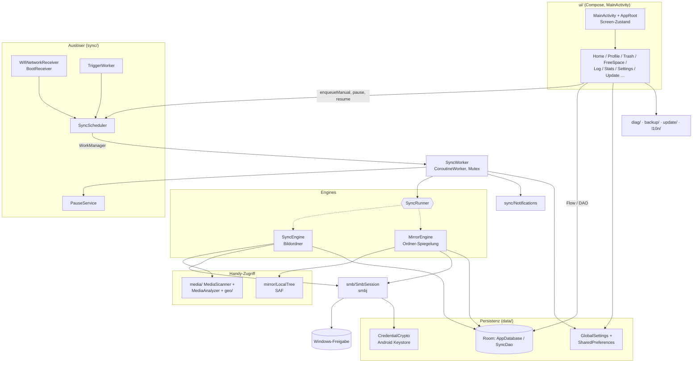
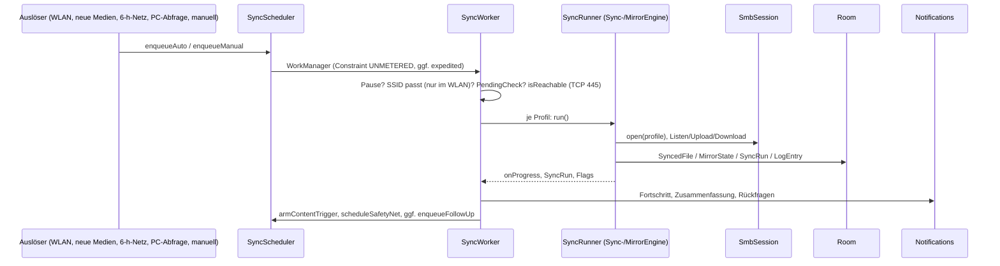

# Architektur – Sync2PC / LeoSync

Technische Referenz der **aktuell implementierten** Architektur (Stand: Quellcode, App-Version aus `version.properties`, DB-Version 6). Maßgeblich ist der Quellcode; `docs/DECISIONS.md` liefert Hintergründe (DEC-IDs). Geplantes steht ausschliesslich in Abschnitt 14 und ist dort als solches gekennzeichnet.

> Hinweis: Die frühere `docs/ARCHITECTURE.md` enthielt nur den Arbeitsauftrag für diese Dokumentation, keine Architektur. Sie wurde daher ersetzt.

Sichtbarer App-Name: **LeoSync**. Repo, Paket (`com.sync2pc.app`), DB-Name (`sync2pc.db`) und Keystore-Alias heissen bewusst weiter *Sync2PC* (DEC-008; Änderung bedeutet Datenverlust bzw. eine neue App).

---

## 1. Projektüberblick

LeoSync ist eine Android-App (minSdk 29, targetSdk/compileSdk 36), die Dateien vom Handy über SMB2/SMB3 auf eine Windows-Freigabe überträgt. Es gibt zwei **Profiltypen** (`ProfileType` in `app/src/main/java/com/sync2pc/app/data/Entities.kt`):

| Typ | Engine | Handy-Zugriff | Ablage auf dem PC |
|---|---|---|---|
| `PHOTOS` (Bildordner) | `SyncEngine` | MediaStore | `Jahr\Monat[ - Land]\`, Richtung nur Handy → PC |
| `MIRROR` (normaler Ordner) | `MirrorEngine` | Storage Access Framework (`LocalTree`) | 1:1, Richtung Handy → PC, PC → Handy oder beidseitig |

**Technik:** Kotlin, Jetpack Compose (Material 3), Room (KSP), WorkManager, smbj, AndroidX ExifInterface, Coroutines. Kein DI-Framework, keine ViewModels, kein Navigation-Component (siehe Abschnitt 9). Der Code ist ein einzelnes Gradle-Modul `app`.

Die Fachlogik des Abgleichs steht in `docs/SYNC-ENGINE.md`, das Datenmodell in `docs/DATA-MODEL.md` – hier nur die Struktur.

---

## 2. Gesamtarchitektur

Schichten (von oben nach unten): **UI** → **Steuerung/Auslöser** (Scheduler, Worker, Receiver) → **Engines** → **SMB / Handy-Zugriff** und **Persistenz**. Quer dazu: Benachrichtigungen, Diagnose, Lokalisierung.



Zentrale Schnittstellen:

- **`SyncRunner`** (`sync/SyncRunner.kt`): gemeinsames Interface der beiden Engines (`run()`, `preview`, `connectionFailed`, `wifiLost`, `blocked`, `newConflicts`, `spaceShortage`, `nextYoungFileAt`). `SyncWorker` kennt nur dieses Interface.
- **`SyncDao`** (`data/SyncDao.kt`): einziger DB-Zugang; liefert für die UI `Flow`s (`profilesFlow()`, `decisionsFlow()` …).
- **`SmbSession`** (`smb/SmbSession.kt`): einziger Ort mit smbj-Aufrufen. *(Geplant, nicht umgesetzt: zentrale PC-Kennungs-Prüfung vor `authenticate`, siehe DEC-204.)*
- **`GlobalSettings`** (`data/GlobalSettings.kt`): profilübergreifende Einstellungen und Zustandsmerker (SharedPreferences „global“).
- **`Notifications`** (`sync/Notifications.kt`): einziger Ort, der Benachrichtigungen erzeugt; öffnet die UI über Intent-Extra `EXTRA_OPEN`.

---

## 3. Verzeichnis- und Modulstruktur

```
Sync2PC/
  app/                      einziges Gradle-Modul
    build.gradle.kts        Abhängigkeiten, Versionierung (version.properties), Signierung (keystore.properties)
    proguard-rules.pro      R8-Keep-Regeln (smbj, dcerpc, BouncyCastle …)
    schemas/…AppDatabase/   exportierte Room-Schemas 1.json–6.json (für MigrationTest)
    src/main/
      AndroidManifest.xml
      assets/geo/countries.geojson   Natural-Earth-Länderdaten (Offline-Ländererkennung)
      java/com/sync2pc/app/          Kotlin-Quellcode, siehe unten
      res/values, values-de           Texte (strings_*.xml je Bereich, Deutsch + Englisch), themes
      res/layout                      nur RemoteViews der Benachrichtigungen
      res/xml                         file_paths (FileProvider), locales_config
    src/test/…              JVM-Unit-Tests (Reine Logik)
    src/androidTest/…       instrumentierter MigrationTest
  docs/                     Dokumentation (DECISIONS, SYNC-ENGINE, DATA-MODEL, TESTING, …)
  tools/                    PowerShell/C#-Werkzeuge: Builder (build.ps1), Icons/Animation, Geodaten,
                            PC-Import (LeoSync-Import.*), Übersetzungstabelle
  build.md, README.md, PATCHNOTES.md, PRIVACY_*.md
  version.properties        VERSION_MAJOR/MINOR/PATCH, UPDATE_REPO
```

Pakete unter `app/src/main/java/com/sync2pc/app/`:

| Paket | Aufgabe |
|---|---|
| (Wurzel) | `App.kt` – Application |
| `ui/` | Compose-Oberfläche, Navigation, Berechtigungs-UI |
| `sync/` | Auslöser, Worker, Bildordner-Engine, Benachrichtigungen, Löschen, „Speicher freigeben“ (Fotos), WLAN |
| `mirror/` | Ordner-Spiegelung: Engine, SAF-Zugriff, Schutzbremse, Papierkorb, Wiederherstellen |
| `smb/` | SMB-Verbindung (smbj) |
| `data/` | Room, Entitäten, DAO, Einstellungen, Passwort-Verschlüsselung, reine Profil-Logik |
| `media/` | MediaStore-Scan, EXIF/Video-Metadaten, Datum aus Dateinamen |
| `geo/` | Offline-Ländererkennung (Punkt-in-Polygon) |
| `update/` | Selbst-Update über GitHub Releases |
| `diag/` | Diagnose, Absturzberichte, Hersteller-Hinweise |
| `backup/` | Export/Import von Profilen und Einstellungen |
| `l10n/` | Sprache (DE/EN) und Textzugriff ausserhalb von Compose |

---

## 4. Datei- und Klassenübersicht

Legende Relevanz: **●** zentral, **○** unterstützend. Pfade relativ zu `app/src/main/java/com/sync2pc/app/`. „Rein“ = ohne Android-Abhängigkeit und per Unit-Test abgedeckt.

### 4.1 Wurzel und `data/`

| Datei | Verantwortlichkeit / Inhalt | Zusammenarbeit | Rel. |
|---|---|---|---|
| `App.kt` | `Application.onCreate`: `CrashReporter.install`, `GlobalSettings.applyInstallDefaults`, `Texts.init`, `Notifications.createChannels`, `SyncScheduler.setupAll`; `onConfigurationChanged` lädt Texte neu | diag, l10n, sync | ● |
| `data/AppDatabase.kt` | Room-Datenbank `sync2pc.db`, Version 6, 10 Entitäten, Migrationen 1→6, **kein** `fallbackToDestructiveMigration` | `SyncDao`, `schemas/` | ● |
| `data/Entities.kt` | Alle Entitäten und Enums: `Profile`, `SyncedFile`, `MirrorState`, `MirrorConflict`, `PendingRestore`, `FolderMapping`, `PendingDecision`, `MediaInfo`, `SyncRun`, `LogEntry`; `ProfileType`, `SyncDirection`, `DeleteMode`, `VerifyLevel`, `ConflictMode`; Konstanten `RunStatus`, `DeleteState`, `ConflictResolution` | überall | ● |
| `data/SyncDao.kt` | Alle Abfragen (Flows für die UI, suspend-Funktionen für Engines) | Room | ● |
| `data/GlobalSettings.kt` | Profilübergreifende Einstellungen und Zustandsmerker (Pause `pausedUntil`/`manualOnly`, `resumeOnWifi`, `shareRetryAt`, `awaitingFirstStart`, Benachrichtigungs-Schalter …) | Scheduler, Worker, UI | ● |
| `data/CredentialCrypto.kt` | Ver-/Entschlüsselung der SMB-Passwörter mit nicht exportierbarem Android-Keystore-Schlüssel | `SmbSession`, `BackupManager` | ● |
| `data/CredentialGroups.kt` | Gruppiert Profile mit gleichen Zugangsdaten (Übernehmen im Profilformular) | `ProfileScreen` | ○ rein |
| `data/ProfileOverlap.kt` | Erkennt identische/überlappende Profile (IDENTICAL, PARTIAL) | `ProfileScreen`, `BackupManager` | ○ rein |
| `data/ProfileWizard.kt` | Schrittfolge des Profil-Assistenten | `ProfileScreen` | ○ rein |
| `data/RunGrouping.kt` | Fasst aufeinanderfolgende „Nichts zu tun“-Läufe im Verlauf zusammen (`LogItem`) | `LogScreen`, `RunSummary` | ○ rein |

### 4.2 `sync/` – Auslöser, Worker, Bildordner-Engine

| Datei | Verantwortlichkeit / Inhalt | Zusammenarbeit | Rel. |
|---|---|---|---|
| `sync/SyncScheduler.kt` | Alle WorkManager-Aufträge und Auslöser: `enqueueAuto/Manual/FollowUp/Resume`, `enqueueShareRetry`, `armContentTrigger` (MediaStore-Content-URI-Trigger), `scheduleSafetyNet` (6 h), `onOffWifiChanged` (Neuplanung und Verwerfen der Wartezeit bei Wechsel von `syncOffWifi`, auch nach Sicherung einspielen), `scheduleRemotePoll`, `pause/pauseForever/resume/cancelAll`, `setupAll` | `SyncWorker`, `TriggerWorker`, `WifiHelper`, `UpdateWorker`, `StaleCheck` | ● |
| `sync/SyncWorker.kt` | `CoroutineWorker`; ein Lauf für alle passenden Profile: Pause/Wartebedingungen prüfen, WLAN-SSID abgleichen, PC-Erreichbarkeit testen, je Profil `SyncRunner` wählen und ausführen, Abschluss-Benachrichtigungen, Folgeaufträge; globaler `Mutex` gegen parallele Läufe | `SyncEngine`, `MirrorEngine`, `Notifications`, `PauseService`, `TransferLocks`, `GuardStore` | ● |
| `sync/SyncRunner.kt` | Interface beider Engines | Worker, Engines | ● |
| `sync/SyncEngine.kt` | Bildordner-Lauf pro Profil: Scan → bekannte Dateien per DB aussortieren → Analyse + Zielordner (sequenziell) → parallele Uploads (je eigene SMB-Verbindung), Verifikation, Log. Enthält `SyncProgress`, `PreviewEntry` | `MediaScanner`, `MediaAnalyzer`, `TargetResolver`, `SmbSession`, `PartialHash`, `DeletionManager`, DAO | ● |
| `sync/TargetResolver.kt` | Bestimmt den Monatsordner (gespeicherte Entscheidung, Standardname, umbenannte Ordner → Rückfrage) | `SyncEngine`, `FolderNames`, `CountryLookup` | ● |
| `sync/FolderNames.kt` | Namensregeln für Zielordner/-dateien | `TargetResolver`, `SyncEngine` | ○ rein |
| `sync/PartialHash.kt` | Teil-Prüfsumme und Prüfstufen (`levelRegions`) für Duplikat- und Upload-Prüfung | `SyncEngine`, `MirrorEngine`, `SmbSession` | ● |
| `sync/PendingCheck.kt` | Netzwerkfreie Prüfung, ob Fotos übertragungsbereit warten (spart Akku, vermeidet PC-Kontakt) | `SyncWorker`, `StaleCheck` | ○ |
| `sync/DeletionManager.kt` | Löschen/Papierkorb der Handy-Quelle nach verifiziertem Upload (Android 10 direkt, 11+ per Systemdialog) | `SyncEngine`, `MainActivity` | ● |
| `sync/SpaceFreer.kt` | „Speicher freigeben“ für Bildordner (nach Einzelprüfung auf dem PC, Live-Foto-Paare gemeinsam) | `FreeSpaceScreen`, `FreeRules` | ● |
| `sync/FreeRules.kt` | Auswahlregeln (Alter, Ordner, Typ, Grösse, Ausnahmen) für „Speicher freigeben“ | `SpaceFreer`, `FolderFreer`, UI | ○ rein |
| `sync/Notifications.kt` | Kanäle (`sync_progress`, `sync_alerts`), Fortschritt/Foreground-Info, Zusammenfassungen, Hinweise; Intent-Extras `EXTRA_OPEN`/`OPEN_*` | Worker, `MainActivity` | ● |
| `sync/PauseService.kt` | Foreground-Service (`dataSync`) „Pausiert – wartet auf WLAN“ nach WLAN-Unterbruch | `SyncWorker`, `SyncScheduler` | ● |
| `sync/Receivers.kt` | `WifiNetworkReceiver` (System-Callback bei WLAN-Verbindung), `BootReceiver` (Boot/App-Update) | `SyncScheduler`, `WifiHelper` | ● |
| `sync/WifiHelper.kt` | SSID lesen, WLAN-Status, Registrierung des `NetworkCallback` über `PendingIntent`; liest die Netzeigenschaften (`isOnMobileOrVpn`) und ruft `NetworkRules` auf | Receiver, Worker, Scheduler | ● |
| `sync/NetworkRules.kt` | Reine Netzentscheidungen (seit 0.11.7, DEC-126): erlaubte Netzart, SSID-Prüfung ja/nein, Wartezeit „PC nicht erreichbar“ (`retryMinutes`: 30 min / 2 min / 2 h ausserhalb WLAN), Erreichbarkeitsversuche (`reachabilityWaits`) | `WifiHelper`, `SyncWorker` | ○ |
| `sync/TriggerWorker.kt` | Leichtgewichtiger Auslöser (neue Medien, Sicherheitsnetz, PC-Abfrage, Pausenende): stellt nur einen Sync ein | `SyncScheduler` | ○ |
| `sync/StaleCheck.kt` | Tägliche Erinnerung „lange nicht gesichert“ (`StaleCheckWorker`) | `PendingCheck`, `Notifications` | ○ |
| `sync/TransferLocks.kt` | WLAN-/CPU-Wakelock nur während eines Laufs | `SyncWorker` | ○ |
| `sync/Errors.kt` | Klassifiziert Netzwerk- gegenüber Datei-Fehlern; verständliche Fehlermeldungen (`friendlyError`) | Engines, UI | ● |
| `sync/RunSummary.kt` | Kurztext eines Laufs für Verlauf und Benachrichtigung; `NOT_IDLE_KEYS` (Schlüssel, die einen Lauf „nicht ruhig“ machen, für `RunGrouping.isIdle`) | Engines, `RunGrouping` | ○ rein |

### 4.3 `mirror/` – Ordner-Spiegelung

| Datei | Verantwortlichkeit / Inhalt | Zusammenarbeit | Rel. |
|---|---|---|---|
| `mirror/MirrorEngine.kt` | 3-Wege-Abgleich Handy (L) / PC (R) / letzter Stand (S), Planung (`Kind`: UPLOAD, DOWNLOAD, TRASH_*, RECORD, DROP, CONFLICT, KEEP_BOTH), Phasen, Papierkorb, vorgemerkte Wiederherstellungen/Leerungen; Papierkorb-Konstanten (`.LeoSync-Bin`, Altnamen) | `LocalTree`, `SmbSession`, `MirrorGuard`, `TrashPolicy`, `TransferPlan`, `FileFilter`, DAO | ● |
| `mirror/LocalTree.kt` | Zugriff auf den freigegebenen Handy-Ordner (SAF/`DocumentsContract`), Einlesen, Kopieren, Ersetzen (`.s2pold`-Recovery), Exceptions (`ChangedDuringRunException`) | `MirrorEngine`, `FolderFreer`, `RestoreManager` | ● |
| `mirror/MirrorGuard.kt` | Schutzbremse: `GuardPolicy` (rein), `GuardStore` (SharedPreferences „guard“), `FolderCheck` (Stichprobe), `MirrorGuard.Choice` | `MirrorEngine`, `SyncWorker`, `HomeScreen`, `ProfileScreen` | ● |
| `mirror/MirrorLock.kt` | Prozessweite Sperre: Papierkorb-Eingriffe warten auf laufenden Ordner-Sync | Engine, `TrashCleaner`, `FolderFreer` | ● |
| `mirror/RestoreManager.kt` | Papierkorb beider Seiten einlesen, Wiederherstellungen vormerken (`PendingRestore`), `RestoreFailures` | `TrashScreen`, `MirrorEngine.runRestores` | ● |
| `mirror/TrashCleaner.kt` | „Leeren“ und „Endgültig löschen“ (Handy sofort, PC sofort oder vorgemerkt) | `TrashScreen`, `PurgeStore`, `MirrorLock` | ● |
| `mirror/TrashPurge.kt` | Regeln (`PurgeRule`, `PurgeSides`), `TrashPurge` (rein), `PurgeStore` (SharedPreferences „purge“) | `TrashCleaner`, `MirrorEngine` | ○ |
| `mirror/TrashIndex.kt` | `TrashEntry`, Zuordnung von Papierkorb-Pfaden zu Originalpfaden | `RestoreManager`, UI | ○ rein |
| `mirror/TrashPolicy.kt` | Automatische Papierkorb-Frist (Datumsordner) | `MirrorEngine` | ○ rein |
| `mirror/FolderFreer.kt` | „Speicher freigeben“ für Ordner-Profile Handy → PC | `FreeSpaceScreen`, `LocalTree`, `SmbSession` | ● |
| `mirror/FileFilter.kt` | Muster „Nur diese Dateien“ / „Ausschliessen“ | `MirrorEngine`, `PendingCheck`, `SyncEngine` | ○ rein |
| `mirror/TransferPlan.kt` | Regeln für parallele Übertragungen des Ordner-Syncs | `MirrorEngine` | ○ rein |

### 4.4 `smb/`, `media/`, `geo/`

| Datei | Verantwortlichkeit / Inhalt | Zusammenarbeit | Rel. |
|---|---|---|---|
| `smb/SmbSession.kt` | `SmbTarget` (Pfad-Parser), `RemoteEntry`, `SmbSession`: `open`, `listShares` (dcerpc/srvsvc), `isReachable` (TCP 445), `test`, Listen/Stat/Upload mit Temp-Datei `.s2ptmp`/Download/Move/Delete/`partialHash` | smbj, dcerpc, `CredentialCrypto` | ● |
| `media/MediaScanner.kt` | Fotos/Videos über MediaStore (`MediaItem`, `FolderInfo`), `hasAddedSince` | `SyncEngine`, `PendingCheck`, UI | ● |
| `media/MediaAnalyzer.kt` | Aufnahmedatum (EXIF/Video-Metadaten → Dateiname → Änderungsdatum) und GPS; nutzt `MediaInfo`-Cache | `FilenameDateParser`, `CountryLookup`, ExifInterface | ● |
| `media/FilenameDateParser.kt` | Datum aus Dateinamen (IMG_…, PXL_…, WhatsApp …) | `MediaAnalyzer` | ○ rein |
| `geo/CountryLookup.kt` | Offline-Punkt-in-Polygon aus `assets/geo/countries.geojson`; `Country` mit Namen je Sprache | `MediaAnalyzer`, `TargetResolver` | ● |

### 4.5 `update/`, `diag/`, `backup/`, `l10n/`

| Datei | Verantwortlichkeit / Inhalt | Rel. |
|---|---|---|
| `update/UpdateChecker.kt` | Fragt das neueste GitHub-Release ab (`UpdateInfo`) | ○ |
| `update/UpdateInstaller.kt` | Lädt/prüft APK, übergibt an `PackageInstaller`; Status-Intent `ACTION_INSTALL_STATUS` | ○ |
| `update/UpdateWorker.kt` | Tägliche Prüfung (periodisch, WLAN) | ○ |
| `update/UpdateScreen.kt` | Update-Seite (Compose) | ○ |
| `diag/Diagnostics.kt` | Diagnosetext ohne Passwörter (Gerät, Berechtigungen, Aufträge, Läufe), zufällige Geräte-ID | ● |
| `diag/Redactor.kt` | Maskiert und pseudonymisiert Diagnosedaten (Platzhalter je Export, Mustererkennung im Freitext); reine Kotlin-Klasse ohne Android, von `Diagnostics` genutzt (DEC-203, 0.12.4) | ● |
| `diag/CrashReporter.kt` | Uncaught-Exception-Handler, Absturzbericht lokal in Datei | ○ |
| `diag/VendorHints.kt` | Hersteller-spezifische Stromspar-Hinweise (OnePlus/Oppo/Realme, Samsung, Xiaomi, Huawei/Honor) | ○ |
| `backup/BackupCodec.kt` | Format `leosync-backup` (v1), Serialisierung/Verschlüsselung mit Export-Passwort (`BackupContent`, `ParsedBackup`, `BackupException`) | ● rein |
| `backup/BackupManager.kt` | Export/Import: Profile, Einstellungen, Sync-Status; prüft Überlappung | ● |
| `l10n/Texts.kt` | Textzugriff ausserhalb von Compose (`Texts.init`, `str`, `plural`, `locale`); `Texts.Resolver` löst auch Ressourcen-Namen auf (`entryName`, `stringByName`, `pluralByName`, seit 0.12.0) | ● |
| `l10n/Msg.kt` | Meldung mit Kennung statt fertigem Text (JSON: Ressourcen-Name, Argumente, Mehrzahl, Verkettung); `render` in der aktiven Sprache mit Rückfalltext; gespeichert in `sync_runs.messageCode/triggerCode`, `log_entries.code` (seit 0.12.0, DEC-159/DEC-202) | ○ |
| `l10n/AppLanguage.kt` | Sprachwahl (System/DE/EN), `localized(context)`; SharedPreferences „lang“ | ○ |

### 4.6 `ui/`

| Datei | Verantwortlichkeit / Inhalt | Rel. |
|---|---|---|
| `ui/MainActivity.kt` | Einzige Activity (`singleTop`, Hochformat). `sealed class Screen` (Navigationszustand), `AppRoot`, Splash, Intent-Verarbeitung (`Notifications.OPEN_*`, Installer-Status), Löschfluss | ● |
| `ui/HomeScreen.kt`, `ui/HomeParts.kt` | Startseite: Status, Profile, Werkzeuge, Schutzbremse-Karten, Pause-Dialog | ● |
| `ui/ProfileScreen.kt`, `ui/ProfileCards.kt`, `ui/ProfileParts.kt` | Profil anlegen/bearbeiten (Assistent, Mirror-/Foto-Optionen, Freigaben- und Ordnerauswahl; `RemoteFolderPicker` kann seit 0.11.3 Ordner unterhalb einer Freigabe anlegen, `SmbSession.ensureDir`, DEC-192) | ● |
| `ui/SettingsScreen.kt` | Einstellungen in Rubriken (`SettingsSection`: NOTIFICATIONS, TRANSFER, PERMISSIONS, APP, UPDATES, DIAGNOSE), Sprache | ● |
| `ui/TrashScreen.kt` | Papierkorb: wiederherstellen, aufräumen | ● |
| `ui/FreeSpaceScreen.kt` | „Speicher freigeben“ mit Vorschau | ● |
| `ui/LogScreen.kt`, `ui/StatsScreen.kt` | Verlauf bzw. Statistik | ○ |
| `ui/DecisionScreen.kt`, `ui/ConflictScreen.kt`, `ui/PreviewScreen.kt` | Ordner-Rückfragen, Konflikte, Simulation | ● |
| `ui/BackupSection.kt` | Export/Import-UI | ○ |
| `ui/PendingProfileDelete.kt` | Prozessweiter Zustand „Profil wird gelöscht (Rückgängig)“; `SyncWorker` überspringt dieses Profil | ● |
| `ui/Permissions.kt`, `ui/PermissionRows.kt` | `PermNeeds`/`PermStatus`, Berechtigungsanzeige | ○ |
| `ui/FirstSync.kt` | Hinweise vor dem ersten Sync | ○ |
| `ui/Common.kt` | `LeoSyncTheme`, `ScreenScaffold`, `SectionCard`, `SwitchRow`, Hinweis-Komponenten | ○ |
| `ui/DogStatus.kt`, `ui/AppIcons.kt`, `ui/SplashScreen.kt` | Statusfigur, Icons, Startbild | ○ |

### 4.7 Tests und Konfiguration

- `app/src/test/java/com/sync2pc/app/` – 25 Testklassen (QA-Lauf 2026-11-09 nach 0.12.1: 143 Tests; `MigrationTest` 3 auf Emulator bestanden) plus `TestTexts` als Hilfsklasse. Abgedeckt sind die reinen Logikklassen (`MirrorGuard`, `RemoteFolderName`, `FreeRules`, `TrashIndex/Policy/Purge`, `BackupCodec`, `Diagnostics`, `FileFilter`, `FolderNames`, `FilenameDateParser`, `ProfileOverlap/Wizard`, `CredentialGroups`, `RunSummary`, `TransferPlan`, `VerifyLevel`, `LocalTree`-Label) sowie `StringsParityTest` (DE/EN-Textparität). Details: `docs/TESTING.md`.
- `app/src/androidTest/java/com/sync2pc/app/MigrationTest.kt` – Room-Migrationen auf Gerät/Emulator (Schemas aus `app/schemas`).
- `app/build.gradle.kts`, `proguard-rules.pro`, `AndroidManifest.xml`, `res/xml/*` – siehe Abschnitte 8 und 9.

---

## 5. Komponenten und Verantwortlichkeiten

- **Benutzeroberfläche (`ui/`)** – Darstellung und Eingabe. Liest Daten direkt über `SyncDao`-Flows und `GlobalSettings`, startet Arbeit nur über `SyncScheduler` oder die Helfer-Objekte (`SpaceFreer`, `RestoreManager`, `TrashCleaner`, …). Enthält keine Abgleichslogik.
- **Synchronisationssteuerung (`SyncScheduler`, `SyncWorker`, `TriggerWorker`, Receiver)** – entscheiden *ob und wann* gelaufen wird (Pause, WLAN/SSID, Erreichbarkeit, Wiederholungen). Sie entscheiden nicht, *was* kopiert wird.
- **Engines (`SyncEngine`, `MirrorEngine`)** – entscheiden *was* pro Profil passiert; schreiben Läufe/Logs/Zustand in die DB. Eine Engine verarbeitet genau ein Profil.
- **Profile** – `Profile` (Entität, `data/Entities.kt`) bündelt Ziel-Share, verschlüsselte Zugangsdaten, Quellen, WLANs und Optionen; reine Hilfslogik in `ProfileOverlap`, `ProfileWizard`, `CredentialGroups`.
- **SMB (`SmbSession`)** – Transport; kennt weder Profile-Regeln noch UI. Pro paralleler Übertragung eine eigene Verbindung.
- **Handy-Zugriff** – `MediaScanner` (MediaStore, nur Fotos/Videos) gegenüber `LocalTree` (SAF, beliebige Dateien). Die Trennung folgt aus Android 11+, wo der MediaStore keine Dokumente liefert.
- **Datenbank (`data/`)** – Room als zentraler Zustandsspeicher (DEC-003). Vollständiges Schema: `docs/DATA-MODEL.md`.
- **Metadaten/EXIF (`media/`, `geo/`)** – Datum und Land einer Datei; Ergebnis wird in `MediaInfo` zwischengespeichert, damit Dateien nicht mehrfach geöffnet werden.
- **Hintergrundverarbeitung** – ausschliesslich WorkManager plus System-Callbacks; kein Dauerdienst. `PauseService` ist ein reiner Wartedienst (Abschnitt 9).
- **Einstellungen** – profilbezogen in `Profile` (Room), profilübergreifend in `GlobalSettings` (SharedPreferences „global“), kleinere Zustände in eigenen SharedPreferences („guard“, „purge“, „restore“, „lang“).
- **Diagnose/Logging** – Lauf-Log in der DB (`SyncRun`, `LogEntry`), Diagnosetext (`Diagnostics`), lokaler Absturzbericht (`CrashReporter`). Es wird nichts automatisch übertragen.
- **Updates (`update/`)** – GitHub Releases, tägliche Prüfung, Installation über `PackageInstaller`.
- **Lokalisierung (`l10n/`)** – Deutsch/Englisch, Texte ausschliesslich in `res/values*/strings_*.xml`.

### 5.1 Innenaufbau der grossen Dateien (vollständig gelesen)

Die fachliche Entscheidungstabelle steht in `docs/SYNC-ENGINE.md`; hier nur der Aufbau, damit man die richtige Stelle findet.

#### `mirror/MirrorEngine.kt` (≈ 840 Zeilen, implementiert `SyncRunner`)

- **Konstruktor:** `context`, `profile`, `trigger`, `dryRun`, `shouldContinue` (false = sauber beenden, setzt `wifiLost`), `onProgress`, `interruptReason`, `previewLimit`. Zustand je Instanz: `local`/`remote` (Schlüssel = relativer Pfad in Kleinbuchstaben → Originalpfad + Eintrag), `propagate` (Löschungen übernehmen, für einen Lauf durch die Schutzbremse abschaltbar), Zähler als `Atomic*`, Flags `connectionFailed`, `wifiLost`, `spaceShortage`, `blocked`, `newConflicts`.
- **Einstieg:** `run()` – echte Läufe unter `MirrorLock.mutex`, die Simulation (`dryRun`) ohne Sperre. `runInner()` gliedert sich in:
  1. *Vorbereitung:* Lauf anlegen, alte Logs/Läufe löschen (30/90 Tage), offene Schutzbremse → `block()`.
  2. *Einlesen:* SAF-Berechtigung prüfen, Handy-Wurzel vorhanden? (sonst `GuardKind.LOCAL_MISSING`), SMB öffnen, PC-Basisordner vorhanden? (sonst `REMOTE_MISSING`, ausser Erstabgleich), vorgemerkte Wiederherstellungen (`runRestores`) und PC-Leerungen (`runPendingPurges`), beide Seiten rekursiv listen (Papierkorb-Ordner und `FileFilter` ausgenommen), Stichprobe nach Ordnerwechsel (`folderMatches` → `CHECK_FOLDER`), Papierkorb-Frist (`purgeTrash`).
  3. *Planen:* pro Schlüssel aus Vereinigung von `local`, `remote`, `MirrorState` → `plan()` liefert eine `Action` (`Kind`). Offene Konflikte (`MirrorConflict`) werden vor dem Planen berücksichtigt.
  4. *Schutzbremse:* `GuardPolicy.massDelete` / `vanishedFolder` → `block(Guard(MASS_DELETE…))`, ausser eine einmalige Freigabe liegt vor (`takeAllowDelete`). In der Simulation nur Hinweistext.
  5. *Ausführen:* Phase A `executeAdmin` (sequenziell, Haupt-Verbindung: `TRASH_*`, `RECORD`, `DROP`, `CONFLICT`), Phase B `runTransfers` (parallel: `UPLOAD`, `DOWNLOAD`, `KEEP_BOTH`).
  6. *Abschluss:* `finish()` schreibt `SyncRun`; Status `OK`/`PARTIAL`/`WAITING`/`INTERRUPTED`/`CANCELLED`/`FAILED` (Konstanten `RunStatus`).
- **`plan()` (3-Wege):** vergleicht Grösse und Änderungszeit (L, R) gegen `MirrorState` (S). Inhaltsvergleich (`sameContent`, `PartialHash.thorough` auf beiden Seiten) nur beim Erstabgleich, bei beidseitiger Änderung und bei einseitiger Änderung mit gleicher Grösse (Zeitstempel-Drift → `RECORD`). Einseitig geänderte Zieldatei wird nur bei `profile.keepVersions` in den Papierkorb gelegt; bei beidseitiger Änderung gewinnt je nach `ConflictMode` die neuere Seite oder es entsteht ein `CONFLICT`. Fehlt eine Seite, entscheiden Richtung und `propagate` zwischen Papierkorb, Wiederherstellen und Verwerfen des Stands (`DROP`).
- **Parallele Übertragung:** `TransferPlan.smallFirst` ordnet die Aufträge; `Shared` hält Zähler, Bytes in Arbeit, Stop-Flag und das Speicherbudget (freier Speicher − 300 MB Reserve, nur für Downloads). `GlobalSettings.parallelUploads` (1–4) bestimmt die Worker-Zahl, jeder Worker nutzt eine eigene `SmbSession`, die bei Bedarf neu aufgebaut wird. Netzfehler → einmal nach 2 s wiederholen, danach Stopp des ganzen Laufs (`connectionFailed`); sonstige Fehler zählen als Dateifehler.
- **Schutzmechanismen bei der Ausführung:** `unchanged()` vergleicht vor jedem Überschreiben mit dem eingelesenen Stand (sonst `skipChanged`, nächster Lauf entscheidet); vor dem Ersetzen wird der `MirrorState` gelöscht, damit ein gescheiterter Upload nicht als „auf Gegenseite gelöscht“ gilt; nach jeder Übertragung wird die Grösse geprüft und erst dann `record()` aufgerufen; Downloads schreiben über `LocalTree.writeFileResumable` (`expectNew`).
- **Papierkorb/Wiederherstellung:** `trashRemote` (PC: `<Basis>\.LeoSync-Bin\<Datum>\…`), `LocalTree.moveToTrash` (Handy), `purgeTrash` (Frist `trashRetentionDays`), `runRestores` mit `rollbackRestore` (macht ein gescheitertes Wiederherstellen rückgängig; Vormerkung bleibt, `RestoreFailures.mark`), `runPendingPurges` (lässt vorgemerkte Wiederherstellungen aus: `TrashPurge.reservedPaths`).
- **Simulation (`dryRun`):** schreibt weder Dateien noch Log noch Zustand (ausser dem `SyncRun`-Eintrag); ohne PC-Verbindung wird nur eine Offline-Vorschau gebildet. Ergebnis in `preview` (`PreviewEntry`).
- **Fehlerpfade:** `CancellationException` → in `NonCancellable` als `INTERRUPTED` (mit `interruptReason`) bzw. `CANCELLED` abschliessen und weiterwerfen; Netzfehler (`sync/Errors.kt`) → `INTERRUPTED`; alles andere → `FAILED`. `smb` wird im `finally` geschlossen.
- **Kopplung:** greift auf `sync`-Hilfen zu (`shortError`, `userError`, `isNetworkError`, `RunSummary`, `Notifications.formatBytes`, `PartialHash`) – eine Rückrichtung `mirror` → `sync`.

#### `sync/SyncEngine.kt` (≈ 650 Zeilen, implementiert `SyncRunner`)

- **Konstruktor** wie `MirrorEngine`. Gleichzeitig definiert die Datei `SyncProgress` und `PreviewEntry`, die auch `MirrorEngine` und die UI verwenden.
- **Ablauf in `run()`:**
  1. *Scan:* `MediaScanner.scan` (Ordner, Unterordner, Bilder/Videos), `FileFilter`; bekannte Dateien (`SyncedFile` mit gleicher `sourceKey`, Grösse, Änderungszeit) fallen ohne I/O heraus; zu junge Dateien (`minFileAgeMinutes`) werden übersprungen und über `nextYoungFileAt` für einen Folgeauftrag gemeldet. Ist nichts zu tun, endet der Lauf vor dem Verbinden.
  2. *Verbinden:* `SmbSession.open`; die „Produzenten“-Verbindung wird vor jeder Nutzung auf `isAlive()` geprüft und neu aufgebaut (Windows trennt Leerlauf nach ca. 15 Min.).
  3. *Produzent (sequenziell):* lokale Funktion `plan(item)` – `mediaInfo` (Cache `MediaInfo`, sonst `MediaAnalyzer` + `CountryLookup`), Live-Foto-Paarung (Video übernimmt Ordner des gleichnamigen Bildes), `TargetResolver.resolve` → entweder `Job` (Jahr/Monatsordner, plus Geschwisterordner desselben Monats für die Duplikatsuche) oder Rückfrage (gesammelt als `DecisionAcc`, am Ende als `PendingDecision` gespeichert).
  4. *Konsumenten:* `Channel<Job>` (Kapazität 32) → `parallel` Worker (`settings.parallelUploads`), jeder mit eigener `SmbSession`, Wiederholung nach Netzfehler wie bei `MirrorEngine`.
  5. *Abschluss:* offene Entscheidungen speichern, `DeletionManager.sweep`, `finish()`.
- **`transfer()` (Kern):** Namensvergabe (`bild.jpg`, `bild_2.jpg` …) und Duplikatprüfung gegen Zielordner und Geschwisterordner unter `Shared.nameLock` (Ordnerlisten werden je Lauf zwischengespeichert, Namen vorab in `reserved` eingetragen); Upload über `SmbSession.upload` mit `expectedHash` (Fortsetzen nur bei passender Handy-Datei); Verifikation nach `VerifyLevel` (Grösse immer, Prüfsumme ab „Wenig“; bei Fehlschlag wird die Zieldatei gelöscht); `record()` schreibt `SyncedFile`, `DeleteState.WANTED` nur bei verifizierter Datei und Löschmodus ≠ `KEEP`. Die Freigabe der Namensreservierung läuft im `finally` unter `NonCancellable`.
- **Original-GPS:** bei erteilter `ACCESS_MEDIA_LOCATION`-Berechtigung wird `MediaStore.setRequireOriginal` verwendet, sonst entfernt Android die Standortdaten aus der Kopie.
- **Simulation/Offline:** `dryRun` oder fehlende PC-Verbindung → nur `plan()` für die ersten `previewLimit` Dateien, nichts wird angelegt oder geschrieben (Ausnahme: `SyncRun`).
- **Fehlerpfade:** wie bei `MirrorEngine` (Abbruch → `INTERRUPTED`/`CANCELLED`, Netzfehler → `INTERRUPTED` mit `connectionFailed`, sonst `FAILED`); „bereits vorhanden“-Meldungen werden pro Ordner gesammelt (`flushAlready`).
- **Unklar/nicht geprüft:** ob `GlobalSettings.parallelUploads` selbst auf einen gültigen Bereich begrenzt (die `MirrorEngine` begrenzt zusätzlich mit `coerceIn(1, 4)`, die `SyncEngine` nicht).

#### `mirror/LocalTree.kt` (≈ 450 Zeilen)

Kapselt die Storage-Access-Framework-Zugriffe auf einen freigegebenen Handy-Ordner; Pfade sind relativ, Trenner `/`. Enthält zusätzlich `LocalEntry`, die Konstante `OLD_SUFFIX` (`.s2pold`) und `ChangedDuringRunException`.

- **Lesen:** `children` (Abfrage ohne Antwort ist ein Fehler, nicht „leer“ – sonst gälten alle Dateien als gelöscht), `listRecursive` (mit Aufräumen liegengebliebener `.s2pold`), `find`/`findDir`, `stat`, `contentHash` (gründlicher Hash), `readAt`, `openInput`.
- **Schreiben:** `ensureDir` (`@Synchronized`, sonst „Ordner (1)“ bei parallelen Übertragungen), `writeFile`, `writeFileResumable` (setzt eine vorhandene `.s2ptmp` fort, wenn `TransferPlan.resumeOffset` es erlaubt; prüft die Endgrösse), `replaceWith`, `rename`, `delete`.
- **Sicheres Ersetzen (`replaceWith`):** alte Datei → `<name>.s2pold`, Temp-Datei → `<name>`, erst dann Alt löschen; scheitert das Umbenennen, wird die alte Version zurückbenannt. Bricht die App ab, stellt der nächste `listRecursive`-Lauf (`recover = true`) die gültige Datei wieder her bzw. löscht die überholte.
- **Papierkorb:** `moveToTrash` (eindeutiger Name per `TrashIndex.uniqueTrashName`; kann der Anbieter nicht verschieben: kopieren + löschen), `listTrash`, `moveFile` (Wiederherstellen), `purgeTrash` + `deleteExcept` (schont vorgemerkte Wiederherstellungen), `deleteTrashFile`.
- **Zwischenspeicher:** `dirIds` (Ordnerpfad klein → Dokument-ID, `ConcurrentHashMap`); wird beim Listen gefüllt und nur über `forgetDirs` (nach `purgeTrash`) verworfen. Eine `LocalTree`-Instanz gilt deshalb für genau einen Lauf; Änderungen am Ordner ausserhalb der Instanz machen den Zwischenspeicher veraltet.
- **Statische Helfer:** `hasPermission`, `label`/`rawPathLabel` (Anzeigename; Unit-Test `LocalTreeLabelTest`), `mimeOf`.
- **Abhängigkeiten:** `TrashIndex`, `TransferPlan`, `PurgeRule`, `Side`, `SmbSession.TEMP_SUFFIX` (gleiches Temp-Suffix auf beiden Seiten) und – zyklisch – `MirrorEngine.TRASH_DIR`/`isTrashDir`.
- **Beachten:** Werte aus `stat()` und `children()` nie mischen (siehe Regel 8 in Abschnitt 11); die Engine liest nach Schreibvorgängen deshalb bewusst über `find()` nach.

---

## 6. Abhängigkeiten und Kommunikationswege

Aufrufrichtung (erlaubt): `ui` → `sync`/`mirror`/`data`; `sync.SyncWorker` → Engines → `smb` + `data` + `media`/`mirror.LocalTree`. Rückwärts kommunizieren Engines **nicht** zur UI, sondern über:

- **Room-Flows** (UI beobachtet Zustand, Engines schreiben ihn),
- **`onProgress`-Callback** → `Notifications.updateProgress` und `setProgressAsync` (WorkManager-Progress),
- **Benachrichtigungs-Intents** (`Notifications.EXTRA_OPEN`) → `MainActivity.handleIntent` → `Screen`,
- **`GlobalSettings`** als gemeinsamer Zustandsspeicher zwischen Worker, Scheduler und UI.

Daten zwischen Engines und Worker laufen über die `SyncRunner`-Eigenschaften und das Ergebnis `SyncRun`.

Auffällige Kopplungen (Ist-Zustand, keine Wertung als Fehler):

- Die UI greift direkt auf `AppDatabase.get(ctx).dao()` zu (kein Repository, keine ViewModels); Zustand lebt in Composables (`remember`, `mutableStateOf`).
- `SyncWorker` kennt konkrete UI-Zustände (`ui/PendingProfileDelete`) – eine Rückkopplung von `sync` nach `ui`.
- `MirrorEngine` ist mit rund 840 Zeilen die grösste Datei und bündelt Planung, Ausführung, Papierkorb und Wiederherstellung; Änderungen daran haben die grösste Hebelwirkung (Aufbau: Abschnitt 5.1; siehe auch Abschnitte 10 und 11).
- `MirrorEngine` ↔ `LocalTree` kennen sich gegenseitig (`LocalTree` nutzt `MirrorEngine.TRASH_DIR`/`isTrashDir`); `mirror` greift zudem auf Hilfen aus `sync` zu (`Errors`, `RunSummary`, `PartialHash`, `Notifications.formatBytes`).
- Die Lese-Schleife für Teil-Hashes (Kanal lesen bis Puffer voll) existiert dreifach: `LocalTree.contentHash`, `LocalTree.readAt`, `SyncEngine.localLevelHash`.
- `LocalTree.dirIds` ist ein Zwischenspeicher ohne allgemeine Invalidierung; die Instanz darf nicht über mehrere Läufe wiederverwendet werden.
- `MirrorLock` wirkt nur innerhalb des Prozesses.
- Teil-Prüfsumme, Ordnerregeln und Länderregeln existieren doppelt (Kotlin und `tools/LeoSyncImport.cs`/`.ps1`) und müssen synchron bleiben (DEC-021/024).

Möglichst unabhängig bleiben sollen: alle als „rein“ markierten Klassen (kein Android-Import, Unit-testbar), `SmbSession` (keine Profil-/UI-Logik) und `BackupCodec`.

---

## 7. Datenflüsse und Verarbeitungsabläufe

### 7.1 Auslöser bis Lauf



### 7.2 Bildordner (`SyncEngine`)

MediaStore-Scan → Abgleich mit `SyncedFile` → `MediaAnalyzer` (+`CountryLookup`) → `TargetResolver` → parallele Uploads → Verifikation (`PartialHash`) → Eintrag in `SyncedFile` → optional `DeletionManager`. Offene Ordnerfragen landen als `PendingDecision` in der DB und erscheinen in `DecisionScreen`.

### 7.3 Ordner-Spiegelung (`MirrorEngine`)

Schutzbremse prüfen → `LocalTree` und `SmbSession` einlesen → 3-Wege-Plan aus `MirrorState` → Phasen (Übertragen, Papierkorb) → `MirrorState` aktualisieren. Konflikte als `MirrorConflict` (UI: `ConflictScreen`). Aufbau: Abschnitt 5.1, fachliche Details: `docs/SYNC-ENGINE.md`.

### 7.4 Unterbruch und Fortsetzen

Verliert das Handy das Ziel-WLAN, markiert `SyncWorker.markInterrupted()` den Zustand (`GlobalSettings.resumeOnWifi`), plant `enqueueResume` ein und startet `PauseService` (oder eine „Pausiert“-Benachrichtigung). Fortgesetzt wird über `WifiNetworkReceiver` *oder* den Resume-Auftrag, spätestens nach Ablauf von 24 h wird aufgegeben.

---

## 8. Externe Bibliotheken (aus `app/build.gradle.kts`)

| Bibliothek | Version | Zweck | Komponenten |
|---|---|---|---|
| Compose BOM / `ui`, `material3`, `material-icons-core`, `ui-tooling-preview` | 2024.12.01 | UI | `ui/`, `update/UpdateScreen` |
| `androidx.activity:activity-compose` | 1.9.3 | `ComponentActivity`, Activity-Result-APIs | `MainActivity` |
| `androidx.core:core-ktx` | 1.15.0 | Android-Kotlin-Erweiterungen, `FileProvider` | überall |
| `androidx.lifecycle:lifecycle-runtime-ktx` / `-compose` | 2.8.7 | Lifecycle in Compose (`collectAsState`) | `ui/` |
| `kotlinx-coroutines-android` | 1.9.0 | Nebenläufigkeit (Engines, Worker, Flows) | `sync/`, `mirror/`, `ui/` |
| `androidx.work:work-runtime-ktx` | 2.10.0 | Hintergrundaufträge, Content-Trigger, Expedited | `SyncScheduler`, `SyncWorker`, `TriggerWorker`, `UpdateWorker`, `StaleCheck` |
| `androidx.exifinterface` | 1.3.7 | EXIF-Datum/GPS | `MediaAnalyzer` |
| `androidx.room` (runtime, ktx, compiler via KSP) | 2.8.5 | Datenbank, Schema-Export | `data/` |
| `com.hierynomus:smbj` | 0.13.0 | SMB2/SMB3-Client | `SmbSession` |
| `com.rapid7.client:dcerpc` | 0.12.13 | Freigaben auflisten (`srvsvc`); smbj und BouncyCastle ausgeschlossen | `SmbSession.listShares` |
| Test: JUnit 4.13.2, `org.json:json` 20240303; androidTest: room-testing, test.ext:junit, test:runner | – | Unit-/Migrationstests | `src/test`, `src/androidTest` |

Build: Android Gradle Plugin 9 mit eingebautem Kotlin, Compose-Compiler-Plugin und KSP; R8 (`isMinifyEnabled`, `isShrinkResources`) im Release – fehlende Keep-Regeln in `proguard-rules.pro` zeigen sich erst zur Laufzeit. Java-Ziel 17. `versionCode = major·1.000.000 + minor·1.000 + patch`. Debug-Build: Suffix `.debug`. Die Gradle-/AGP-Versionen stehen in `settings.gradle.kts`/Wrapper (hier nicht im Detail geprüft).

---

## 9. Android-spezifische Architektur

- **Application:** `App` (Reihenfolge in `onCreate` ist wichtig: Crash-Handler zuerst, dann Install-Defaults, Texte, Kanäle, Scheduler).
- **Activity:** nur `MainActivity` (`singleTop`, `portrait`, `adjustResize`, edge-to-edge). Sprachkontext via `attachBaseContext` (`AppLanguage.localized`) für Android 10–12.
- **Navigation:** eigener Zustand, **kein** Navigation-Component: `var screen by mutableStateOf<Screen>` in `MainActivity`, `AppRoot` schaltet per `when`. Screens: Home, Settings(section), ProfileEdit(id), Decisions, Preview(profileId), Log, Stats, Update, Conflicts, FreeSpace, Trash.
- **ViewModels:** keine vorhanden.
- **Services/Receiver:** `PauseService` (`foregroundServiceType=dataSync`), WorkManagers `SystemForegroundService` (dataSync, per `tools:node="merge"`), `WifiNetworkReceiver` (nicht exportiert), `BootReceiver` (exportiert; `BOOT_COMPLETED`, `MY_PACKAGE_REPLACED`), `FileProvider` für den Verlauf-Export.
- **WorkManager:** Eindeutige Aufträge (Konstanten in `SyncScheduler`): `sync-auto`, `sync-manual`, `sync-followup`, `sync-share-retry`, `sync-resume`, `trigger-content`, `trigger-safety`, `trigger-remote-poll`, `pause-end`; außerdem `stale-check` (`StaleCheck`) und die Update-Prüfung (`UpdateWorker`). Automatische Läufe verlangen `NetworkType.UNMETERED` (optional Laden), mit eingeschaltetem Schalter `syncOffWifi` seit 0.11.5 `CONNECTED` (`SyncScheduler.autoConstraints`, DEC-126); manuelle `CONNECTED`. Einzelne Läufe laufen expedited bzw. als Foreground (`getForegroundInfo`, `setForeground`).
- **Berechtigungen (Manifest):** Netzwerk/WLAN, Standort inkl. Hintergrund (nur zum Lesen der SSID), Medien (`READ_MEDIA_IMAGES/VIDEO`, `ACCESS_MEDIA_LOCATION`, Legacy-Storage begrenzt auf ältere SDKs), `POST_NOTIFICATIONS`, `FOREGROUND_SERVICE(_DATA_SYNC)`, `RECEIVE_BOOT_COMPLETED`, `WAKE_LOCK`, `REQUEST_IGNORE_BATTERY_OPTIMIZATIONS`, `REQUEST_INSTALL_PACKAGES` (Selbst-Update). Anzeige und Anforderung: `ui/Permissions.kt`, `ui/PermissionRows.kt`.
- **Benachrichtigungen:** zwei Kanäle (`sync_progress` niedrig, `sync_alerts` Standard) in `Notifications.createChannels`; eigene RemoteViews-Layouts `res/layout/notif*.xml`.
- **Speicherzugriff:** MediaStore (Fotos/Videos), SAF mit dauerhafter Berechtigung (beliebige Ordner), SMB über Netzwerk. `allowBackup=false`.
- **Kompatibilität:** minSdk 29 (Löschen: Android 10 direkt, 11+ per Systemdialog; Sprache: ab 13 System, davor eigener Weg); targetSdk 36 (Hochformat-Sperre auf grossen Bildschirmen dort wirkungslos, DEC-152). Zeitlimit des `dataSync`-Dienstes ab Android 15: Rückfallweg vorhanden, Wirksamkeit laut DECISIONS offen.

---

## 10. Einstiegs- und Erweiterungspunkte

| Aufgabe | Ansatzpunkt |
|---|---|
| Neuer Bildschirm | `Screen` in `ui/MainActivity.kt` ergänzen, Zweig in `AppRoot`, Composable in `ui/`; Einstieg ggf. als Tool-Kachel in `ui/HomeParts.kt`/`HomeScreen.kt`; `ScreenScaffold` aus `ui/Common.kt` verwenden |
| Neue Einstellung (global) | Property in `data/GlobalSettings.kt`, UI in der passenden `SettingsSection` (`ui/SettingsScreen.kt`), Texte DE+EN in `res/values*/strings_settings.xml`; Sicherung: `backup/BackupCodec.kt`/`BackupManager.kt` prüfen |
| Neue Profiloption | Feld in `Profile` (`data/Entities.kt`) **mit Default**, DB-Version erhöhen + `Migration` in `AppDatabase`, Schema-Export, `MigrationTest`, UI in `ProfileCards.kt`/`ProfileScreen.kt`, Backup (`BackupCodec`) |
| Abgleichsverhalten Ordner-Sync | `MirrorEngine` (Planung/`Kind`), ggf. `MirrorGuard`, `TrashPolicy`, `TransferPlan`; reine Regeln als eigene Klasse auslagern und testen |
| Verhalten Bildordner | `SyncEngine`, `TargetResolver`, `FolderNames`, `MediaAnalyzer`; Import-Skript in `tools/` synchron halten |
| Neue DB-Abfrage | `SyncDao` (Flow für UI, suspend für Engines) |
| Neue SMB-Funktion | `SmbSession` – ausschliesslich dort; Verbindungsabbrüche über `sync/Errors.kt` klassifizieren |
| Neue Hintergrundaufgabe | Worker im passenden Paket, Auftrag und Konstante in `SyncScheduler` (bzw. eigene `schedule()` wie `StaleCheck`), Registrierung in `SyncScheduler.setupAll` |
| Neue Benachrichtigung | Methode und ggf. `OPEN_*` in `Notifications`, Behandlung in `MainActivity.handleIntent`; Schalter in `GlobalSettings` |
| Diagnose erweitern | `diag/Diagnostics.kt` (keine Passwörter, Test: `DiagnosticsTest`); Hersteller-Hinweise: `diag/VendorHints.kt` |
| Neue Sprache/Texte | `res/values*/strings_<bereich>.xml`, Parität prüft `StringsParityTest`; Zugriff ausserhalb von Compose über `l10n/Texts.kt` (`str`/`plural`) |
| Neuer Updatemechanismus | `update/` |

---

## 11. Architekturregeln und Einschränkungen

1. **Keine Texte im Code** – alle sichtbaren Texte in `strings_*.xml` (DE + EN); Verlaufseinträge werden als Kennung (`Msg`) plus Rückfalltext gespeichert und in der aktiven Sprache angezeigt (DEC-159, DEC-202; Details `DATA-MODEL.md` 3.11).
2. **Migrationen nie destruktiv**, neue Spalten mit `DEFAULT`; kein `fallbackToDestructiveMigration()` (DEC-084). DB-Name, Paket-ID und Keystore-Alias nicht ändern.
3. **Eine Engine pro Profil, ein Lauf zugleich** (`SyncWorker`-Mutex). Neue Auslöser müssen über `SyncScheduler` gehen, nicht direkt Engines starten.
4. **Nebenläufigkeit:** `SyncWorker.doWork` läuft auf `Dispatchers.IO`; geteilter Zustand in Engines ist `@Volatile`/atomar; jede parallele Übertragung nutzt eine eigene `SmbSession`.
5. **Verbindungsabbrüche sind kein Dateifehler** (`sync/Errors.kt`, DEC-053): Lauf unterbrechen, nicht als Fehler zählen.
6. **Datensicherheit vor Komfort:** Löschen nur nach verifizierter Prüfung (`VerifyLevel`, `DeletionManager`, `SpaceFreer`/`FolderFreer` prüfen jede Datei erneut auf dem PC). Ersetzte/gelöschte Ordner-Dateien gehen in den Papierkorb (`.LeoSync-Bin`; Altnamen bleiben erkannt, `MirrorEngine.TRASH_DIRS`).
7. **Schutzbremse nicht umgehen** (`MirrorGuard`): Änderungen an `MirrorEngine.plan` dürfen insbesondere nicht dazu führen, dass bei Handy → PC ohne „Löschungen übernehmen“ ein Fehlen auf dem Handy zum Löschen auf dem PC wird (Grundlage von „Speicher freigeben“ für Ordner, DEC-147).
8. **SAF-Zeitstempel:** Werte aus `stat()` und `children()` nie mischen (DEC-137).
9. **Eingriffe in den Papierkorb/Handy-Ordner** laufen über `MirrorLock` und warten auf einen laufenden Sync.
10. **Reine Logik ohne Android-Abhängigkeit halten** und mit Unit-Test absichern.
11. **Doppelte Logik** (Teil-Prüfsumme, Ordner-/Länderregeln) in `tools/LeoSyncImport.cs` bei Änderungen mitziehen.
12. **Kotlin-Falle:** kein `/**` innerhalb von Blockkommentaren (Build-Fehler, DEC-Risiko 10/30).
13. **Zustände ausserhalb der Datenbank** (`GlobalSettings`, „guard“, „purge“, „restore“) werden bei Neuinstallation nicht wiederhergestellt und nur teilweise gesichert.
14. **R8:** neue Bibliotheken mit Reflection brauchen Keep-Regeln in `proguard-rules.pro` und einen Release-Test.
15. **Akku:** keine Dauerdienste, nur Callbacks/WorkManager; Wakelocks nur während eines Laufs (`TransferLocks`).

---

## 12. Offene Punkte und nicht eindeutig nachvollziehbare Details

- Gradle-/AGP-/Kotlin-/KSP-Versionen (`settings.gradle.kts`, Wrapper) wurden nicht im Detail geprüft; AGP 9 mit eingebautem Kotlin wird nur aus Kommentaren in `build.gradle.kts` abgeleitet.
- `MirrorEngine`, `SyncEngine` und `LocalTree` wurden vollständig gelesen (Abschnitt 5.1). Die Klassen-Inhalte von `ProfileScreen`, `TrashScreen` und `FreeSpaceScreen` wurden dagegen nur anhand von Kopfkommentaren, Signaturen und DECISIONS erfasst, nicht Zeile für Zeile gelesen.
- Ob `GlobalSettings.parallelUploads` selbst auf 1–4 begrenzt, wurde nicht geprüft (`SyncEngine` begrenzt nicht, `MirrorEngine` mit `coerceIn(1, 4)`).
- Genaue Aufrufbeziehungen einzelner Hilfsklassen (z. B. `StaleCheck` ↔ `PendingCheck`, `TargetResolver` ↔ `CountryLookup`) sind aus Kommentaren abgeleitet.
- Lebensdauer von `PendingProfileDelete` über Prozessneustarts: nicht geprüft.

---

## 13. Verweise auf weitere Dokumentation

Massgeblich sind die Dateien mit Bindestrich (alle vorhanden); die Unterstrich-Varianten sind Entwürfe und nicht massgeblich:

- `docs/DECISIONS.md` – nummerierte Entscheidungen (DEC-xxx) mit Begründung, verworfene Ansätze, offene Punkte und Risiken.
- `docs/SYNC-ENGINE.md` – fachliche Funktionsweise beider Engines (Ordnerauflösung, Duplikate, 3-Wege-Entscheidungstabelle, Papierkorb, Zeitregeln).
- `docs/DATA-MODEL.md` – Tabellen, Schlüssel, Migrationen, `GlobalSettings`-Schlüssel.
- `docs/TESTING.md` – Unit-/Migrationstests, manuelle Feldtests.
- Ausserdem: `build.md` (Build, Release-Checkliste), `README.md`, `PATCHNOTES.md`.

---

## 14. Geplant oder noch nicht umgesetzt (Quelle: DECISIONS, **nicht** implementiert)

- Paketwechsel zu `ch.leo.sync` und Play-Store-Integration: nur als offene Punkte geführt, ohne Versionsnummer (DEC-109, DEC-110). PC-Erkennung: unabhängig vom Play Store, eigenständige Umsetzung (Development SYNC-20261109-047; DEC-109, DEC-188).
- Heimnetz-Berechtigung ab targetSdk 37 voraussichtlich nötig (DEC-183).
- ~~„Verlauf mit Kennungen statt fertiger Texte“ (DEC-159)~~ – umgesetzt in 0.12.0/0.12.1 (DEC-202).
