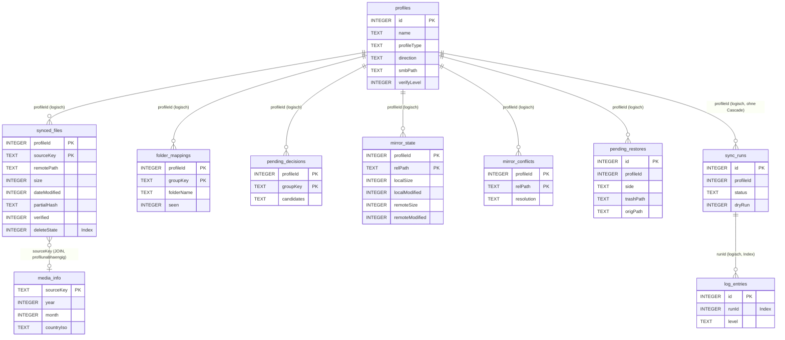
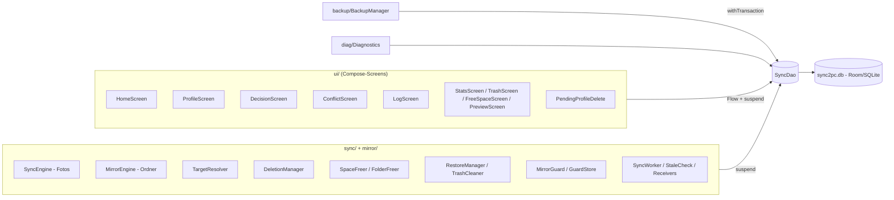
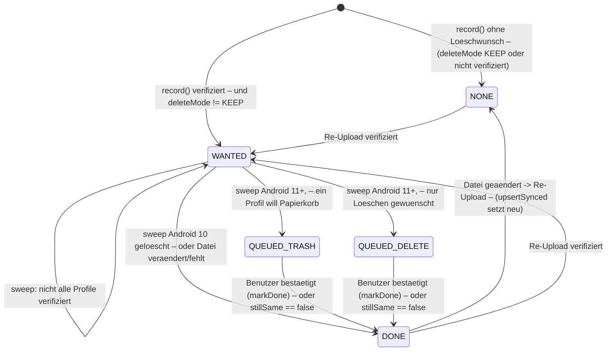
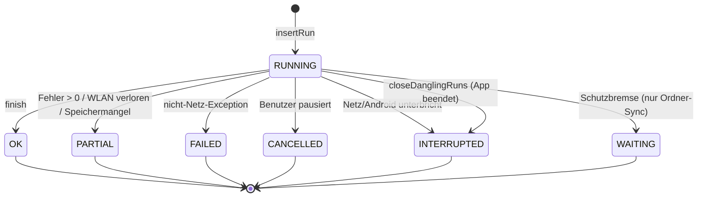
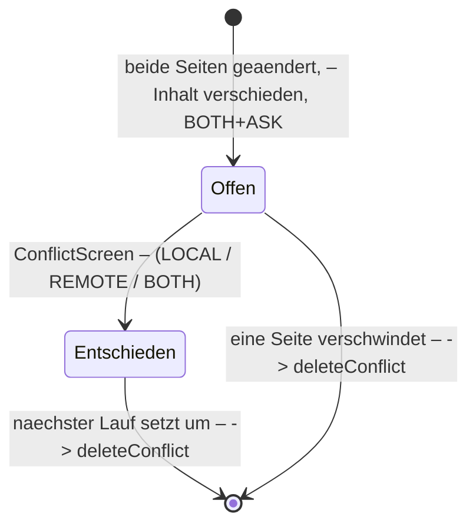
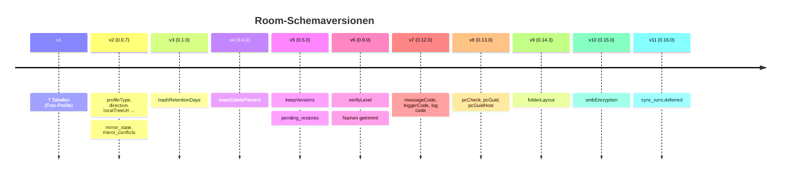

# Datenmodell – LeoSync (Sync2PC)

Technische Referenz der **aktuell implementierten** persistenten Datenstrukturen.
Stand: Quellcode, App-Version 0.15.0 (`version.properties`; Änderungen bis 0.16.3 nachgeführt: Datenbankversion 11 und `sync_runs.deferred` ab 0.16.0, DEC-238), **Room-Datenbankversion 11** (neu: `sync_runs.deferred`, 3.9, 10; v10: `smbEncryption`, DEC-222, 3.1; v9: `folderLayout`, DEC-209, 3.1, 10, 11.2; v8: `pcCheck`, `pcGuid`, `pcGuidHost`; Stand der übrigen Abschnitte: s. u.). Abschnitte 3.9, 3.10, 10, 12.4, 14 und 17 sind auf 0.12.x nachgeführt (Verlauf mit Kennungen); die übrigen Abschnitte wurden zuletzt mit 0.11.0 abgeglichen.
Der Quellcode ist massgeblich; `docs/DECISIONS.md` liefert Hintergründe (DEC-IDs). Geplantes steht nur in Abschnitt 17 und ist dort als solches gekennzeichnet.

> **Hinweis zu Dateinamen:** Massgeblich sind die Dateien mit Bindestrich: `docs/DATA-MODEL.md` (diese Datei) und `docs/SYNC-ENGINE.md` (Sync-Abläufe).

Quellen (alle relativ zum Repository):

| Bereich | Datei |
|---|---|
| Datenbank, Migrationen | `app/src/main/java/com/sync2pc/app/data/AppDatabase.kt` |
| Entities, Enums, Konstanten | `app/src/main/java/com/sync2pc/app/data/Entities.kt` |
| DAO | `app/src/main/java/com/sync2pc/app/data/SyncDao.kt` |
| Exportierte Schemas | `app/schemas/com.sync2pc.app.data.AppDatabase/1.json … 10.json` |
| Einstellungen ausserhalb der DB | `data/GlobalSettings.kt`, `mirror/MirrorGuard.kt` (`GuardStore`), `mirror/TrashPurge.kt` (`PurgeStore`), `mirror/RestoreManager.kt` (`RestoreFailures`), `l10n/AppLanguage.kt` |
| Sicherung | `backup/BackupCodec.kt`, `backup/BackupManager.kt` |
| Tests | `app/src/test/…`, `app/src/androidTest/…/MigrationTest.kt` |

---

## 1. Überblick

**Technologie:** Room (KSP, Version 2.8.5 laut `ARCHITECTURE.md`) auf SQLite. Schema-Export ist an (`exportSchema = true`), jede Version liegt als JSON in `app/schemas/`.

**Datenbanken:** genau **eine** Room-Datenbank, Datei `sync2pc.db` (Name bewusst unverändert, DEC-007/DEC-110; eine Änderung wäre Datenverlust). `AppDatabase.get(context)` ist ein Singleton (`@Volatile` + `synchronized`).

**Weitere Persistenz ausserhalb von Room:**

| Speicher | Zweck | Abschnitt |
|---|---|---|
| SharedPreferences `global` (`GlobalSettings`) | profilübergreifende Einstellungen, Pausen, Update-Zustand | 11 |
| SharedPreferences `guard` (`GuardStore`) | offene Schutzbremsen, Einmal-Freigaben, Stichproben-Vormerkung | 11 |
| SharedPreferences `purge` (`PurgeStore`) | vorgemerktes Leeren des PC-Papierkorbs | 11 |
| SharedPreferences `restore` (`RestoreFailures`) | fehlgeschlagene Wiederherstellungen; seit 0.11.8 zusätzlich Schlüssel `attempts` (Fehlversuche, Format `restoreId:n`, nicht in der Sicherung) | 11 |
| SharedPreferences `lang` (`AppLanguage`) | Sprachwahl | 11 |
| SharedPreferences `enc_status` (`smb/EncryptionStatus.kt`) | tatsächlicher Verschlüsselungszustand der letzten Anmeldung je Profil (Symbol auf der Profilkarte, 0.16.20) | – |
| SharedPreferences `trashname` (`mirror/PcTrashNameMemory.kt`) | Merker «PC lehnt `@LeoSync-Bin` ab» je Profil und PC-Ziel, 7 Tage (0.16.34); rein lokal, wird beim Löschen eines Profils oder beim Import nicht bereinigt | – |
| Android-Keystore (`CredentialCrypto`) | Schlüssel für `profiles.smbPasswordEnc` | 3.1 |
| Dateisystem (Handy via SAF, PC via SMB) | Papierkorb `.LeoSync-Bin/<Datum>/…`, Temp-Dateien `.s2ptmp`, `.s2pold` | 12 |

**Zugriff:** Es gibt **keine Repository-Schicht**. Alle Komponenten greifen direkt über `AppDatabase.get(ctx).dao()` auf das eine Interface `SyncDao` zu (Abschnitt 6).

**Für die Synchronisation entscheidend:**
- Foto-Profile (`ProfileType.PHOTOS`, Handy → PC): `synced_files` (bereits gesichert), `folder_mappings`/`pending_decisions` (Zielordner), `media_info` (Analyse-Cache).
- Ordner-Profile (`ProfileType.MIRROR`): `mirror_state` (gemeinsamer Ausgangszustand S des 3-Wege-Abgleichs), `mirror_conflicts`, `pending_restores`.
- Beide: `profiles` (Konfiguration), `sync_runs` + `log_entries` (Verlauf, Zustand eines Laufs).

---

## 2. Tabellenübersicht

| # | Tabelle | Entity | Primärschlüssel | Profiltyp | Zweck (kurz) |
|---|---|---|---|---|---|
| 1 | `profiles` | `Profile` | `id` (auto) | beide | Sync-Profil: Ziel, Zugang, Quellen, Optionen |
| 2 | `synced_files` | `SyncedFile` | (`profileId`, `sourceKey`) | PHOTOS | bereits auf den Share übertragene Fotos/Videos |
| 3 | `folder_mappings` | `FolderMapping` | (`profileId`, `groupKey`) | PHOTOS | Benutzerentscheid Gruppe → Monatsordner |
| 4 | `pending_decisions` | `PendingDecision` | (`profileId`, `groupKey`) | PHOTOS | offene Ordnerfrage an den Benutzer |
| 5 | `media_info` | `MediaInfo` | `sourceKey` | PHOTOS | Cache der Datums-/Länderanalyse |
| 6 | `mirror_state` | `MirrorState` | (`profileId`, `relPath`) | MIRROR | Stand beim letzten Abgleich (S) |
| 7 | `mirror_conflicts` | `MirrorConflict` | (`profileId`, `relPath`) | MIRROR | Konflikte, offen oder entschieden |
| 8 | `pending_restores` | `PendingRestore` | `id` (auto) | MIRROR | vorgemerkte Wiederherstellung aus dem Papierkorb |
| 9 | `sync_runs` | `SyncRun` | `id` (auto) | beide | ein Lauf (Verlauf, Zustand) |
| 10 | `log_entries` | `LogEntry` | `id` (auto) | beide | Detail-Log eines Laufs |

Insgesamt **10 Tabellen / 10 Room-Entities**, **1 DAO**. Es gibt **keine Fremdschlüssel (`ForeignKey`)**, keine `@Relation`, keine `@Embedded`, keine `@TypeConverters` und keine Views (geprüft in `Entities.kt`, `AppDatabase.kt` und den Schemas). Alle Beziehungen sind indirekte ID-Verweise (Abschnitt 5).

---

## 3. Tabellen im Detail

Konvention: Kotlin `Long`/`Int`/`Boolean` → SQLite `INTEGER`, `String` → `TEXT`, `Double` → `REAL`. „Default“ ist der **Kotlin-Standardwert** der Entity; ein SQL-`DEFAULT` existiert nur bei Spalten, die per Migration hinzugefügt wurden (siehe 3.1, Besonderheiten).

### 3.1 `profiles` – `Profile`

**Zweck:** ein Sync-Profil mit Ziel-Share, Zugangsdaten, Quelle und allen Optionen. Zwei Typen (`profileType`): Foto-Ordner (`PHOTOS`, nur Handy → PC, sortiert nach Jahr/Monat/Land) und normaler Ordner (`MIRROR`, 1:1-Spiegelung mit Unterordnern).

| Feld | Typ | Null | Default | Schlüssel | Bedeutung |
|---|---|---|---|---|---|
| `id` | INTEGER | nein | `0` | **PK**, autoGenerate | Profil-ID; Bezugspunkt aller anderen Tabellen |
| `name` | TEXT | nein | `"Standard"` | | Anzeigename; wird beim Speichern/Import/Migration 5→6 getrimmt (DEC-173) |
| `enabled` | INTEGER (Bool) | nein | `true` | | Profil aktiv (nur aktive laufen automatisch) |
| `smbPath` | TEXT | nein | `""` | | Freigabe-Pfad, z. B. `\\fs01.local\Fotos`; beim Öffnen wird `remoteSubfolder` hineingerechnet (siehe unten) |
| `smbUser` | TEXT | nein | `""` | | SMB-Benutzer |
| `smbDomain` | TEXT | nein | `""` | | SMB-Domäne |
| `smbPasswordEnc` | TEXT | nein | `""` | | Passwort, mit Android-Keystore verschlüsselt (Base64), `CredentialCrypto` |
| `sourceFolders` | TEXT | nein | `""` | | PHOTOS: Quellordner (MediaStore `RELATIVE_PATH`), zeilengetrennt |
| `wifiSsids` | TEXT | nein | `""` | | erlaubte WLAN-Namen, zeilengetrennt |
| `includeImages` | INTEGER | nein | `true` | | PHOTOS: Bilder einbeziehen |
| `includeVideos` | INTEGER | nein | `true` | | PHOTOS: Videos einbeziehen |
| `includeSubfolders` | INTEGER | nein | `true` | | PHOTOS: Unterordner einbeziehen |
| `deleteMode` | TEXT | nein | `"KEEP"` | | `DeleteMode`: Quelldatei nach verifiziertem Upload behalten / Papierkorb / löschen (nur PHOTOS wirksam) |
| `verifyUpload` | INTEGER | nein | `true` | | Altfeld (bis 0.8.x). Seit 0.9.0 nur noch **Spiegel** von `verifyLevel != OFF` (wird in `ProfileScreen.save` gesetzt) |
| `profileType` | TEXT | nein | `"PHOTOS"` | | `ProfileType` (v2) |
| `direction` | TEXT | nein | `"UPLOAD"` | | `SyncDirection` (v2); bei PHOTOS wirkungslos (immer UPLOAD) |
| `localTreeUri` | TEXT | nein | `""` | | MIRROR: SAF-Baum-URI des Handy-Ordners mit dauerhafter Berechtigung (v2) |
| `remoteSubfolder` | TEXT | nein | `""` | | Altfeld: Unterordner auf dem Share. Wird beim Öffnen des Profils in `smbPath` übernommen und leer gespeichert (`ProfileScreen`); `SmbSession` und `ProfileOverlap` werten es weiter aus (v2) |
| `propagateDeletes` | INTEGER | nein | `false` | | MIRROR: Löschungen auf die Gegenseite übernehmen (v2) |
| `conflictMode` | TEXT | nein | `"ASK"` | | `ConflictMode` (v2) |
| `includePatterns` | TEXT | nein | `""` | | Einschlussmuster (`*.pdf`), leer = alles (v2) |
| `excludePatterns` | TEXT | nein | `""` | | Ausschlussmuster (v2) |
| `remotePollMinutes` | INTEGER | nein | `60` | | MIRROR: Prüfintervall im WLAN in Minuten (v2) |
| `trashRetentionDays` | INTEGER | nein | `30` | | MIRROR: Papierkorb-Frist in Tagen, `0` = nie leeren (v3) |
| `massDeletePercent` | INTEGER | nein | `20` | | MIRROR: Schwelle der Schutzbremse in Prozent (v4) |
| `keepVersions` | INTEGER | nein | `true` | | MIRROR: Versionsschutz – überschriebene Version in den Papierkorb (v5) |
| `verifyLevel` | INTEGER | nein | `2` | | `VerifyLevel.code` 0–4, Standard MEDIUM (v6) |
| `pcCheck` | TEXT | nein | `"WIFI"` | | PC-Erkennung (DEC-204): `WIFI` (nur WLAN-Name) / `GUID` (nur PC-Kennung) / `BOTH` (beides). Abgeleitet: `Profile.pcMode()` (`PcCheckMode.parse`, unbekannt oder leer → `WIFI`) (v8, 0.13.0) |
| `pcGuid` | TEXT | nein | `""` | | Gelernte PC-Kennung (SMB-Server-GUID, kleingeschrieben); leer = unbekannt (v8) |
| `pcGuidHost` | TEXT | nein | `""` | | Host (kleingeschrieben), zu dem `pcGuid` gelernt wurde; die Kennung gilt nur für diesen Host (`PcIdentity.storedFor`) (v8) |
| `folderLayout` | TEXT | nein | `"MONTH_SUFFIX"` | | Ordnerstruktur auf dem PC, nur Fotoprofile (DEC-209): `MONTH_SUFFIX` (V1 `Jahr\MM[ - Land]`, Standard) / `COUNTRY_FOLDER` (V2 `Jahr\[Land\]MM`) / `COUNTRY_SUBFOLDER` (V3 `Jahr\MM\[Land]`). Abgeleitet: `Profile.layout()` (`FolderLayout.of`, unbekannt oder leer → V1). Die Codes dürfen sich nie ändern. Ab der ersten Synchronisierung gesperrt: `SyncDao.updateProfile` übernimmt dann immer den gespeicherten Wert (`FolderLayoutGuard`) (v9, 0.14.3) |
| `smbEncryption` | TEXT | nein | `"PREFERRED"` | | SMB3-Verschlüsselung (DEC-222): `OFF` (Aus, wie bisher) / `PREFERRED` (Wenn möglich, Standard auch für bestehende Profile; `withEncryptData(true)`) / `REQUIRED` (Erforderlich: nur SMB 3.x, Pflichtprüfung vor `authenticate()`). Enum `SmbEncryption`, Zugriff `Profile.encryption()`; fehlender oder unbekannter Wert in Sicherung = `PREFERRED` (v10, 0.15.0) |

**Indizes:** keine.
**Beziehungen:** `profiles.id` wird von allen anderen Tabellen (ausser `media_info`) als `profileId` referenziert – ohne Fremdschlüssel.
**Abgeleitete Werte (nicht gespeichert, in `Profile`):** `type()`, `dir()` (PHOTOS → immer UPLOAD), `delete()` (MIRROR → immer KEEP), `verify()` (OFF wird zu MEDIUM, sobald `delete() != KEEP`), `mustVerify()`, `conflict()`, `isConfigured()`. Die Enum-Parser (`…of(name)`) fallen bei unbekanntem Wert auf den Standard zurück (kein Absturz bei Altwerten).
**Besonderheiten:**
- `deleteMode`, `profileType`, `direction`, `conflictMode` sind als **TEXT mit Enum-Namen** gespeichert, ohne TypeConverter; `verifyLevel` als Zahl. Umbenennen eines Enum-Werts würde bestehende Zeilen auf den Standard zurückfallen lassen.
- Frisch angelegte Datenbanken haben **kein SQL-`DEFAULT`** (siehe `createSql` in `6.json`); migrierte Datenbanken haben bei den Spalten ab v2 ein `DEFAULT`. Folge: Inserts per Raw-SQL (wie in `MigrationTest`) müssen auf frischen Datenbanken alle Spalten angeben. Room-Zugriffe sind nicht betroffen.
- Listenfelder (`sourceFolders`, `wifiSsids`, Muster) sind **zeilengetrennte Strings**; `Profile.splitLines/joinLines` trimmen und entfernen Duplikate.

### 3.2 `synced_files` – `SyncedFile`

**Zweck:** Bestand der von einem Foto-Profil bereits auf den Share übertragenen Dateien. Grundlage des schnellen Überspringens bekannter Dateien ohne Netzzugriff (DEC-021) und des Löschens/„Speicher freigeben“ nach verifiziertem Upload.

| Feld | Typ | Null | Default | Schlüssel | Bedeutung |
|---|---|---|---|---|---|
| `profileId` | INTEGER | nein | – | **PK (Teil 1)** | Verweis auf `profiles.id` (kein FK) |
| `sourceKey` | TEXT | nein | – | **PK (Teil 2)** | `RELATIVE_PATH + DISPLAY_NAME`, z. B. `DCIM/Camera/IMG_1.jpg` |
| `mediaUri` | TEXT | nein | – | | `content://`-URI der Quelldatei; für Löschen/Papierkorb (`DeletionManager`) |
| `size` | INTEGER | nein | – | | Grösse in Bytes beim Upload |
| `dateModified` | INTEGER | nein | – | | Änderungsdatum in **Sekunden** (MediaStore `dateModifiedSec`) |
| `partialHash` | TEXT | **ja** | – | | Teil-Prüfsumme (SHA-256, „Wenig“-Stufe); seit 0.15.0 wird sie in `SyncEngine.transfer` **immer** als LOW-Teil-Prüfsumme abgelegt (auch ab Prüfstufe „Mittel“; bis 0.14.7 oft `null`); Zeilen aus älteren Läufen können weiter `null` enthalten |
| `remotePath` | TEXT | nein | – | | Pfad der Zieldatei relativ zur Share-Wurzel bzw. voller UNC-Pfad (siehe Besonderheiten) |
| `syncedAt` | INTEGER | nein | – | | Zeitpunkt der Aufzeichnung (ms) |
| `verified` | INTEGER | nein | – | | `true`, wenn nach dem Upload eine Prüfsumme (Stufe ≥ LOW) übereinstimmte; „Aus“ gilt nicht als verifiziert |
| `deleteState` | INTEGER | nein | `0` | | `DeleteState` (Abschnitt 8.1) |

**Indizes:** `index_synced_files_deleteState` auf `deleteState` (schnelle Auswahl wartender Löschungen, `byDeleteState`, `queuedDeletes`).
**Besonderheiten:**
- Kein Index auf `sourceKey` allein, obwohl `syncedAllProfiles(key)` und `setDeleteStateForKey(key, …)` danach filtern (PK beginnt mit `profileId`). Für typische Grössen unkritisch, aber ein Performance-Hinweis (Abschnitt 9).
- Überspring-Regel in `SyncEngine`: Datei gilt als bekannt, wenn `sourceKey`, `size` **und** `dateModified` gleich sind (`syncedLite`). Ändert sich eine Datei, wird sie als neu behandelt und per `upsertSynced` (REPLACE) überschrieben – dabei wird `deleteState` neu gesetzt.
- `remotePath` wird in `SyncEngine.record` als vollständiger Pfad (`folderPath – ame`) aus `smb.path(...)` geschrieben; `StatRow`/`SpaceFreer` lesen ihn. Die Entity-Doku „relativ zur Share-Wurzel“ und der geschriebene Wert sind nicht deckungsgleich formuliert – **offene Frage** (Abschnitt 17).
- Nicht gesichert im Export: `deleteState` (bewusst, `BackupCodec`); beim Import wird er auf den Standard `0` gesetzt.

### 3.3 `folder_mappings` – `FolderMapping`

**Zweck:** gespeicherte Benutzerentscheidung „Gruppe (Jahr/Monat/Land) → Ordner auf dem Share“ (relativer Pfad unter dem Jahr mit 1–2 Segmenten; bei V3 ist die Gruppe je Monat ohne Land, DEC-209).

| Feld | Typ | Null | Default | Schlüssel | Bedeutung |
|---|---|---|---|---|---|
| `profileId` | INTEGER | nein | – | **PK (1)** | Profil |
| `groupKey` | TEXT | nein | – | **PK (2)** | `"2026/06/EG"` bzw. `"2026/06/-"` ohne Land (`FolderNames.groupKey`) |
| `folderName` | TEXT | nein | – | | gewählter Ordnername (bereinigt per `FolderNames.sanitize`) |
| `seen` | INTEGER | nein | `false` | | `true`, sobald der Ordner auf dem Share existierte; verschwindet er danach, wird neu gefragt (`TargetResolver`) |

**Indizes:** keine. **Zugriff:** `TargetResolver` (lesen/`seen` setzen/löschen), `DecisionScreen` (Anlage), `BackupManager` (Export/Import, wird mitgesichert).

### 3.4 `pending_decisions` – `PendingDecision`

**Zweck:** offene Frage „In welchen vorhandenen Monatsordner?“ mit Kandidaten und Vorschaubildern.

| Feld | Typ | Null | Default | Schlüssel | Bedeutung |
|---|---|---|---|---|---|
| `profileId` | INTEGER | nein | – | **PK (1)** | Profil |
| `groupKey` | TEXT | nein | – | **PK (2)** | wie `folder_mappings.groupKey` |
| `year` | INTEGER | nein | – | | Jahr der Gruppe |
| `month` | INTEGER | nein | – | | Monat der Gruppe |
| `countryIso` | TEXT | ja | – | | Länderkürzel oder `null` |
| `countryName` | TEXT | ja | – | | Ländername oder `null` |
| `defaultName` | TEXT | nein | – | | vorgeschlagener Standardordner (z. B. `06 - Ägypten`) |
| `candidates` | TEXT | nein | – | | vorhandene passende Ordner, zeilengetrennt |
| `fileCount` | INTEGER | nein | – | | Anzahl betroffener Dateien |
| `totalBytes` | INTEGER | nein | – | | Summe der Grössen |
| `sampleUris` | TEXT | nein | – | | bis zu 8 `content://`-URIs für Vorschaubilder, zeilengetrennt |
| `updatedAt` | INTEGER | nein | – | | letzte Aktualisierung (ms) |

**Besonderheiten:** Bei **jedem** echten Foto-Lauf werden zuerst alle Entscheidungen des Profils gelöscht (`deleteDecisionsOfProfile`) und am Ende des Laufs neu aus den noch offenen Gruppen aufgebaut. Die Tabelle ist also ein Zwischenstand der letzten Planung, kein dauerhafter Bestand. Nicht in der Sicherung.

### 3.5 `media_info` – `MediaInfo`

**Zweck:** Cache der Analyse (Aufnahmedatum, Standort, Land), damit Dateien nicht mehrfach geöffnet werden.

| Feld | Typ | Null | Default | Schlüssel | Bedeutung |
|---|---|---|---|---|---|
| `sourceKey` | TEXT | nein | – | **PK** | wie `synced_files.sourceKey` – **profilunabhängig** |
| `size` | INTEGER | nein | – | | Grösse zum Zeitpunkt der Analyse |
| `dateModified` | INTEGER | nein | – | | Änderungsdatum (Sekunden) zum Zeitpunkt der Analyse |
| `year` | INTEGER | nein | – | | ermitteltes Jahr |
| `month` | INTEGER | nein | – | | ermittelter Monat |
| `dateSource` | TEXT | nein | – | | `EXIF`, `META`, `FILENAME` oder `MODIFIED` (Quelle des Datums; freier String, kein Enum) |
| `latitude` | REAL | ja | – | | GPS-Breite |
| `longitude` | REAL | ja | – | | GPS-Länge |
| `countryIso` | TEXT | ja | – | | Länderkürzel; massgeblich für den Ordnernamen (DEC-162) |
| `countryName` | TEXT | ja | – | | gecachter (deutscher) Ländername; nur noch Kennzeichen „Land bestimmt“ und Rückfall |

**Besonderheiten:** Cache-Treffer nur, wenn `size` **und** `dateModified` zur aktuellen Datei passen; sonst Neuanalyse. Fehlt `countryName` trotz GPS und ist die Länderdatenbank inzwischen verfügbar, wird nur das Land nachgetragen. Wird in `dryRun` nur in diesem Nachtrags-Fall nicht geschrieben; die normale Neuanalyse schreibt auch im Probelauf (`dao.upsertMediaInfo(info)` ohne `dryRun`-Prüfung). Der Cache wird von **keinem** Profil-Löschvorgang bereinigt (Abschnitt 9). Nicht in der Sicherung.

### 3.6 `mirror_state` – `MirrorState`

**Zweck:** Stand jeder Datei beim **letzten erfolgreichen Abgleich** eines Ordner-Profils = der gemeinsame Ausgangszustand **S** des 3-Wege-Abgleichs.

| Feld | Typ | Null | Default | Schlüssel | Bedeutung |
|---|---|---|---|---|---|
| `profileId` | INTEGER | nein | – | **PK (1)** | Profil |
| `relPath` | TEXT | nein | – | **PK (2)** | relativer Pfad, **Kleinbuchstaben**, `/` als Trenner (Schlüssel) |
| `localSize` | INTEGER | nein | – | | Grösse auf dem Handy beim Abgleich |
| `localModified` | INTEGER | nein | – | | Änderungsdatum auf dem Handy (ms, aus Ordnerliste gelesen) |
| `remoteSize` | INTEGER | nein | – | | Grösse auf dem PC |
| `remoteModified` | INTEGER | nein | – | | Änderungsdatum auf dem PC |
| `syncedAt` | INTEGER | nein | – | | Zeitpunkt des Abgleichs (ms) |

**Indizes:** keine (PK deckt `profileId`-Abfragen).
**Besonderheiten:** kein Hash gespeichert – Änderungserkennung basiert **ausschliesslich auf Grösse und Änderungszeit** je Seite. Inhaltsgleichheit wird bei Bedarf live per Hash geprüft (`PartialHash.thorough`). Schlüssel ist kleingeschrieben (Windows-Namensverhalten); die Originalschreibweise steckt nur in `mirror_conflicts.relPath` und in den Verzeichnislisten. Wird mitgesichert.

### 3.7 `mirror_conflicts` – `MirrorConflict`

**Zweck:** Konflikt „Datei auf beiden Seiten geändert“ (nur Richtung BOTH, `ConflictMode.ASK`), wartet auf Benutzerentscheid (`resolution = null`) oder ist entschieden.

| Feld | Typ | Null | Default | Schlüssel | Bedeutung |
|---|---|---|---|---|---|
| `profileId` | INTEGER | nein | – | **PK (1)** | Profil |
| `relPath` | TEXT | nein | – | **PK (2)** | relativer Pfad in **Originalschreibweise** (anders als `mirror_state`) |
| `localSize` | INTEGER | nein | – | | Grösse Handy zum Zeitpunkt der Erkennung |
| `localModified` | INTEGER | nein | – | | Änderungszeit Handy |
| `remoteSize` | INTEGER | nein | – | | Grösse PC |
| `remoteModified` | INTEGER | nein | – | | Änderungszeit PC |
| `detectedAt` | INTEGER | nein | – | | Zeitpunkt der Erkennung (ms) |
| `resolution` | TEXT | **ja** | `null` | | `null` = offen; sonst `ConflictResolution`: `LOCAL`, `REMOTE`, `BOTH` |

**Besonderheiten:** Der Engine-Abgleich der Konflikt-Schlüssel erfolgt über `relPath.lowercase()`, der PK selbst ist aber **case-sensitiv** (SQLite-Standard-Collation BINARY). Zwei Zeilen, die sich nur in der Gross-/Kleinschreibung unterscheiden, wären als PK zulässig; in der Praxis entsteht pro Pfad nur eine (gleiche Schreibweise aus der Ordnerliste) – nicht durch die DB erzwungen. Nicht in der Sicherung.

### 3.8 `pending_restores` – `PendingRestore`

**Zweck:** vorgemerkte Wiederherstellung einer alten Version aus dem Papierkorb (0.5.0); wird vom nächsten Ordner-Sync mit erreichbarem PC ausgeführt.

| Feld | Typ | Null | Default | Schlüssel | Bedeutung |
|---|---|---|---|---|---|
| `id` | INTEGER | nein | `0` | **PK**, autoGenerate | Vormerkungs-ID (auch Schlüssel in `RestoreFailures`) |
| `profileId` | INTEGER | nein | – | | Profil |
| `side` | TEXT | nein | – | | `"LOCAL"` (Handy) oder `"REMOTE"` (PC) = `Side.name`: wo die alte Version liegt |
| `trashPath` | TEXT | nein | – | | Pfad der alten Version relativ zum Profilordner (`.LeoSync-Bin/<Datum>/…`) |
| `origPath` | TEXT | nein | – | | ursprünglicher Pfad relativ zum Profilordner |
| `requestedAt` | INTEGER | nein | – | | Zeitpunkt der Vormerkung (ms) |

**Indizes:** keine (Abfragen nach `profileId` machen einen Tabellenscan – bei erwartbar wenigen Zeilen unkritisch).
**Besonderheiten:** `side` ist als freier String gespeichert (kein Enum-Converter). Vormerkungen werden vom Papierkorb-Aufräumen **nie** gelöscht (`TrashPurge.reservedPaths`, DEC-145). Nicht in der Sicherung.

### 3.9 `sync_runs` – `SyncRun`

**Zweck:** ein Lauf (Foto- oder Ordner-Sync, echt oder Simulation). Quelle der Verlaufsliste, der „zuletzt gesichert“-Anzeige und der Erinnerung „lange nicht gesichert“.

| Feld | Typ | Null | Default | Schlüssel | Bedeutung |
|---|---|---|---|---|---|
| `id` | INTEGER | nein | `0` | **PK**, autoGenerate | Lauf-ID |
| `profileId` | INTEGER | nein | – | | Profil (kein FK; Lauf überlebt das Profil) |
| `profileName` | TEXT | nein | – | | Profilname zum Zeitpunkt des Laufs (Kopie, DEC-173) |
| `trigger` | TEXT | nein | – | | Auslöser als fertiger Text in der damaligen App-Sprache; Rückfalltext, wenn `triggerCode` fehlt (DEC-159) |
| `dryRun` | INTEGER | nein | – | | `true` = Simulation (Vorschau); wird aus Verlauf und Statistik ausgeblendet |
| `startedAt` | INTEGER | nein | – | | Start (ms) |
| `finishedAt` | INTEGER | ja | `null` | | Ende (ms); `null` solange offen |
| `status` | TEXT | nein | `"RUNNING"` | | `RunStatus` (Abschnitt 8.2) |
| `uploaded` | INTEGER | nein | `0` | | Foto: hochgeladene Dateien; Ordner: Uploads **+** Downloads |
| `skipped` | INTEGER | nein | `0` | | Foto: bereits vorhanden/bekannt; Ordner: immer `0` |
| `failed` | INTEGER | nein | `0` | | Anzahl Datei-Fehler |
| `waiting` | INTEGER | nein | `0` | | Foto: auf Ordnerentscheid wartende Dateien; Ordner: neue Konflikte |
| `bytes` | INTEGER | nein | `0` | | übertragene Bytes |
| `message` | TEXT | nein | `""` | | Kurzzusammenfassung in der damaligen App-Sprache; Rückfalltext, wenn `messageCode` fehlt |
| `messageCode` | TEXT | ja | `null` | | seit DB v7 (0.12.0): Kurzzusammenfassung als Kennung (JSON, Abschnitt 3.11); `null` = nur `message` |
| `triggerCode` | TEXT | ja | `null` | | seit DB v7 (0.12.0): Auslöser als Kennung (JSON); `null` = nur `trigger` |
| `deferred` | INTEGER | nein | `0` | | seit DB v11 (0.16.0, DEC-238): Ordner: Dateien, die während des Laufs geändert wurden (oder neu entstanden) und beim nächsten Sync folgen; **nicht** `skipped` (bei Fotos «bereits vorhanden»); Foto-Läufe `0`. Der Lauf bleibt `OK`. |

**Indizes:** keine (Abfragen nach `status`, `dryRun`, `startedAt`, `profileId` laufen ohne Index – Verlauf ist auf 90 Tage begrenzt).
**Besonderheiten:** `trigger` ist ein SQL-Schlüsselwort; Room quotet die Spalte automatisch (`` `trigger` ``), handgeschriebene SQL-Abfragen auf diese Spalte müssten es ebenfalls tun (derzeit keine). Aufbewahrung: `pruneRuns` löscht Läufe **älter als 90 Tage** (`startedAt`), beim Start jedes echten Laufs. Läufe mit `dryRun = true` werden ebenfalls angelegt (`insertRun` ohne Prüfung), nicht aber deren Log-Einträge.

### 3.10 `log_entries` – `LogEntry`

**Zweck:** Detail-Log eines Laufs.

| Feld | Typ | Null | Default | Schlüssel | Bedeutung |
|---|---|---|---|---|---|
| `id` | INTEGER | nein | `0` | **PK**, autoGenerate | Eintrags-ID (Sortierung `ORDER BY id`) |
| `runId` | INTEGER | nein | – | | Verweis auf `sync_runs.id` (kein FK) |
| `time` | INTEGER | nein | – | | Zeit (ms) |
| `level` | TEXT | nein | – | | `I`, `W`, `E` (freier String) |
| `message` | TEXT | nein | – | | Text in der damaligen App-Sprache; Rückfalltext, wenn `code` fehlt, und Text der Diagnose (DEC-160) |
| `code` | TEXT | ja | `null` | | seit DB v7 (0.12.0): Zeile als Kennung (JSON, Abschnitt 3.11); `null` = nur `message` (alte Einträge, wörtliche Texte) |

**Indizes:** `index_log_entries_runId` auf `runId`.
**Besonderheiten:** Aufbewahrung 30 Tage (`pruneLogs(time < …)`), beim Start jedes echten Laufs. Dadurch können `log_entries` **früher** verschwinden als ihr `sync_run`; umgekehrt löscht `pruneRuns` keine zugehörigen Log-Einträge (diese altern über `time` selbst aus; ein Log-Eintrag eines Laufs, der älter als 90 Tage ist, ist zwangsläufig auch älter als 30 Tage). Simulationen schreiben keine Log-Einträge.

### 3.11 Kennung (`Msg`) in `messageCode`, `triggerCode` und `code` (seit 0.12.0, DEC-159)

Statt nur eines fertigen Textes speichern Läufe und Log-Zeilen zusätzlich eine Kennung (`l10n/Msg.kt`), die beim Anzeigen in der aktiven App-Sprache gerendert wird. Format: kleiner JSON-Baum (org.json) mit dem Ressourcen-**Namen** (nie der R-ID, die sich mit jedem Build ändert):

| Form | Bedeutung |
|---|---|
| `{"t":"Text"}` | wörtlicher Text (Dateinamen, Fehlertexte); als alleinige Meldung nicht als Kennung gespeichert (Spalte bleibt `null`, der Text steht in `message`/`trigger`); als Argument oder Teil einer Verkettung kommt die Form vor |
| `{"k":"name","a":[…]}` | Text aus `res/values*/` mit Argumenten |
| `{"k":"name","n":3,"a":[…]}` | Mehrzahl (`plurals`) mit Anzahl `n` |
| `{"j":", ","p":[…]}` | Verkettung mehrerer Teile |

Argumente sind Text, Zahl oder eine verschachtelte Kennung; die Verschachtelungstiefe ist auf 12 begrenzt. Regeln: Felder sind optional, Leser ignorieren unbekannte Felder. Anzeige: `Msg.render(code, fallback)` liefert die Kennung in der aktiven Sprache; `Msg.toCode()` fängt Ausnahmen beim Erzeugen ab und liefert dann `null` (seit 0.12.2; ein ungültiges Argument bricht keinen Lauf ab, es gilt der Rückfalltext); bei leerer oder unlesbarer Kennung, unbekanntem Schlüssel, Format- oder Parsefehler wird der gespeicherte Text (`message`/`trigger`) angezeigt. Alte Einträge (Code `null`) zeigen daher unverändert ihren Text; sie werden nicht umgerechnet und altern mit der Aufbewahrung (Logs 30, Läufe 90 Tage) aus. Die Sicherung (Abschnitt 11.2) enthält weder Läufe noch Log-Einträge und bleibt unverändert (Formatversion 1). Die Diagnose (`Diagnostics.build/compress`) arbeitet weiter mit dem gespeicherten Text (DEC-160), der Verlauf-Export (`logExport`) rendert in der aktiven Sprache.

---

## 4. Entity-Klassen und andere Datenklassen

Alle Entities liegen in `data/Entities.kt` und sind Kotlin-`data class`es. Verwendete Annotationen: `@Entity(tableName, primaryKeys, indices)`, `@PrimaryKey(autoGenerate = true)` (vier Entities mit Einzel-PK `id`; `MediaInfo` mit `@PrimaryKey` ohne Auto), `@Index`. `PendingRestore` verwendet die voll qualifizierten Annotationen `androidx.room.Entity`/`PrimaryKey` (nur Stil). **Nicht** verwendet: `@ColumnInfo`, `@ForeignKey`, `@Embedded`, `@Relation`, `@TypeConverters`, `@Ignore`.

### 4.1 Persistente Entities (Room)

| Entity | Verantwortung | Bemerkungen |
|---|---|---|
| `Profile` | Konfiguration eines Sync-Profils | Enthält Verhaltensmethoden (`type()`, `dir()`, `verify()` …); Enum-Werte als `String`/`Int` gespeichert |
| `SyncedFile` | Foto-Bestand (Teil von „bereits gesichert“) | Zeitstempel in Sekunden (`dateModified`) und Millisekunden (`syncedAt`) gemischt |
| `FolderMapping` | Gruppe → Ordner | `seen` steuert Neu-Nachfrage |
| `PendingDecision` | offene Ordnerfrage | Zeilengetrennte Listenfelder |
| `MediaInfo` | Analyse-Cache | `dateSource` freier String |
| `MirrorState` | Gemeinsamer Ausgangszustand | Schlüssel kleingeschrieben |
| `MirrorConflict` | Konflikt | `resolution` nullable |
| `PendingRestore` | Wiederherstellung vormerken | `side` = `Side.name` als String |
| `SyncRun` | Lauf | Zählerfelder |
| `LogEntry` | Log | |

**Zeitstempel-Einheiten (wichtig):** `SyncedFile.dateModified` und `MediaInfo.dateModified` = **Sekunden**; `MirrorState.localModified/remoteModified`, `MirrorConflict.*Modified`, alle `*At`-/`time`-Felder = **Millisekunden**. Die Einheit ist nicht im Typ erkennbar.

### 4.2 Enums und Konstantenobjekte (Werte-Vokabular)

| Typ | Werte | Speicherung |
|---|---|---|
| `DeleteMode` | `KEEP`, `TRASH`, `DELETE` | `profiles.deleteMode` (Name als TEXT); Parser `of()` → Standard `KEEP` |
| `ProfileType` | `PHOTOS`, `MIRROR` | `profiles.profileType` (TEXT); Standard `PHOTOS` |
| `SyncDirection` | `UPLOAD`, `DOWNLOAD`, `BOTH` | `profiles.direction` (TEXT); Standard `UPLOAD`; `up`/`down`-Hilfseigenschaften |
| `VerifyLevel` | `OFF(0)`, `LOW(1)`, `MEDIUM(2)`, `HIGH(3)`, `FULL(4)` | `profiles.verifyLevel` (Code als INTEGER); `of(code)` → Standard `MEDIUM` |
| `ConflictMode` | `ASK`, `NEWER` | `profiles.conflictMode` (TEXT); Standard `ASK` |
| `SmbEncryption` | `OFF`, `PREFERRED`, `REQUIRED` | `profiles.smbEncryption` (Name als TEXT); `SmbEncryption.parse`: leer/fehlend → `PREFERRED` (0.15.0, DEC-222); vorhandener, unbekannter Wert → `REQUIRED` (sicherer Ausfall, seit 0.16.0, DEC-234; gilt für DB-Wert und Sicherung) |
| `DeleteState` (Objekt) | `NONE=0`, `WANTED=1`, `QUEUED_TRASH=2`, `DONE=3`, `QUEUED_DELETE=4` | `synced_files.deleteState` (INTEGER) |
| `ConflictResolution` (Objekt) | `LOCAL`, `REMOTE`, `BOTH` (Konstanten `KEEP_LOCAL`, `KEEP_REMOTE`, `KEEP_BOTH`) | `mirror_conflicts.resolution` (TEXT) |
| `RunStatus` (Objekt) | `RUNNING`, `OK`, `PARTIAL`, `FAILED`, `CANCELLED`, `INTERRUPTED`, `WAITING` | `sync_runs.status` (TEXT); SQL-Abfragen nutzen die Texte direkt (`'OK'`, `'RUNNING'` …) |

Die `label`-Eigenschaften der Enums (`str(@StringRes)`) sind reine UI-Texte, nicht persistiert.

### 4.3 Nicht persistierte Datenklassen (Abfrage- und Laufzeitobjekte)

| Klasse | Ort | Zweck |
|---|---|---|
| `SyncedLite` (`sourceKey`, `size`, `dateModified`) | `Entities.kt` | Projektion von `synced_files` für den schnellen Lauf-Beginn |
| `StatRow` (`sourceKey`, `remotePath`, `size`, `year`, `countryIso`, `countryName`) | `Entities.kt` | Ergebnis des `LEFT JOIN synced_files ⟕ media_info` für die Statistik |
| `StateCount` (`state`, `count`) | `Entities.kt` | Diagnose: Anzahl je `deleteState` |
| `Guard` / `GuardKind` / `Side` | `mirror/MirrorGuard.kt` | offene Schutzbremse (in SharedPreferences `guard` serialisiert, siehe 11) |
| `BackupContent` / `ParsedBackup` | `backup/BackupCodec.kt` | Inhalt einer Sicherungsdatei (JSON) |
| `PendingProfileDelete.Pending` (`id`, `name`) | `ui/PendingProfileDelete.kt` | prozessweit im Speicher (`MutableStateFlow`): zum Löschen vorgemerktes Profil |
| `TargetResolver.Resolution` (`Folder`/`Ask`) | `sync/TargetResolver.kt` | Ergebnis der Ordnerauflösung |
| `MirrorEngine.Action` / `Kind` (privat) | `mirror/MirrorEngine.kt` | geplante Aktion je Datei: `UPLOAD`, `DOWNLOAD`, `TRASH_LOCAL`, `TRASH_REMOTE`, `RECORD`, `DROP`, `CONFLICT`, `KEEP_BOTH` |
| `LocalEntry`, `RemoteEntry`, `MediaItem`, `PurgeRule`, `PreviewEntry`, `SyncProgress` | `mirror/`, `smb/`, `media/`, `sync/` | Laufzeitobjekte (Listen, Fortschritt, Vorschau); hier **nicht** im Detail untersucht |

---

## 5. Beziehungen

**Es sind keine Datenbank-Beziehungen definiert.** Weder `@ForeignKey` noch `@Relation` noch Junction-Tabellen. Alle Verbindungen sind **logische ID-Verweise**, die nur im Anwendungscode gepflegt werden:

| Verweis | Kardinalität | Umsetzung |
|---|---|---|
| `profiles.id` ← `synced_files.profileId`, `folder_mappings.profileId`, `pending_decisions.profileId`, `mirror_state.profileId`, `mirror_conflicts.profileId`, `pending_restores.profileId`, `sync_runs.profileId` | 1 : n | nur Wert-Gleichheit; kein FK, kein Cascade |
| `sync_runs.id` ← `log_entries.runId` | 1 : n | Wert-Gleichheit, Index auf `runId` |
| `synced_files.sourceKey` ↔ `media_info.sourceKey` | n : 1 (über mehrere Profile) | `LEFT JOIN` in `statRows`; `media_info` ist **profilunabhängig** |
| `mirror_state.relPath` ↔ `mirror_conflicts.relPath` | 1 : 0..1 | Abgleich in `MirrorEngine` über `lowercase()`; keine DB-Beziehung |
| `pending_restores.origPath` ↔ `mirror_state.relPath` / `mirror_conflicts.relPath` | indirekt | `runRestores` löscht Zustand/Konflikt zu `origPath` (`lowercase()` bzw. Originalschreibweise) |
| `folder_mappings` ↔ `pending_decisions` | 1 : 0..1 je (`profileId`, `groupKey`) | gleiche Schlüsselstruktur; verknüpft nur im Code (`DecisionScreen` schreibt Mapping, löscht Decision) |
| Profil `id` → SharedPreferences-Schlüssel (`block_<id>`, `check_<id>`, `rules_<id>`, `files_<id>`, `awaitingFirstStart`-Menge, `failed`-Menge `<profileId>:<restoreId>`) | indirekt | siehe Abschnitt 11 |
| Profil `id` → Dateien (Papierkorb, Temp-Dateien) | indirekt | Pfade relativ zum Profilordner |

Alle Linien im Diagramm sind **keine** DB-Constraints (kein FK); das Diagramm zeigt nur, welche Spalten inhaltlich aufeinander verweisen.

**Wer pflegt die „Kaskade“?** Da nichts kaskadiert, löschen `PendingProfileDelete.delete` und `BackupManager.import(replace=true)` die Kind-Tabellen von Hand (Abschnitt 9, Regel I-6).

---

## 6. DAO- und Zugriffsschicht

**Ein** DAO: `SyncDao` (`@Dao interface`), erreichbar über `AppDatabase.dao()`. **74 Funktionen** (gezählt), davon 1 Default-Methode mit Logik (`closeDanglingRuns`). Es gibt keine Repository-Klassen, keine ViewModels, keinen DI-Container.

### 6.1 Funktionen nach Tabelle

| Tabelle | Lesen | Schreiben | Löschen |
|---|---|---|---|
| `profiles` | `profilesFlow`, `profiles`, `profile(id)` | `insertProfile` (→ neue `id`), `updateProfile` | `deleteProfileRow(id)` |
| `synced_files` | `syncedLite`, `synced`*, `syncedAllProfiles`, `byDeleteState`, `queuedDeleteCount` (Flow), `queuedDeletes`, `syncedCount`* (Flow), `syncedCountNow`, `statRows`, `allSynced`, `verifiedSynced`, `deleteStateCounts` | `upsertSynced` (REPLACE), `upsertSyncedAll` (REPLACE), `setDeleteStateForKey` (`deleteState IN (1,2,4)`), `setDeleteState`* | `clearSynced(profileId)`, `deleteSynced(profileId, key)` (0.15.0: entfernt eine Zeile, wenn die PC-Kopie vor dem Löschen fehlt, damit die Datei neu gesichert wird, DEC-223) |
| `folder_mappings` | `mapping`, `allMappings` | `upsertMapping`, `upsertMappings` (REPLACE) | `deleteMapping`, `clearMappings` |
| `pending_decisions` | `decisionsFlow`, `decisions`, `decisionCount` | `upsertDecision` (REPLACE) | `deleteDecision`, `deleteDecisionsOfProfile`, `clearDecisions` |
| `media_info` | `mediaInfo(key)` | `upsertMediaInfo` (REPLACE) | – (keine) |
| `mirror_state` | `mirrorStates`, `mirrorStateCount`, `allMirrorStates` | `upsertMirrorState`, `upsertMirrorStates` (REPLACE) | `deleteMirrorState`, `clearMirrorState` |
| `mirror_conflicts` | `openConflictsFlow`, `openConflictCount`, `conflicts` | `upsertConflict` (REPLACE), `resolveConflict` (UPDATE `resolution`) | `deleteConflict`, `clearConflicts` |
| `pending_restores` | `pendingRestores`, `pendingRestoreCount`, `pendingRestoreProfiles` (Flows) | `insertRestores` (`@Insert` ohne Strategie) | `deleteRestore(id)`, `clearRestores(profileId)` |
| `sync_runs` | `runsFlow(limit=100)`, `lastRunFlow`, `runningRuns`, `lastSuccessAt`, `recentRuns` | `insertRun`, `updateRun`, `closeDanglingRuns` | `pruneRuns(before)`, `clearRuns` (`status != 'RUNNING'`) |
| `log_entries` | `logFlow`, `logs`, `lastLogTime` | `insertLog` | `pruneLogs(before)`, `clearLogs` (alle) |

\* Im Quellcode ausserhalb des DAO **kein Aufrufer gefunden** (`synced`, `syncedCount`, `setDeleteState`).

### 6.2 Für die Sync-Engines besonders relevante Abfragen

| Abfrage | Nutzer | Bedeutung |
|---|---|---|
| `syncedLite(profileId)` | `SyncEngine`, `PendingCheck` | Bekanntheitsprüfung ohne I/O (Pfad + Grösse + Änderungsdatum) |
| `upsertSynced` | `SyncEngine.record` | Aufzeichnung nach erfolgreichem Upload bzw. erkanntem Duplikat |
| `mirrorStates(profileId)` | `MirrorEngine`, `FolderFreer`, `MirrorGuard`, `RestoreManager` | Laden des Ausgangszustands S |
| `upsertMirrorState` / `deleteMirrorState` | `MirrorEngine.record`/`executeAdmin`/`executeTransfer` | Fortschreiben bzw. Vergessen von S |
| `conflicts(profileId)` / `upsertConflict` / `deleteConflict` | `MirrorEngine` | Konflikte laden, anlegen, entfernen |
| `undoResolution(profileId, relPath, expected)` / `deleteConflictIf(profileId, relPath, expected)` (seit 0.16.0, DEC-232) | `ConflictScreen` / `MirrorEngine` | bedingtes Rückgängigmachen (`resolution = NULL`) bzw. Löschen (`… AND resolution = :expected`); Rückgabe = Anzahl Zeilen, 0 = Entscheidung inzwischen geändert |
| `pendingDeferredFlow` (seit 0.16.1) | `HomeScreen` / `HomeStatus` | Summe `sync_runs.deferred` aus dem jeweils letzten echten (`dryRun = 0`), erfolgreichen Lauf je aktivem Profil |
| `pendingRestores(profileId)` | `MirrorEngine`, `TrashCleaner`, `RestoreManager` | auszuführende Wiederherstellungen, Schutz vor Papierkorb-Leeren |
| `byDeleteState(WANTED)`, `syncedAllProfiles(key)`, `setDeleteStateForKey` | `DeletionManager` | profilübergreifende Löschfreigabe |
| `mapping` / `upsertMapping` / `deleteMapping` | `TargetResolver` | Ordnerauflösung der Foto-Sortierung |
| `mediaInfo` / `upsertMediaInfo` | `SyncEngine.mediaInfo` | Analyse-Cache |
| `insertRun` / `updateRun` / `insertLog` / `pruneLogs` / `pruneRuns` | beide Engines | Lauf-Lebenszyklus |
| `closeDanglingRuns` | `SyncWorker` | offene `RUNNING`-Läufe nach App-Kill abschliessen |
| `lastSuccessAt(profileId)` | `StaleCheck`, `FirstSync` | letzte erfolgreiche Sicherung (`OK`/`PARTIAL`, `dryRun = 0`) |
| `verifiedSynced` | `SpaceFreer` | Kandidaten für „Speicher freigeben“ |

### 6.3 Zugriffspfade

- **Direkt aufs DAO** greifen alle oben gezeigten Komponenten zu; die Screens halten das DAO als `remember { AppDatabase.get(ctx).dao() }`.
- **Reaktiv (Flow):** `profilesFlow`, `decisionsFlow`, `openConflictsFlow`, `runsFlow`, `lastRunFlow`, `logFlow`, `queuedDeleteCount`, `pendingRestoreCount`, `pendingRestoreProfiles`, `syncedCount`. Die UI beobachtet, die Engines schreiben.
- **Transaktionen:** einzige explizite Transaktion ist `BackupManager.import` (`db.withTransaction`). Weder die Engines noch `PendingProfileDelete` verwenden Transaktionen (Abschnitt 13).

---

## 7. Synchronisationsrelevante Daten

Vollständige Abläufe: `docs/SYNC-ENGINE.md` . Hier nur die Rolle der Daten.

### 7.1 Foto-Profile (Handy → PC)

| Konzept | Gespeichert in | Verwendung |
|---|---|---|
| Bekannter Dateibestand | `synced_files` | Datei gilt als bekannt bei gleichem `sourceKey` + `size` + `dateModified` (Sekunden) → ohne Netzzugriff übersprungen |
| Lokale Kennung | `sourceKey` (`RELATIVE_PATH + DISPLAY_NAME`), `mediaUri` | `sourceKey` ist profilübergreifender Schlüssel (auch für `media_info`, `DeletionManager`); `mediaUri` für Löschen |
| Entfernte Kennung | `remotePath` | Ort auf dem Share (Statistik, „Speicher freigeben“) |
| Hash | `partialHash` (optional) | Teil-Prüfsumme „Wenig“ (SHA-256 über Grösse + 3×64 KB; ≤ 192 KB vollständig); seit 0.15.0 immer gesetzt, wenn die Zeile neu geschrieben wird. Die Prüfung nach dem Upload (`VerifyLevel`) wird nicht als Hash gespeichert, sondern als Ergebnis `verified` |
| Übertragungsstatus | `verified`, `syncedAt` | Eine Zeile entsteht **erst nach** erfolgreichem Upload + Prüfung (`record` am Ende von `transfer`) oder nach erkanntem Duplikat |
| Löschinformation | `deleteState` + Profilfeld `deleteMode` | Zustandsmaschine 8.1 |
| Zielordner | `folder_mappings` (+ `seen`), `pending_decisions` | Benutzerentscheid pro Gruppe |
| Analyse | `media_info` | Datum (EXIF/META/FILENAME/MODIFIED), GPS, Land |

Unverzichtbar für korrekte Erkennung „neu/geändert“: `sourceKey`, `size`, `dateModified` in `synced_files`. Für die sichere Löschfreigabe: `verified` **aller** abdeckenden Profile und `size` (Prüfung `stillSame` vor dem Löschen).

### 7.2 Ordner-Profile (3-Wege-Abgleich)

Der Abgleich je Datei vergleicht **L** (Handy jetzt), **R** (PC jetzt) und **S** (`mirror_state`):

| Information | Quelle | Bedeutung |
|---|---|---|
| Gemeinsamer Ausgangszustand S | `mirror_state` (`localSize/localModified/remoteSize/remoteModified`, `syncedAt`) | Wird nach **jedem erfolgreichen Übertragen oder erkannter Inhaltsgleichheit** (`record`) pro Datei geschrieben; nach Löschen/Verwerfen entfernt (`deleteMirrorState`) |
| Änderung Handy | `L.size != S.localSize` oder `L.modified != S.localModified` | `changedL` |
| Änderung PC | `R.size != S.remoteSize` oder `R.modified != S.remoteModified` | `changedR` |
| Neu | S fehlt | als geändert behandelt; bei beiden Seiten vorhanden → Inhaltsvergleich per Hash |
| Gelöscht | S vorhanden, eine Seite fehlt | je nach Richtung/`propagateDeletes` → Papierkorb der Gegenseite, Wiederherstellen oder S verwerfen (`DROP`) |
| Konflikt | beide Seiten geändert, Inhalt verschieden, Richtung BOTH | `ConflictMode.ASK` → `mirror_conflicts`; `NEWER` → neuere Änderungszeit gewinnt |
| Hash | nicht gespeichert | live berechnet (`PartialHash.thorough`: ≤ 32 MB ganze Datei, darüber 32 Stichproben) – nur beim Erstabgleich, bei beidseitiger Änderung oder wenn nur der Zeitstempel verschoben scheint |
| Papierkorb | Dateisystem (`.LeoSync-Bin/<Datum>/…`), Frist `trashRetentionDays` | nicht in der DB; nur `pending_restores` verweist darauf |
| Fehlerzustand | `sync_runs.status/failed/message`, `log_entries` | Datei-Fehler → `PARTIAL`; Netzfehler → `INTERRUPTED`; sonstige → `FAILED` |
| Profilzuordnung | `profileId` in allen Zeilen | |

**Konsistenzregel der Engine (dokumentierte Reihenfolge):** Vor einem Überschreiben/Ersetzen wird `mirror_state` der Datei **zuerst gelöscht** (`deleteMirrorState`), dann übertragen. Scheitert die Übertragung, gilt die Datei beim nächsten Lauf als *neu* (wird übertragen) statt als *auf der Gegenseite gelöscht* (würde sonst die andere Kopie löschen). Das ist die zentrale Absicherung von S (Quelle: Kommentar in `MirrorEngine.executeTransfer`).

**Zusatzzustände ausserhalb der DB, die die Sync-Entscheidung beeinflussen:** offene Schutzbremse (`guard`), Einmal-Freigaben „Trotzdem löschen“/„Nicht löschen“, ausstehende Stichprobe nach Ordnerwechsel, vorgemerktes PC-Leeren, „wartet auf ersten Start“ (`awaitingFirstStart`) – Abschnitt 11.

---

## 8. Statuswerte und Zustandsmodelle

### 8.1 `DeleteState` (`synced_files.deleteState`) – Datenbankstatus

| Name | Wert | Bedeutung |
|---|---|---|
| `NONE` | 0 | kein Löschwunsch (Profil `deleteMode = KEEP`, oder Datei nicht verifiziert) |
| `WANTED` | 1 | verifiziert hochgeladen, Löschen gewünscht; wartet, bis **alle** abdeckenden aktiven Foto-Profile sie verifiziert haben |
| `QUEUED_TRASH` | 2 | bereit für Papierkorb, wartet auf Systemdialog (Android 11+) |
| `DONE` | 3 | erledigt, oder Datei fehlt/wurde verändert (`stillSame == false`) → nicht mehr löschen |
| `QUEUED_DELETE` | 4 | bereit für endgültiges Löschen, wartet auf Systemdialog (Android 11+) |

Gesetzt von: `SyncEngine.record` (`NONE` oder `WANTED`, bei jedem Upsert), `DeletionManager.sweep` (→ `QUEUED_*` oder `DONE`), `DeletionManager.buildRequests`/`markDone` (→ `DONE`). `setDeleteStateForKey` wirkt auf **alle Profile** mit gleichem `sourceKey` und nur aus den Zuständen 1, 2, 4.

Hinweis: Rückwärtskanten (`DONE → …`) entstehen nur durch erneutes `upsertSynced` derselben Zeile (REPLACE), nicht durch eigene Statusfunktionen. Ablehnung des Systemdialogs durch den Benutzer: im untersuchten Code **kein expliziter Zustandsübergang** gefunden (die Zeile bleibt `QUEUED_*`); **offene Frage**.

### 8.2 `RunStatus` (`sync_runs.status`) – Datenbankstatus

| Wert | Bedeutung | Gesetzt von |
|---|---|---|
| `RUNNING` | Lauf offen | `SyncRun`-Standard bei `insertRun` |
| `OK` | alles erledigt | beide Engines in `finish` |
| `PARTIAL` | Lauf beendet, aber ≥ 1 Datei-Fehler, WLAN verloren oder Speichermangel (Ordner) | beide Engines |
| `FAILED` | nicht behebbarer Fehler (kein Netzfehler) | beide Engines (`catch Exception`) |
| `CANCELLED` | vom Benutzer pausiert/abgebrochen | beide Engines (`CancellationException` ohne `interruptReason`) |
| `INTERRUPTED` | von Android/Netz unterbrochen (WLAN weg, Stromsparer, Verbindungsabbruch) | beide Engines; `SyncDao.closeDanglingRuns` für verwaiste `RUNNING`-Läufe |
| `WAITING` | wartet auf Benutzerentscheid (Schutzbremse) | nur `MirrorEngine.block` |

Ein Lauf wechselt nie von einem Endzustand zurück; jeder neue Lauf ist eine neue Zeile. Auswirkungen: `lastSuccessAt` zählt nur `OK`/`PARTIAL` (echte Läufe); `clearRuns` löscht alles ausser `RUNNING`; `runningRuns` betrachtet nur `dryRun = 0`.
Anmerkung: der KDoc-Kommentar an `SyncRun.status` nennt nur „RUNNING, OK, PARTIAL, FAILED, CANCELLED“ und ist veraltet (die Konstanten `INTERRUPTED`, `WAITING` existieren; DEC-179).

### 8.3 Konfliktzustand (`mirror_conflicts.resolution`)

| `resolution` | Bedeutung | Folge im nächsten Lauf |
|---|---|---|
| `null` | offen | Datei wird übersprungen (`continue`), Konfliktkarte sichtbar |
| `LOCAL` | Handy-Version behalten | `UPLOAD` mit `trashOther` (PC-Version in den Papierkorb) |
| `REMOTE` | PC-Version behalten | `DOWNLOAD` mit `trashOther` |
| `BOTH` | beide behalten | `KEEP_BOTH`: Handy-Version mit Zusatz `_conflict-phone` umbenennen und hochladen, PC-Version laden |

Gesetzt: `upsertConflict` (Erkennung, `MirrorEngine`), `resolveConflict` (`ConflictScreen`). Entfernt: `deleteConflict`, sobald der Entscheid umgesetzt wurde oder eine Seite fehlt (`doneConflicts`), beim Wiederherstellen, bei Reset (`clearConflicts`).

### 8.4 `mirror_state` – impliziter Zustand je Datei

Die Zeile selbst hat kein Statusfeld; der Zustand ergibt sich aus (S vorhanden?) × (L vorhanden/geändert?) × (R vorhanden/geändert?). Die Planung (`MirrorEngine.plan`) ist die Zustandsabbildung (Tabelle ohne Wiederholung der Gesamtlogik; Details → `SYNC-ENGINE.md`):

| S | L | R | Ergebnis (`Kind`) – Auszug |
|---|---|---|---|
| – | ja | nein | `UPLOAD` falls Richtung up, sonst nichts |
| – | nein | ja | `DOWNLOAD` falls Richtung down, sonst nichts |
| ja | ja | nein | UPLOAD-Richtung: `UPLOAD` (wiederherstellen); sonst `propagateDeletes` → `TRASH_LOCAL`; BOTH → `UPLOAD`; DOWNLOAD → `DROP` |
| ja | nein | ja | DOWNLOAD-Richtung: `DOWNLOAD`; sonst `propagateDeletes` → `TRASH_REMOTE`; BOTH → `DOWNLOAD`; UPLOAD → `DROP` |
| ja | nein | nein | `DROP` (S entfernen) |
| beliebig | ja | ja | keine Änderung → nichts; nur eine Seite geändert → Übertragen (Versionsschutz `trashOther`); beide geändert/S fehlt → gleicher Inhalt `RECORD`, sonst je Richtung/`ConflictMode` |

### 8.5 Weitere Zustandswerte ausserhalb der Tabellen

| Zustand | Typ / Ort | Werte |
|---|---|---|
| `GuardKind` | Enum, SharedPreferences `guard` (`block_<id>`) | `REMOTE_MISSING`, `LOCAL_MISSING`, `MASS_DELETE`, `CHECK_FOLDER` |
| `MirrorGuard.Choice` | Enum, nur transient | `DELETE_ANYWAY`, `KEEP_FILES`, `ACCEPT_FOLDER`, `RESET_AS_NEW` |
| `Side` | Enum | `LOCAL`, `REMOTE` (auch als String in `pending_restores.side`) |
| `VerifyLevel` | Enum/Spalte | siehe 4.2 |
| `awaitingFirstStart` | Menge von Profil-IDs in `global` | Profil ohne ersten manuellen Start → keine automatischen Läufe (DEC-103/DEC-135) |
| Benutzer-Pause | `pausedUntil` (ms), `manualOnly` (Bool) in `global` | |
| WLAN-Fortsetzen | `resumeOnWifi`, `resumeSince` in `global` | |
| `FolderCheck.Result` | Enum, transient | `OK`, `MISMATCH`, `UNAVAILABLE` |
| Zum Löschen vorgemerktes Profil | `PendingProfileDelete.pending` (Flow im Speicher) | `Pending(id, name)` oder `null` |

Unterscheidung: **DB-Status** = 8.1–8.3; **temporärer Programmstatus** = `Guard`-Entscheidungen, `Choice`, `FolderCheck.Result`, `PendingProfileDelete.pending`, `Shared`-Zähler der Engines; **UI-Anzeigestatus** (z. B. Statuskachel, Hundebild `DogStatus`) leitet sich aus diesen Werten ab und wird nicht gespeichert.

---

## 9. Datenintegrität und Konsistenzregeln

Legende: **DB** = von SQLite/Room erzwungen · **App** = durch Anwendungscode abgesichert · **Fachlich** = nur vorausgesetzt, nicht technisch erzwungen · ⚠ = Lücke bzw. nicht eindeutig abgesichert.

| # | Regel | Warum | Absicherung | Folge einer Verletzung |
|---|---|---|---|---|
| I-1 | Eindeutigkeit je Tabelle über den Primärschlüssel (Verbund-PKs bei `synced_files`, `folder_mappings`, `pending_decisions`, `mirror_state`, `mirror_conflicts`) | Keine Doppelzeilen pro (Profil, Datei/Gruppe) | **DB** (PK) + `OnConflictStrategy.REPLACE` in allen `upsert…` | Ohne REPLACE Insert-Fehler; mit REPLACE wird die Zeile ersetzt (nicht gemischt) |
| I-2 | NOT-NULL ausser `partialHash`, `countryIso/-Name`, `latitude/longitude`, `finishedAt`, `resolution` | Spalten sind Sync-Pflichtangaben | **DB** (NOT NULL) / Kotlin-Nullability | Insert scheitert bzw. kompiliert nicht |
| I-3 | `profileId` muss auf ein existierendes Profil zeigen | Waisenzeilen würden Zählungen (z. B. `openConflictsFlow`, `decisions`, `lastSuccessAt`) verfälschen | ⚠ **nicht erzwungen** (kein FK); nur durch vollständiges manuelles Löschen (I-6) | Konfliktkarten/Entscheidungen ohne Profil; `DecisionScreen`/`ConflictScreen` filtern teils über `profilesFlow` (Anzeige-Ebene) |
| I-4 | Bekannte-Datei-Regel (`sourceKey` + `size` + `dateModified`) | Schnelles Überspringen ohne Netz | **App** (`SyncEngine`, `syncedLite`) | Geänderte Datei fälschlich übersprungen oder doppelt hochgeladen |
| I-5 | `synced_files`-Zeile entsteht erst nach erfolgreichem Upload + Prüfung (oder erkannter Duplikatdatei); keine unvollständige Datei als übertragen markieren | Basis für Überspringen und Löschfreigabe | **App**: `record` am Ende von `transfer`; bei Prüffehler wird die Zieldatei gelöscht und eine Exception geworfen | Sonst Datenverlust beim „Löschen nach Sync“ |
| I-6 | Beim Profil-Löschen alle Kind-Daten mitlöschen: `synced_files`, `folder_mappings`, `pending_decisions`, `mirror_state`, `mirror_conflicts`, `pending_restores`, Profilzeile, plus `GuardStore`, `PurgeStore`, `RestoreFailures`, `awaitingFirstStart` | Ersatz für fehlende Kaskade | **App**: `PendingProfileDelete.delete`, `BackupManager.import(replace)` – zwei **getrennte Codestellen mit derselben Liste** ⚠ (Neue Tabelle mit `profileId` muss in beiden ergänzt werden) | Verwaiste Zeilen; Profil-IDs werden nicht wiederverwendet (autoGenerate), Altzeilen blieben unsichtbar liegen |
| I-7 | `sync_runs`, `log_entries` und `media_info` werden beim Profil-Löschen **nicht** gelöscht | Verlauf soll erhalten bleiben; Cache ist profilunabhängig | **App** (bewusst, nicht dokumentiert in DEC) ⚠ Verlauf eines gelöschten Profils bleibt bis zur Alterung (90/30 Tage) sichtbar; `media_info` wächst unbegrenzt | Nur Speicher/Anzeige, keine Sync-Fehler |
| I-8 | `mirror_state` vor Überschreiben/Ersetzen löschen, danach neu schreiben | Verhindert, dass eine gescheiterte Übertragung als „Löschung auf Gegenseite“ gedeutet wird | **App** (`MirrorEngine.executeTransfer`, `runRestores`) – **nicht in einer Transaktion** zusammen mit der Dateioperation (Dateisystem ist ohnehin nicht transaktional) | Bei Fehlerzeitpunkt zwischen Löschen von S und Übertragung: Datei gilt als neu → Datenverlust vermieden, ggf. erneuter Transfer |
| I-9 | Beim Reset (`RESET_AS_NEW`, „Sync-Status zurücksetzen“) `mirror_state` **und** `mirror_conflicts` gemeinsam leeren | Sonst würden bestehende Konflikte ohne S weiterbestehen | **App** (`MirrorGuard.resolve`/`afterFolderChange`, `ProfileScreen` Reset). `pending_restores` und `folder_mappings` bleiben bewusst unberührt | Konflikt ohne S wird als „neu“ neu bewertet |
| I-10 | Mass-Delete-Schutz: Löschlauf hält an, wenn > `massDeletePercent` (Standard 20 %), ≥ 100 Dateien oder ein Unterordner mit > 5 Dateien vollständig verschwindet | Schutz vor massenhaftem Datenverlust (z. B. leerer/falscher Ordner) | **App** (`GuardPolicy`, Zustand in SharedPreferences `guard`); Schwelle pro Profil in `profiles.massDeletePercent` | Ohne Schutzbremse: massenhaftes Verschieben in den Papierkorb der Gegenseite |
| I-11 | Ordner fehlt/gewechselt → Lauf hält an (`LOCAL_MISSING`, `REMOTE_MISSING`, `CHECK_FOLDER`) | Verhindert, dass ein leerer Ordner „alles gelöscht“ bedeutet | **App** (`MirrorEngine`, `FolderCheck`) | Siehe I-10 |
| I-12 | Wiederherstellungsvormerkungen werden nie gelöscht, solange sie bestehen | Alte Version darf nicht durch Papierkorb-Frist verschwinden | **App** (`TrashPurge.reservedPaths`, `purgeTrash`, `runPendingPurges`, `TrashCleaner`) | Wiederherstellen schlägt fehl (Datei weg) |
| I-13 | Wiederherstellen ist umkehrbar: bei Fehler Rollback + Vormerkung bleibt | Kein halber Zustand | **App** (`rollbackRestore`, `RestoreFailures`) – Rollback kann unvollständig sein (DEC risk 27) | Alte Version bleibt im Papierkorb, Hinweis im Verlauf |
| I-14 | Löschfreigabe nur, wenn **alle** abdeckenden aktiven Foto-Profile die Datei verifiziert haben und die Datei unverändert ist (`size`) | Sicherheit vor Löschen vom Handy | **App** (`DeletionManager.sweep`/`covers`/`stillSame`); „Aus“ gilt nicht als verifiziert; bei `delete() != KEEP` mindestens MEDIUM (`Profile.verify`) | Datenverlust des einzigen Exemplars |
| I-15 | Namenskonflikte nie überschreiben (`name_2`, `name_3`), Duplikate nur bei Name + Grösse + Hash erkennen; Duplikatsuche auch in Geschwisterordnern | Keine Überschreibung, keine Doppelablage | **App** (`SyncEngine.transfer`, `nameLock`-Mutex, `FolderNames`) | Überschriebene bzw. doppelte Fotos |
| I-16 | Nichts überschreiben, was sich seit dem Einlesen geändert hat | Parallele Änderung während des Laufs | **App** (`unchanged()`-Prüfung in `executeTransfer`, `expectNew` im Download) | Verlorene Änderung; hier: Datei wird übersprungen, nächster Lauf entscheidet |
| I-17 | Profilnamen getrimmt | Anzeige/Verlauf | **App** (`ProfileScreen.save`, `BackupCodec`) + einmalig `MIGRATION_5_6` | Nur Anzeige |
| I-18 | `verifyUpload` spiegelt `mustVerify()` | Altfeld konsistent halten (Rückwärtskompatibilität der Sicherung) | **App** (`ProfileScreen.save`) | Nur Alt-Lesepfade betroffen |
| I-19 | Doppelte/verschachtelte Profile warnen bzw. blockieren | Zwei Profile würden dieselben Dateien verwalten | **App** (`ProfileOverlap`, `ProfileScreen`, `BackupManager.import`); IDENTICAL blockiert, PARTIAL warnt | Konkurrierende Läufe auf denselben Dateien |
| I-20 | Nur ein echter Lauf gleichzeitig (Fotos und Ordner) | Gemeinsamer Zustand (DB, Dateien) | **App**: `SyncWorker` companion-`Mutex` (`tryLock`; zweiter Aufruf kehrt sofort mit Erfolg zurück), `MirrorLock.mutex` (Ordner-Lauf ↔ Eingriffe von Hand) | Race Conditions |
| I-21 | Kein `fallbackToDestructiveMigration` | Update darf nie still Daten löschen | **App** (`AppDatabase`-Builder) | – (Fehlende Migration → Absturz statt Löschung) |
| I-22 | Schema und Entities übereinstimmend (Identity-Hash) | Room prüft beim Öffnen | **DB/Room** (Identity-Hash, `6.json`) | App-Start-Absturz bei Abweichung |
| I-23 | `mirror_state.relPath` kleingeschrieben, `mirror_conflicts.relPath` in Originalschreibweise | Windows-/SAF-Namen sind nicht case-sensitiv | **Fachlich/App** (Konvention im Code, `lowercase()` an allen Zugriffen) ⚠ nicht per Collation erzwungen | Duplikat-Schlüssel bei abweichender Schreibweise |
| I-24 | Zeitstempel-Quelle beim Vergleich nur aus der Ordnerliste (nicht `stat()`) | SAF-Anbieter liefern je nach Abfrage andere Zeiten (DEC-137) | **App** (`download` liest `tree.find`, `record(key, ls, r)`) | Datei wird beim nächsten Lauf als geändert erkannt |

**Erkannte Lücken (zusammengefasst):**
1. ⚠ Keine Fremdschlüssel/Cascade: Waisen sind möglich, Löschlisten (I-6) müssen an zwei Stellen gleich gepflegt werden.
2. ⚠ Keine Transaktion um zusammengehörige Mehrfach-Schreibzugriffe der Engines (z. B. `deleteMirrorState` + Dateioperation + `upsertMirrorState`) – Konsistenz beruht auf der Reihenfolge (I-8).
3. ⚠ Kein Index auf `synced_files.sourceKey`, `sync_runs.profileId/status/startedAt`, `pending_restores.profileId`, `mirror_conflicts.resolution`.
4. ⚠ `media_info` wird nie bereinigt (wächst mit jedem je gesehenen `sourceKey`).
5. ⚠ Verlauf (`sync_runs`) eines gelöschten Profils bleibt bis zur Alterung bestehen; `closeDanglingRuns` markiert nur Läufe mit `dryRun = 0`, Simulationen mit Status `RUNNING` bleiben bei App-Kill ungeschlossen (Zeile mit `finishedAt = null`; `clearRuns` löscht sie ebenfalls nicht, `pruneRuns` nach 90 Tagen schon).
6. ⚠ `side`, `level`, `dateSource`, `resolution`, `status`, Enum-Texte sind **freie Strings** ohne CHECK-Constraint.
7. ⚠ Die Vergleichsgrundlage von S sind Grösse + Änderungszeit; Inhaltsänderungen bei gleicher Grösse und gleichem Zeitstempel bleiben unentdeckt (fachliche Grenze).

---

## 10. Migrationen und Versionshistorie

**Aktuelle Version:** 10 (DEC-222). Schemas 1–10 liegen vor (`app/schemas/…/1.json … 10.json`). **Migrationen 1→2, 2→3, 3→4, 4→5, 5→6, 6→7, 7→8, 8→9, 9→10** sind registriert (`addMigrations` in `AppDatabase.get`). **Destruktive Migrationen: keine** (`fallbackToDestructiveMigration` wird nicht aufgerufen; Kommentar und DEC-084). Alle Migrationen sind rein additiv (`ALTER TABLE … ADD COLUMN`, `CREATE TABLE IF NOT EXISTS`) bzw. enthalten `UPDATE`-Datenkonvertierung.

| Von → Nach | App-Version | Änderungen am Schema | Datenkonvertierung | Hinweise für bestehende Installationen |
|---|---|---|---|---|
| (initial) → **1** | 0.0.x | Tabellen `profiles`, `synced_files`, `folder_mappings`, `pending_decisions`, `media_info`, `sync_runs`, `log_entries` (laut `1.json`; keine Migration, Schema-Quelle `1.json`) | – | Startversion mit nur Foto-Profilen |
| **1 → 2** | 0.0.7 | `profiles` + 9 Spalten: `profileType` (`'PHOTOS'`), `direction` (`'UPLOAD'`), `localTreeUri`, `remoteSubfolder`, `propagateDeletes` (0), `conflictMode` (`'ASK'`), `includePatterns`, `excludePatterns`, `remotePollMinutes` (60); neue Tabellen `mirror_state`, `mirror_conflicts` | keine (Defaults) | Bestehende Profile bleiben Foto-Profile |
| **2 → 3** | 0.1.0 | `profiles.trashRetentionDays INTEGER NOT NULL DEFAULT 30` | keine | |
| **3 → 4** | 0.4.2 | `profiles.massDeletePercent INTEGER NOT NULL DEFAULT 20` | keine | |
| **4 → 5** | 0.5.0 | `profiles.keepVersions INTEGER NOT NULL DEFAULT 1`; neue Tabelle `pending_restores` | keine | Versionsschutz ist für bestehende Ordner-Profile standardmässig **an** |
| **5 → 6** | 0.9.0 | `profiles.verifyLevel INTEGER NOT NULL DEFAULT 2` | `verifyLevel = CASE WHEN verifyUpload = 0 AND deleteMode = 'KEEP' THEN 0 ELSE 1 END`; `UPDATE profiles SET name = TRIM(name)` | Bestehende Profile behalten ihr bisheriges Prüfverhalten (an → „Wenig“, aus → „Aus“); `verifyUpload` bleibt als Spalte (Tabellenneuaufbau vermieden) |
| **6 → 7** | 0.12.0 | `sync_runs` + `messageCode TEXT`, `triggerCode TEXT`; `log_entries` + `code TEXT` (alle nullable, ohne DEFAULT) | keine | Bestehende Läufe und Log-Zeilen behalten ihren Text, Kennung `NULL` → Anzeige des gespeicherten Textes (Abschnitt 3.11) |
| **7 → 8** | 0.13.0 | `profiles` + `pcCheck TEXT NOT NULL DEFAULT 'WIFI'`, `pcGuid TEXT NOT NULL DEFAULT ''`, `pcGuidHost TEXT NOT NULL DEFAULT ''` | keine | Bestehende Profile bleiben bei der WLAN-Prüfung (DEC-204) |
| **8 → 9** | 0.14.3 | `profiles.folderLayout TEXT NOT NULL DEFAULT 'MONTH_SUFFIX'` | keine | Bestehende Profile behalten Struktur V1, Verhalten unverändert (DEC-209, DEC-084); Migration am Emulator mit echten Daten (0.13.14 → 0.14.3) erfolgreich (QA SYNC-20261109-088) |
| **9 → 10** | 0.15.0 | `profiles.smbEncryption TEXT NOT NULL DEFAULT 'PREFERRED'` | keine | Bestehende Profile erhalten «Wenn möglich» (DEC-222); Schema `10.json`; `MigrationTest` 9→10 ergänzt, laut Development (SYNC-20261111-142 bis -144) **nicht ausgeführt** |
| **10 → 11** | 0.16.0 | `sync_runs.deferred INTEGER NOT NULL DEFAULT 0` | keine | Bestehende Läufe haben `0` (DEC-238); `MigrationTest` 10→11 geschrieben, laut Development (SYNC-20261111-173) **nicht ausgeführt** (nur als androidTest); Schema `11.json` entsteht beim nächsten Build |

Versionsangaben aus den KDoc-Kommentaren der Migrationen und DEC-084/-172; die Zuordnung `1.json`-Inhalt zu „0.0.x“ ist aus dem Quellcode **nicht** belegt (Git-Historie liegt nicht vor; das Projekt ist kein Git-Repository). **Dies ist eine offene Frage.**

**Weitere Besonderheiten:**
- **Durchgehende Regel (DEC-084):** neue Spalten per `ALTER TABLE … DEFAULT …`, Entity bekommt denselben Kotlin-Default, **kein** `@ColumnInfo(defaultValue)`. Folge: Migrierte DBs haben SQL-DEFAULTs, frische nicht (Abschnitt 3.1).
- **Fehlende Migrationen = Absturz**, nicht stilles Löschen. Eine Schemaänderung ohne Migration bricht Bestandsinstallationen.
- **Sicherung/Import** ist die einzige Brücke bei Paket-/DB-Wechsel (DEC-110), Format `leosync-backup` Version 1 (Abschnitt 11).
- `MigrationTest` (instrumentiert, `app/src/androidTest/…`) enthält die Kette 1→neueste sowie `verifyLevelFromVersion5`, `runCodesFromVersion6`, `pcCheckFromVersion7` und `folderLayoutFromVersion8`; die Zwischenstufen 2→3, 3→4, 4→5 laufen nur als Teil der Kette (Abschnitt 14). Der Testlauf von 8→9 wurde laut QA -088 nicht ausgeführt; 9→10 (0.15.0) ist ergänzt und laut Development ebenfalls nicht ausgeführt.

---

## 11. TypeConverter, Serialisierung und Nicht-Room-Speicher

### 11.1 Room-TypeConverter

**Keine.** Das Projekt nutzt weder `@TypeConverters` noch `@TypeConverter`. Alle Spalten sind primitive Kotlin-Typen. Boolean wird von Room nativ als `INTEGER` 0/1 gespeichert.

| Ausgangstyp | Gespeichert als | Mechanismus |
|---|---|---|
| `Boolean` | `INTEGER` 0/1 | Room nativ |
| Enum (`DeleteMode`, `ProfileType`, `SyncDirection`, `ConflictMode`) | `TEXT` (Name) | manuell: Feld ist `String`; `Enum.of(name)` mit Rückfall |
| `VerifyLevel` | `INTEGER` (`code`) | manuell: Feld ist `Int` |
| Listen (Quellordner, WLANs, Kandidaten, Beispiel-URIs, Muster) | `TEXT`, getrennt durch ` – ` (Muster auch durch `,`) | `Profile.splitLines/joinLines`; `FileFilter` |
| Zeit | `INTEGER` (ms bzw. Sekunden, siehe 4.1) | direkt |
| `Uri` | `TEXT` (`toString()`) | `Uri.parse` bei Gebrauch |
| Passwort | `TEXT` (Base64, Keystore-verschlüsselt) | `CredentialCrypto.encrypt/decrypt` |

### 11.2 Sicherungsformat (JSON, `BackupCodec`)

Format `leosync-backup`, `VERSION = 1`. Inhalt: `settings`, `profiles` (+ optional verschlüsseltes Passwort), `folderMappings`, `syncedFiles`, `mirrorState`. Optional AES-256-GCM mit PBKDF2-HMAC-SHA256 (210 000 Iterationen) und Prüfwert. Rückwärtskompatibilität: `verifyLevel` fehlt in alten Sicherungen → aus `verifyUpload`; `folderLayout` ist optional (fehlt → V1, DEC-209). Ein vorhandener, aber unbekannter `folderLayout`-Code lässt das Profil **nicht** importieren (`FolderLayout.parse` streng, kein stilles Zurückfallen auf V1); „Ersetzen“ bricht dann ab, bevor etwas gelöscht wird. Zuordnungspfade (`folderMappings`) werden beim Lesen bereinigt (kein `..`, höchstens 2 Segmente). Beim Einlesen werden fehlende Felder mit den `Profile`-Defaults belegt (`optString/optBoolean`).

**In der Sicherung enthalten:** `profiles` (seit 0.15.0 inkl. `smbEncryption` als Name; fehlend = `PREFERRED`, vorhandener unbekannter Wert = `REQUIRED` seit 0.16.0, DEC-234), `folder_mappings`, `synced_files` (ohne `deleteState`), `mirror_state` (die beiden Sync-Stände nur mit Option „Sync-Status“), exportierbare `GlobalSettings`.
**Nicht enthalten:** `pending_decisions`, `media_info`, `mirror_conflicts`, `pending_restores`, `sync_runs`, `log_entries`, `guard`, `purge`, `restore`, `lang`, Gerätezustand (Pause, Update-Zustand, `deviceId`, `awaitingFirstStart`).
**Import:** neue Profil-IDs; `profileId` der Kindzeilen wird umgeschrieben; Ordner-Profile erhalten `awaitingFirstStart` und – bei importiertem Sync-Stand – eine Stichproben-Vormerkung (`guard`).

### 11.3 SharedPreferences (kein Schema, nicht in der DB)

| Datei | Schlüssel (Auswahl) | Inhalt |
|---|---|---|
| `global` (`GlobalSettings`) | `autoSyncOnWifi`, `syncOnNewMedia`, `onlyWhileCharging`, `minFileAgeMinutes`, `homeCountryIso`, `parallelUploads` (1–4), `notifySummary/Update/Hints`, `autoUpdateCheck`, `update*`, `shareRetryAt`, `deferredStart` (Nachlauf-Merker, 0.15.0, DEC-221; mit `commit()` geschrieben; Schreibfehler seit 0.16.0 nur im Diagnose-Log, DEC-236), `lastSkipFollowUpAt` (Zeitstempel des letzten Folgelaufs nach übersprungenen Dateien, 0.16.0, DEC-238), `encNotified` (Menge der Profile, für die «Verschlüsselung nicht verfügbar» schon gemeldet wurde, 0.16.0, DEC-237), `shareUnreachable`, `resumeOnWifi`, `resumeSince`, `remotePollMinutes`, `lastSkipInfo/At`, `awaitingFirstStart` (Menge), `previewLimit`, `logFilterErrors/Transfers`, `pausedUntil`, `manualOnly`, `staleWarn*`, `staleBaseline`, `freeSpaceMonths`, `freeSpaceKeepFavorites`, `deviceId`, `lastWifiTriggerAt`, `pullTipDone`, `syncOffWifi` (Bool, Standard aus, seit 0.11.5, DEC-126) | Anwendungseinstellungen und Gerätezustand. `exportable()`/`importFrom` begrenzen, was gesichert wird (14 Schlüssel, ab 0.11.5 zusätzlich `syncOffWifi`; ältere Sicherungen ohne den Schlüssel bleiben gültig – laut Development, Anzahl nicht nachgezählt) |
| `guard` (`GuardStore`) | `block_<profileId>` = `"<Kind>;<count>;<total>;<folder>"`; `check_<profileId>` = `"LOCAL,REMOTE"`; `allowDelete_<id>`, `keepFiles_<id>` (Booleans, einmalig verbraucht) | offene Schutzbremse, Stichproben-Vormerkung, Einmal-Freigaben |
| `purge` (`PurgeStore`) | `rules_<profileId>` (Menge kodierter `PurgeRule`), `files_<profileId>` (Menge Pfade) | vorgemerktes PC-Leeren |
| `restore` (`RestoreFailures`) | `failed` = Menge `"<profileId>:<restoreId>"` | fehlgeschlagene Wiederherstellungen |
| `lang` (`AppLanguage`) | `KEY` | Sprachtag |

Die SharedPreferences gehen bei Neuinstallation verloren und werden nur teilweise gesichert (`ARCHITECTURE.md` Regel 13, DECISIONS Risiko 17/25).

---

## 12. Datenlebenszyklus

### 12.1 Foto-Datei (`synced_files`)

1. **Erkennen:** `MediaScanner` liefert `MediaItem`; Filter, `syncedLite` → bekannt (übersprungen) oder neu/geändert; Mindestalter (`minFileAgeMinutes`).
2. **Analyse:** `media_info` lesen/schreiben, Zielordner über `TargetResolver` (`folder_mappings`, ggf. `pending_decisions`).
3. **Übertragen:** Namen vergeben (`name_2` …), Duplikatsuche, Upload über `.s2ptmp` mit Fortsetzen, Grössenprüfung + Prüfsumme nach `VerifyLevel`.
4. **Aufzeichnen:** `upsertSynced` mit `verified`, `deleteState` (`NONE`/`WANTED`) – **erst danach** existiert die Zeile.
5. **Löschen/Papierkorb am Handy (optional):** `DeletionManager.sweep` → Zustandsmaschine 8.1; Android 11+ per Systemdialog; die Zeile **bleibt** mit `DONE` bestehen (kein Löschen der Zeile).
6. **Speicher freigeben (manuell):** `SpaceFreer` nutzt `verifiedSynced`, prüft die Datei auf dem PC erneut.
7. **Ende:** Zeile verschwindet nur durch `clearSynced` (Profil löschen, Reset „Sync-Status zurücksetzen“, Import mit Ersetzen).

### 12.2 Ordner-Datei (`mirror_state`)

1. **Erstabgleich:** S fehlt → Datei existiert nur auf einer Seite → Übertragung gemäss Richtung; auf beiden Seiten → Hash-Vergleich → `RECORD` oder Konflikt/Richtung.
2. **Übertragen:** erfolgreicher Upload/Download → `record()` schreibt S mit **aktuellen** Werten beider Seiten.
3. **Folgeläufe:** keine Änderung → keine DB-Aktion. Eine Seite geändert → Übertragung (Versionsschutz: alte Version in `.LeoSync-Bin`), neues S.
4. **Löschung erkannt:** Papierkorb der Gegenseite (`TRASH_*`) und `deleteMirrorState`; oder `DROP` bei Handy/PC-gelöscht ohne Übernahme.
5. **Wiederherstellen:** `pending_restores` → nächster Sync führt aus (aktuelle Version in den Papierkorb, alte zurück, S neu setzen, Konflikt und Vormerkung löschen).
6. **Ende:** Zeilen verschwinden mit `clearMirrorState` (Profil löschen, Reset, `RESET_AS_NEW`).

**Zusammenhang Datenmodell ↔ Dateioperationen:** DB-Schreibzugriffe folgen den Dateioperationen (Ausnahme: S wird *vor* dem Überschreiben bewusst gelöscht, I-8). Ein Absturz zwischen Dateioperation und `record()` führt dazu, dass die Datei im nächsten Lauf als *neu* bzw. *geändert* neu bewertet wird (kein Verlust, ggf. erneute Übertragung). Temp-Dateien: `<name>.s2ptmp` (Fortsetzen von Uploads/Downloads, nur mit Hash-Prüfung für Uploads) und `<name>.s2pold` (sicheres Ersetzen auf dem Handy, `recover` räumt auf).

### 12.3 Papierkorb (Dateisystem)

Verschieben in `.LeoSync-Bin/<yyyy-MM-dd>/<relativer Pfad>` (alte Namen `.LeoSync-Papierkorb`, `.Sync2PC-Papierkorb` werden weiter erkannt, `MirrorEngine.TRASH_DIRS`). Gleiche Namen erhalten `name (HH-mm-ss).ext`. Endgültiges Löschen: Frist `trashRetentionDays` (0 = nie), von Hand (`TrashCleaner`), vorgemerkt (`PurgeStore`). Vormerkungen (`pending_restores`) sind geschützt. Der Papierkorb ist **nicht in der Datenbank** abgebildet.

### 12.4 Lauf (`sync_runs`, `log_entries`)

`insertRun(RUNNING)` zu Beginn (Auslöser mit `triggerCode`) → `insertLog` während des Laufs (Text und `code` aus derselben `Msg`) → `updateRun` in `finish`. Beim Start jedes echten Laufs: `pruneLogs(30 Tage)`, `pruneRuns(90 Tage)`. Verwaiste `RUNNING`-Läufe werden vom nächsten `SyncWorker` mit `closeDanglingRuns` auf `INTERRUPTED` gesetzt (ein Log-Eintrag `W` wird nachgetragen). Manuell: `clearRuns`, `clearLogs` (`LogScreen`).

### 12.5 Profil

Anlage (`insertProfile`, ggf. `awaitingFirstStart`) → Bearbeiten (`updateProfile`) → Löschen: zuerst nur **vorgemerkt** (`PendingProfileDelete`, 15 s, nur im Speicher; bei App-Ende bleibt das Profil erhalten), dann `PendingProfileDelete.delete` löscht alle Kind-Tabellen von Hand und die SharedPreferences-Zustände (Abschnitt 9, I-6).

---

## 13. Nebenläufigkeit und Datenbankzugriffe

**Implementiert:**
- Room-Zugriffe sind `suspend` bzw. `Flow` (Room dispatcht auf eigene Threads). Die UI nutzt `Dispatchers.IO` für Schreibzugriffe.
- **Ein Lauf zur Zeit:** `SyncWorker` (companion-`Mutex`, `tryLock`) schützt Foto- und Ordnerlauf; `MirrorEngine.run` zusätzlich `MirrorLock.mutex` (auch von `FolderFreer`/`TrashCleaner` genutzt), Simulationen (`dryRun`) laufen ohne Sperre.
- **Parallele Übertragungen** (`parallelUploads`, 1–4) schreiben aus mehreren Coroutines in `synced_files` bzw. `mirror_state` (`upsert…` pro Datei, jeder Worker eigene SMB-Verbindung). Zähler sind Atomics; Namensvergabe unter `nameLock`-Mutex (nur Foto-Engine).
- **Einzelne, atomare DAO-Operationen** (Room führt jede `@Insert/@Update/@Query` als eigene Transaktion aus). Mehrere DAO-Aufrufe hintereinander sind **nicht** atomar.
- **Transaktion:** nur `BackupManager.import` (`db.withTransaction`); innerhalb werden aber auch SharedPreferences geändert (nicht transaktional) – ein Rollback der DB-Transaktion macht diese nicht rückgängig ⚠.
- **Abbruch:** `CancellationException` → `finish(CANCELLED/INTERRUPTED)` in `NonCancellable`; verwaiste Läufe → `closeDanglingRuns`. Zähler eines Laufs werden erst bei `finish` geschrieben; bei hartem Kill bleibt `RUNNING` mit Nullzählern.
- **Konkurrierende Änderungen an Dateien:** vor dem Überschreiben erneutes Lesen (`unchanged`), sonst Überspringen (I-16).

**Risiken / Einschränkungen (nicht gelöst):**
1. Kein Mehrprozess-Schutz; die Sperren sind prozessweit (DEC-Risiko 29).
2. Kein atomares „Datei + DB“. Reihenfolge ist die einzige Absicherung (I-8).
3. `closeDanglingRuns` liefe falsch, wenn gleichzeitig ein Lauf aktiv wäre; Absicherung nur über den Aufrufer (`SyncWorker` unter Mutex).
4. Lesende Flows (`openConflictsFlow` …) können während eines Laufs Zwischenstände sehen.
5. Die Zähler `uploaded/skipped/failed` sind nach hartem Kill falsch/0.

**Nur theoretisch / nicht implementiert:** DB-Transaktionen um Engine-Schritte, Foreign-Key-Kaskaden, Optimistic Locking/Versionsfelder auf Zeilen, WAL-spezifische Konfiguration (Room-Standard gilt, im Code nicht angepasst).

---

## 14. Tests des Datenmodells

Ausgewertet wurde **nur der vorhandene Testcode**; es wurden **keine Tests ausgeführt**.

| Test | Typ | Datenmodellbezug |
|---|---|---|
| `androidTest/…/MigrationTest` (3 Tests) | instrumentiert (Gerät/Emulator) | `fromVersion1ToLatest` (alle 6 Migrationen, `MigrationTestHelper.runMigrationsAndValidate(…, 7, true, …)`, Prüfung von Defaults und Trim); `verifyLevelFromVersion5` (Konvertierung 5→6); `runCodesFromVersion6` (6→7: Kennungsspalten `NULL`, Texte erhalten); nicht ausgeführt (Gerät nötig) |
| `MsgTest` (11) | Unit | Kennung (`Msg`): JSON-Form, Rendern in der aktiven Sprache, Rückfalltext, `isIdle` über Schlüssel (`RunSummary.NOT_IDLE_KEYS`) |
| `BackupCodecTest` (8) | Unit | Sicherungsformat, Passwort/Verschlüsselung, Altformate |
| `MirrorGuardTest` (15) | Unit | Schwellen der Schutzbremse, Stichprobe (`GuardPolicy`) |
| `TrashIndexTest` (9), `TrashPurgeTest` (6), `TrashPolicyTest` (4) | Unit | Papierkorb-Namen/-Fristen/-Schutz vorgemerkter Einträge |
| `FreeRulesTest` (6) | Unit | Regeln „Speicher freigeben“ |
| `VerifyLevelTest` (8) | Unit | `VerifyLevel`-Verhalten, Prüfstufen |
| `ProfileOverlapTest` (8) | Unit | Duplikaterkennung Profile |
| `ProfileWizardTest` (4), `CredentialGroupsTest` (4), `FileFilterTest` (5) | Unit | Profil-Logik, Zugangsdaten, Muster |
| `FolderNamesTest` (9), `FilenameDateParserTest` (5), `TransferPlanTest` (4) | Unit | Ordnernamen (`groupKey`, Namenskonflikte), Datumsparser, Übertragungsreihenfolge |
| `RunSummaryTest` (7) | Unit | Zusammenfassungen/`RunGrouping` |
| `DiagnosticsTest` (7), `StringsParityTest` (6), `LocalTreeLabelTest` (2) | Unit | Diagnose, Übersetzungen, Beschriftung |

**Abdeckung nach Kategorie:**

| Kategorie | Vorhanden | Bemerkung |
|---|---|---|
| Entity-Tests | indirekt (`VerifyLevelTest`, `ProfileOverlapTest`) | keine eigenen Entity-/Enum-Parser-Tests (`DeleteMode.of` usw.) |
| DAO-Tests | **keine** | keine Room-In-Memory-Tests der Abfragen |
| Datenbanktests | **keine** ausser `MigrationTest` | |
| Migrationstests | `MigrationTest` (nur instrumentiert; DEC-113/-180: vom Builder nicht ausgeführt) | Einzelmigrationen 2→3, 3→4, 4→5 nur als Kette 1→7 |
| Integritätsbedingungen | nur für Teile der App-Logik (Schutzbremse, Papierkorb) | keine PK-/REPLACE-Tests |
| Statusübergänge | **keine** für `DeleteState`/`RunStatus` | `DeletionManager` (Android-abhängig) nicht getestet |
| Duplikaterkennung | Profile (`ProfileOverlapTest`), Ordnernamen (`FolderNamesTest`) | Datei-Duplikaterkennung der Engine (`SyncEngine.transfer`) nicht automatisiert getestet |
| Sync-Daten (3-Wege-Abgleich) | **keine** direkten Tests von `MirrorEngine.plan` | Engine ist an `Context`/SMB/SAF gebunden |

**Nicht ausreichend getestete Datenmodell-Bereiche (Auszug):**
1. `MirrorEngine.plan` (Entscheidungstabelle × Richtung × `propagateDeletes` × `ConflictMode`) und Fortschreibung von `mirror_state`.
2. `DeleteState`-Zustandsmaschine inkl. profilübergreifender Freigabe.
3. `SyncDao`-Abfragen (`setDeleteStateForKey`, `statRows`-JOIN, `closeDanglingRuns`, `prune*`).
4. Zeilen-Löschlisten beim Profil-Löschen (I-6) – Vollständigkeit bei neuen Tabellen nicht abgesichert.
5. Backup-Import mit `replace=true` gegen echte Room-DB (Transaktion, Rückfall).
6. Einzelmigrationen als eigene Tests; Test, dass `exportSchema` JSON und Entities übereinstimmen, läuft nur über Room selbst beim Build (KSP).

---

## 15. Kritische Regeln für Änderungen am Datenmodell

| # | Regel | Siehe |
|---|---|---|
| R-1 | **Neue Spalte = neue Migration.** `DB-Version` in `@Database` erhöhen, `MIGRATION_n_n+1` mit `ALTER TABLE … DEFAULT …`, Entity-Default gleich, **kein** `@ColumnInfo(defaultValue)`, exportiertes Schema (`n+1.json`) committen, `AppDatabase.get` um die Migration ergänzen, `MigrationTest` erweitern. | DEC-084, DEC-172 |
| R-2 | **Nie `fallbackToDestructiveMigration()`**; fehlende Migration muss auffallen. | DEC-003, DEC-084 |
| R-3 | **Datenbankname `sync2pc.db`, Paket-ID, Keystore-Alias nicht ändern** (Datenverlust bzw. neue App). Paketwechsel nur mit Export/Import. | DEC-007, DEC-110, Risiko 6/23 |
| R-4 | **Neue Tabelle mit `profileId`** → in `PendingProfileDelete.delete` **und** `BackupManager.import(replace)` die Löschung ergänzen; Sicherungsformat nur rückwärtskompatibel erweitern (`BackupCodec.VERSION`). | DEC-089, DEC-196 |
| R-5 | **`sourceKey`, `relPath`, `groupKey`-Format nicht ändern** (Schlüssel in DB, Sicherung, Sync-Entscheidungen). `mirror_state.relPath` bleibt kleingeschrieben, `/`-getrennt. | DEC-035, DEC-019 |
| R-6 | **Sync-Metadaten vollständig erhalten:** Beim Fortschreiben von `mirror_state` immer beide Seiten (Grösse + Zeit) und aus der **Ordnerliste** gelesene Werte verwenden (`stat()`/`children()` nie mischen). | DEC-137 |
| R-7 | **Reihenfolge S/Datei:** Vor dem Überschreiben/Ersetzen `deleteMirrorState`, danach übertragen, danach `record`. Nicht umkehren. | DEC-035, DEC-133 |
| R-8 | **Änderungen an `MirrorEngine.plan`** müssen die Annahme von „Speicher freigeben“ (Handy → PC ohne „Löschungen übernehmen“ überträgt fehlende Handy-Dateien nie) beachten. | DEC-147, Risiko 26 |
| R-9 | **`DeleteState`-Werte nicht umnummerieren** (in SQL-Abfragen fest als `IN (2, 4)` bzw. `IN (1, 2, 4)` verdrahtet). | DEC-025 |
| R-10 | **`RunStatus`-Texte nicht ändern** (SQL-Abfragen mit `'OK'`, `'PARTIAL'`, `'RUNNING'`). | DEC-179 |
| R-11 | **Enum-Namen (`DeleteMode`, `ProfileType`, `SyncDirection`, `ConflictMode`) nicht umbenennen** – gespeichert als Text. | DEC-084 |
| R-12 | **Teil-Prüfsumme „Wenig“ identisch zum PC-Import-Skript** (`tools/LeoSyncImport.cs`) halten. | DEC-021, DEC-171 |
| R-13 | **Löschfreigabe nie lockern:** nur verifiziert, alle abdeckenden Profile, Datei unverändert. | DEC-024, DEC-025, DEC-091 |
| R-14 | **Schutzbremse** (Schwellen, Stichprobe) vor jedem Löschlauf beibehalten; Zustand liegt in `guard`, nicht in der DB. | DEC-127, DEC-128, DEC-129 |
| R-15 | **Zustände ausserhalb der DB** (`global`, `guard`, `purge`, `restore`) gehen bei Neuinstallation verloren – neue dauerhafte Daten bevorzugt in Room, wenn sie gesichert werden müssen; ohne Migration nur in `GlobalSettings`. | DEC-084, Risiko 17/25 |
| R-16 | **DAO anpassen, wo Spalten benutzt werden:** `statRows`, `closeDanglingRuns`, `BackupCodec` (profileToJson/parse) und `Diagnostics` nennen Spalten explizit. | – |
| R-17 | **Zeitstempel-Einheit prüfen:** Sekunden (`synced_files`, `media_info`) vs. Millisekunden (alles andere). | – |
| R-18 | **Kein Verhaltensfeld neu auswerten ohne Anpassung von `Profile.dir()/delete()/verify()`**, die Profiltyp-Regeln kapseln. | DEC-033, DEC-034 |
| R-19 | **Übersetzte Texte in Verlauf/Log werden fertig gespeichert** (kein Schlüssel); Änderungen an Merkmalen in `RunGrouping.isIdle` in beiden Sprachen prüfen. | DEC-159 |

---

## 16. Abgrenzung zu anderen Dokumenten

| Dokument | Zuständig für |
|---|---|
| `docs/ARCHITECTURE.md` | Komponenten, Pakete, Bibliotheken, Hintergrundverarbeitung (verweist für das Schema auf `docs/DATA-MODEL.md`) |
| `docs/SYNC-ENGINE.md` | vollständige Sync-Abläufe, 3-Wege-Entscheidungstabelle, Fehlerklassen |
| `docs/DECISIONS.md` | Entscheidungen und Begründungen (DEC-IDs), v. a. Abschnitte 6–8 |
| `docs/TESTING.md` | Test- und Feldtestanleitung |
| diese Datei | Tabellen, Felder, Beziehungen, Status, Integrität, Migrationen, Nicht-Room-Speicher |

---

## 17. Offene Fragen und Planung

**Offene Fragen (aus der Analyse, nicht aus dem Code entscheidbar):**
1. `synced_files.remotePath`: Entity-Kommentar sagt „relativ zur Share-Wurzel“, `SyncEngine.record` schreibt den vollen Pfad aus `smb.path(...)` (Format ggf. UNC). Welches Format gilt für Daten aus `SpaceFreer`/`StatRow`/Import-Skript?
2. Verhalten, wenn der Benutzer den Systemdialog (Löschen/Papierkorb, Android 11+) ablehnt: Bleibt `QUEUED_*` bestehen und wird beim nächsten Mal erneut gefragt?
3. Zuordnung `1.json` ↔ App-Version: Kommentar nennt 0.0.7 für 1→2; für Version 1 gibt es keine Migrationsquelle (kein Git).
4. Bereinigung von `media_info` und Verlauf gelöschter Profile (Absicht oder Lücke).
5. Ob `setDeleteState`, `synced` und `syncedCount` im DAO noch benötigt werden (keine Aufrufer gefunden).
6. `lastLogTime`/`runningRuns` nur intern genutzt; Simulationen mit Status `RUNNING` nach hartem Kill (siehe Abschnitt 9, Lücke 5).

**Geplant / nicht umgesetzt (Quelle DECISIONS.md, Abschnitt A):**
- ~~Verlauf mit Kennungen statt fertiger Texte (DEC-159)~~ – umgesetzt in 0.12.0/0.12.1, siehe Abschnitt 3.11.
- Versionsplan: 0.12.0 ist laut Inhaber (2026-11-09) durch den Verlauf mit Kennungen belegt; die Nummer für den Play Store ist nicht entschieden. 0.13.0 PC-Erkennung (DEC-188).
- ~~DB v8 mit `pcCheck`, `pcGuid`, `pcGuidHost` (DEC-204)~~ – im Code umgesetzt (0.13.0, DB v8, `MIGRATION_7_8` nur `ADD COLUMN`, Schema `8.json` vorhanden), APK 0.13.0 in `releases\` vorhanden, Migration am Emulator mit echten Daten geprüft (0.13.14 → 0.14.3, `docs/TESTING.md` §4.3), `MigrationTest.pcCheckFromVersion7` nicht ausgeführt (Stand 2026-11-09, Development SYNC-20261109-047). Felder: Abschnitt 3.1. **Sicherung:** die drei Felder stehen im Profil-JSON, `BackupCodec.VERSION` bleibt 1; fehlende oder unbekannte Werte → `WIFI` und leer (alte Sicherung), Host und Kennung werden beim Einlesen normalisiert (Kleinbuchstaben; ungültige Kennung wie die Null-UUID → leer). `Diagnostics` nennt Modus sowie pseudonymisierte Kennung und Host.
- **Beschlossen, Umsetzung offen (Entscheidung Inhaber 2026-11-09, Architecture SYNC-20261109-058, Umsetzung in SYNC-20261109-055 Punkt 6):** keine Schemaänderung; es ändert sich nur, wann die Kennung gelernt wird (siehe DEC-205). Bis zur Umsetzung gilt das beschriebene Verhalten nach DEC-204.

**Nicht mehr verwendet:** `profiles.verifyUpload` (nur noch gespiegelt), `profiles.remoteSubfolder` (wird beim Öffnen in `smbPath` überführt, aber weiter ausgewertet), Updater-Schlüssel `updateRepo` (`GlobalSettings.importFrom` ignoriert ihn seit 0.4.0). Papierkorb-Namen `.LeoSync-Papierkorb`, `.Sync2PC-Papierkorb` sind historisch, werden aber weiter erkannt.
