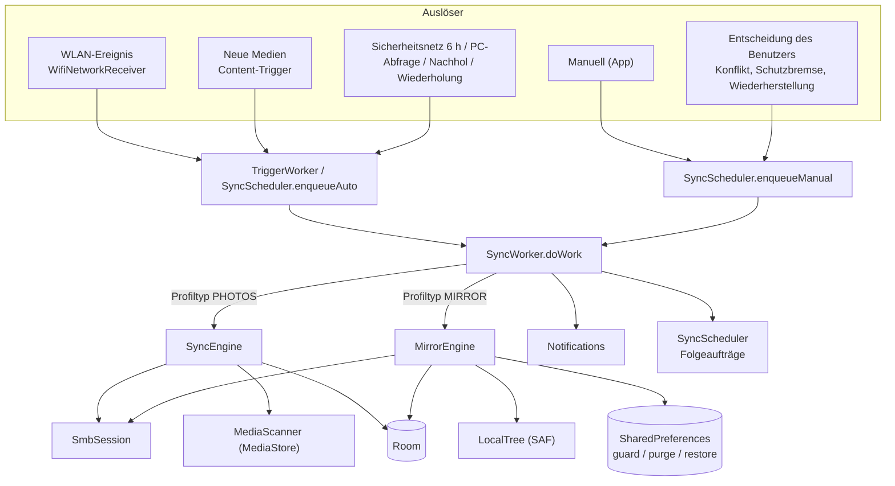
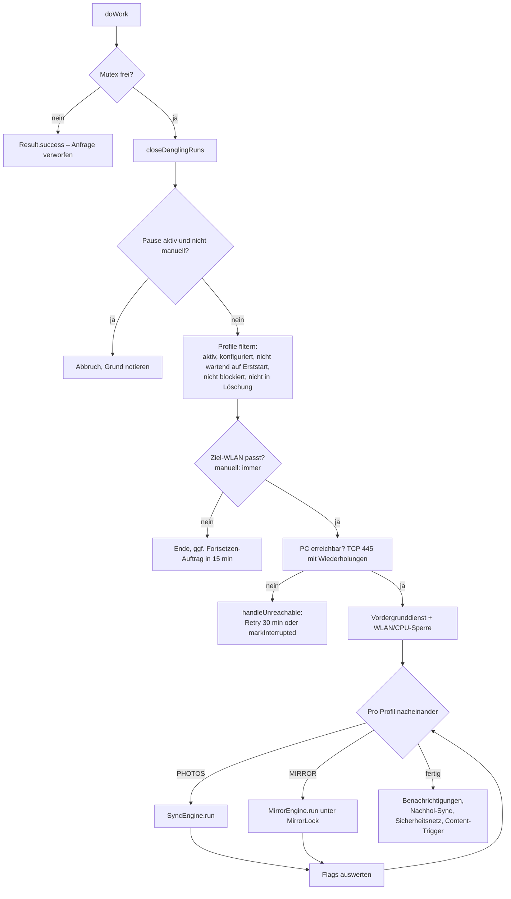
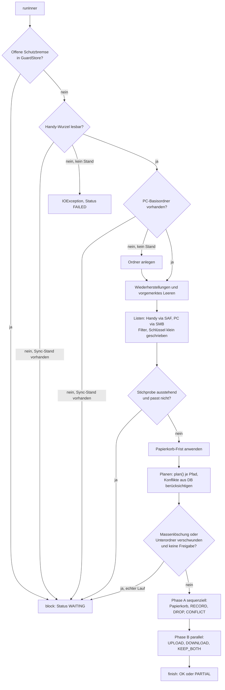
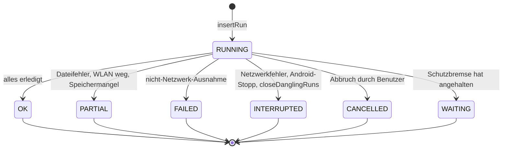
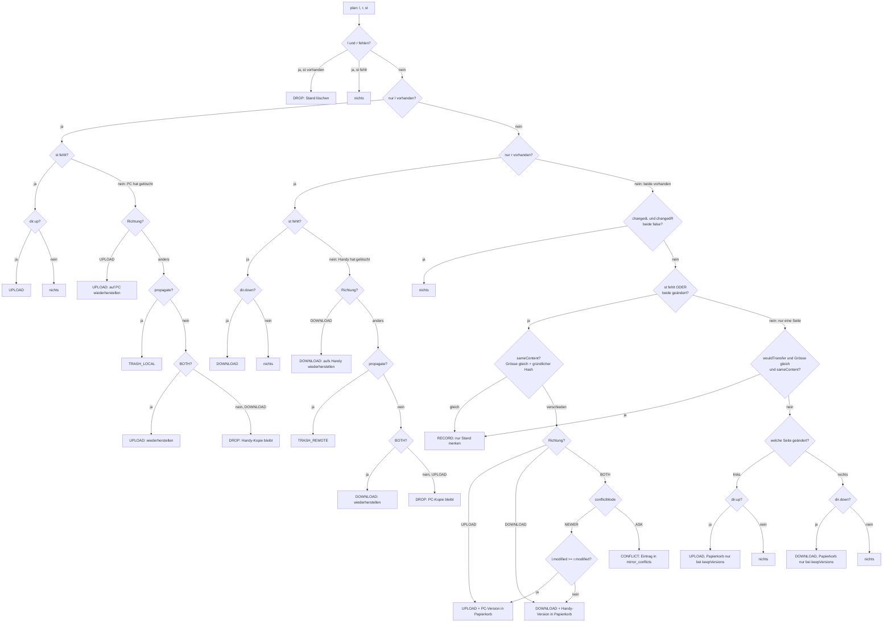
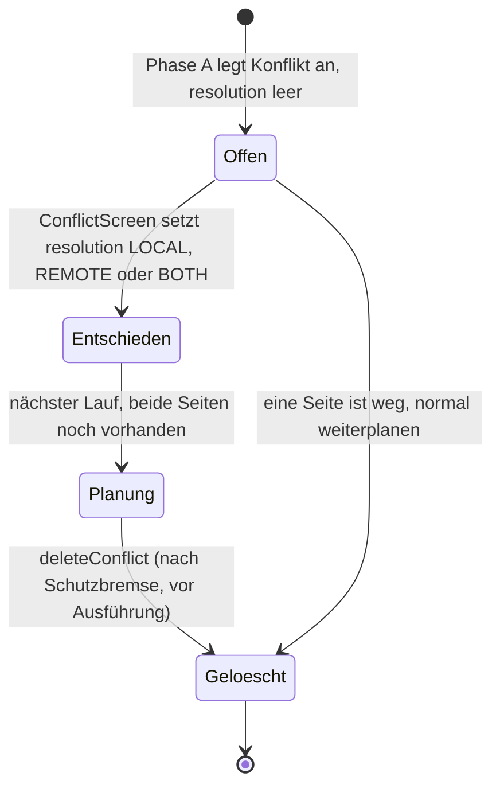
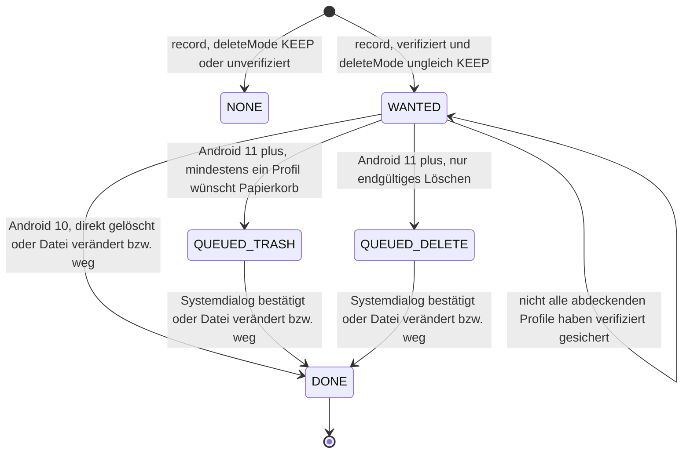

# Synchronisationsengine – LeoSync (Sync2PC)

> **Stand:** Version 0.11.0 (`version.properties`, DB-Version 6). **Massgebliche Quelle ist der Quellcode** unter
> `app/src/main/java/com/sync2pc/app/`. Dieses Dokument beschreibt ausschliesslich den **implementierten** Zustand.
> Geplantes steht nur in Abschnitt 18 und ist dort als „nicht umgesetzt“ gekennzeichnet.
>
> **Kennzeichnung im Text**
>
> | Marke | Bedeutung |
> |---|---|
> | **[IMPL]** | im Code nachweisbar umgesetzt |
> | **[RISIKO]** | umgesetzt, aber mit einer Lücke oder einem Datenverlust-Risiko, das hier benannt wird |
> | **[FEHLT]** | ein Schutz, den man erwarten könnte, existiert im Code nicht |
> | **[OFFEN]** | aus dem Code nicht eindeutig nachvollziehbar oder nicht geprüft |
>
> **Zuständigkeit dieser Datei:** Abläufe und Regeln der Synchronisation. Bibliotheken, Modulstruktur und Android-Details
> → `docs/ARCHITECTURE.md`; Tabellen und Spalten → `docs/DATA-MODEL.md`; Entscheidungsgründe (DEC-xxx) →
> `docs/DECISIONS.md`; Build und Testbefehle → `docs/TESTING.md`.

---

## Inhaltsverzeichnis

1. [Quellen und Analysegrundlage](#1-quellen-und-analysegrundlage)
2. [Überblick](#2-überblick)
3. [Synchronisationsablauf](#3-synchronisationsablauf)
4. [3-Wege-Abgleich (Ordner-Profile)](#4-3-wege-abgleich-ordner-profile)
5. [Konflikterkennung und Konfliktbehandlung](#5-konflikterkennung-und-konfliktbehandlung)
6. [Dateioperationen und Übertragung](#6-dateioperationen-und-übertragung)
7. [Löschlogik und Wiederherstellung](#7-löschlogik-und-wiederherstellung)
8. [Metadaten und Dateivergleich](#8-metadaten-und-dateivergleich)
9. [Synchronisationsprofile](#9-synchronisationsprofile)
10. [SMB-Kommunikation](#10-smb-kommunikation)
11. [Nebenläufigkeit und Hintergrundverarbeitung](#11-nebenläufigkeit-und-hintergrundverarbeitung)
12. [Fehlerbehandlung und Wiederanlauf](#12-fehlerbehandlung-und-wiederanlauf)
13. [Datenbank und Synchronisationszustand](#13-datenbank-und-synchronisationszustand)
14. [Kritische Invarianten und Schutzmechanismen](#14-kritische-invarianten-und-schutzmechanismen)
15. [Tests und bekannte Einschränkungen](#15-tests-und-bekannte-einschränkungen)
16. [Konkrete Beispiele](#16-konkrete-beispiele)
17. [Risikoregister](#17-risikoregister)
18. [Offene Fragen, Nicht-Geprüftes, Geplantes](#18-offene-fragen-nicht-geprüftes-geplantes)
19. [Abgrenzung und Verweise](#19-abgrenzung-und-verweise)

---

## 1. Quellen und Analysegrundlage

### 1.1 Tatsächlich gelesen (Zeile für Zeile)

| Bereich | Dateien (alle unter `app/src/main/java/com/sync2pc/app/`) |
|---|---|
| Engines | `sync/SyncEngine.kt` (Fotos), `mirror/MirrorEngine.kt` (Ordner), `sync/SyncRunner.kt` |
| Hintergrund | `sync/SyncWorker.kt`, `sync/SyncScheduler.kt`, `sync/TriggerWorker.kt`, `sync/Receivers.kt`, `sync/TransferLocks.kt`, `sync/PendingCheck.kt` |
| SMB / lokal | `smb/SmbSession.kt`, `mirror/LocalTree.kt`, `media/MediaScanner.kt` |
| Regeln | `mirror/MirrorGuard.kt`, `mirror/TransferPlan.kt`, `mirror/FileFilter.kt`, `sync/PartialHash.kt`, `sync/FolderNames.kt`, `sync/TargetResolver.kt`, `sync/Errors.kt` |
| Papierkorb | `mirror/TrashIndex.kt`, `mirror/TrashPolicy.kt`, `mirror/TrashPurge.kt`, `mirror/TrashCleaner.kt`, `mirror/RestoreManager.kt`, `mirror/MirrorLock.kt`, `mirror/FolderFreer.kt` |
| Löschen Fotos | `sync/DeletionManager.kt`, `sync/SpaceFreer.kt` (nur die ersten 120 Zeilen) |
| Daten | `data/Entities.kt`, `data/SyncDao.kt`, `data/AppDatabase.kt` (Migrationen), `data/GlobalSettings.kt` (nur `minFileAgeMinutes`, `parallelUploads`) |
| Tests | `MirrorGuardTest`, `TransferPlanTest`, `VerifyLevelTest`, `TrashPurgeTest`, `MigrationTest` (Inhalt gelesen); `TrashIndexTest` (Ausschnitt); übrige Testklassen nur über Testnamen und Grep nach Engine-Klassen |
| Doku | `docs/DECISIONS.md` (Abschnitte 2, 3, 4 teilweise, 7 teilweise, 8), `docs/ARCHITECTURE.md` (§7, §12–14), `docs/DATA-MODEL.md` (nur Überschriften), `PATCHNOTES.md` (Kopf), `version.properties` |

### 1.2 Nicht oder nur oberflächlich gelesen

`media/MediaAnalyzer.kt`, `geo/CountryLookup.kt`, `sync/WifiHelper.kt`, `sync/PauseService.kt`, `sync/Notifications.kt`,
`sync/StaleCheck.kt`, `backup/*`, `ui/*` (ausser `ConflictScreen`-Ausschnitt), `README.md`,
der Rest von `sync/SpaceFreer.kt`. Aussagen dazu sind als **[OFFEN]** gekennzeichnet oder verweisen auf DECISIONS.

### 1.3 Abweichungen zwischen Dokumentation und Code

| # | Dokumentation sagt | Code sagt | Hier gilt |
|---|---|---|---|
| A1 | `DECISIONS.md` DEC-035: „Der Ordner-Sync läuft sequenziell.“ | `MirrorEngine.runTransfers` führt Übertragungen mit 1–4 parallelen Workern aus (`MirrorEngine.kt:472`, seit 0.3.0 laut Kommentar). Nur Phase A (Verwaltung) ist sequenziell. | Code |
| A2 | Klassenkommentar `MirrorEngine` (Z. 47–56): „Ersetzte oder gelöschte Dateien landen immer in `.LeoSync-Papierkorb/<Datum>/…`“ | Der Papierkorb heisst seit 0.8.0 `.LeoSync-Bin` (`MirrorEngine.TRASH_DIR`). Ersetztes landet nicht „immer“ im Papierkorb: bei einseitiger Änderung nur mit `keepVersions` (Abschnitt 6.5). | Code |
| A3 | `DECISIONS.md` DEC-036: „… nie endgültig gelöscht“ | Der Papierkorb wird nach `trashRetentionDays` automatisch und von Hand geleert (`purgeTrash`, `TrashCleaner`). „Nie“ gilt nur für den Sync selbst. | Code |
| A4 | *(erledigt 2026-11-08)* Frühere Verweise auf die Unterstrich-Datei `docs/SYNC_ENGINE.md` (Arbeitsauftrag) | Datei entfernt; `ARCHITECTURE.md` §13 verweist auf `docs/SYNC-ENGINE.md`. | Diese Datei |
| A5 | `DECISIONS.md` DEC-037: „Beide behalten“ → `*_Konflikt-Handy.*` | Seit 0.8.0 `_conflict-phone` (`MirrorEngine.CONFLICT_SUFFIX`); DEC-037 selbst enthält den Nachtrag (DEC-164). | Code |
| A6 | `MirrorEngine`-Kommentar (Z. 52): „auf einer Seite gelöscht → optional übernehmen …, sonst wiederherstellen“ | Zutreffend für `BOTH`, `UPLOAD` und `DOWNLOAD` nur teilweise; bei der Richtung, die nicht zurückschreiben darf, wird nur der Sync-Stand verworfen (`DROP`), nicht wiederhergestellt (Abschnitt 4.5). | Code |

---

## 2. Überblick

### 2.1 Zweck

Die Engine hält Dateien zwischen einem Android-Handy und einem Windows-SMB-Share (PC/NAS) abgeglichen. Es gibt **zwei
voneinander unabhängige Engines**, die dieselbe Schnittstelle `SyncRunner` implementieren (`sync/SyncRunner.kt`):

| Engine | Profiltyp | Prinzip | Klasse |
|---|---|---|---|
| **Foto-Engine** | `PHOTOS` („Bildordner“) | Einweg Handy → PC, sortiert nach `Jahr\Monat[ - Land]`; Wiederholung erkannt über die Tabelle `synced_files`; **kein** 3-Wege-Abgleich | `sync/SyncEngine.kt` |
| **Ordner-Engine** | `MIRROR` („Ordner“) | 1:1-Spiegelung eines SAF-Ordners mit einem PC-Ordner, 3-Wege-Abgleich über `mirror_state` | `mirror/MirrorEngine.kt` |

Der **3-Wege-Abgleich existiert nur in der Ordner-Engine**. Die Foto-Engine erkennt weder Löschungen noch Änderungen auf dem
PC und kennt keine Konflikte (Abschnitt 3.2).

### 2.2 Komponenten und Verantwortlichkeiten

| Komponente | Datei | Aufgabe |
|---|---|---|
| `SyncScheduler` | `sync/SyncScheduler.kt` | Plant WorkManager-Aufträge (Auto, Manuell, Nachhol, Wiederholung, Fortsetzen, Sicherheitsnetz, PC-Abfrage, Pause) |
| `TriggerWorker` | `sync/TriggerWorker.kt` | Leichter Auslöser: ruft nur `enqueueAuto` |
| `WifiNetworkReceiver`, `BootReceiver` | `sync/Receivers.kt` | WLAN-Ereignis → `enqueueAuto`; Neustart/Update → `setupAll` |
| `SyncWorker` | `sync/SyncWorker.kt` | Eigentlicher Lauf-Koordinator: wählt Profile, prüft WLAN und PC-Erreichbarkeit, startet je Profil die passende Engine, Benachrichtigungen, Wiederholungen |
| `SyncEngine` | `sync/SyncEngine.kt` | Foto-Lauf eines Profils |
| `MirrorEngine` | `mirror/MirrorEngine.kt` | Ordner-Lauf eines Profils (Planung + Ausführung) |
| `GuardPolicy`, `GuardStore`, `MirrorGuard`, `FolderCheck` | `mirror/MirrorGuard.kt` | Schutzbremse (reine Regeln, Speicher in SharedPreferences, Benutzerantworten, Stichprobe bei Ordnerwechsel) |
| `SmbSession` | `smb/SmbSession.kt` | Alle SMB-Operationen (Auflisten, Hoch-/Herunterladen, Verschieben, Hashes) |
| `LocalTree` | `mirror/LocalTree.kt` | Alle Operationen im Handy-Ordner über das Storage Access Framework |
| `MediaScanner` | `media/MediaScanner.kt` | Fotos/Videos aus dem MediaStore (nur Foto-Engine) |
| `TargetResolver` | `sync/TargetResolver.kt` | Zielordner `Jahr\Monat` der Foto-Engine |
| `PartialHash`, `TransferPlan`, `FileFilter`, `FolderNames`, `TrashIndex`, `TrashPolicy`, `TrashPurge` | `sync/`, `mirror/` | Reine Regelobjekte (teilweise getestet, Abschnitt 15) |
| `RestoreManager`, `TrashCleaner`, `FolderFreer`, `SpaceFreer`, `DeletionManager` | `mirror/`, `sync/` | Eingriffe ausserhalb des Syncs (Wiederherstellen, Leeren, Speicher freigeben, Löschen nach Sync) |
| `MirrorLock` | `mirror/MirrorLock.kt` | Mutex zwischen Ordner-Lauf und Handeingriffen |
| `AppDatabase`, `SyncDao`, `Entities.kt` | `data/` | Room-Persistenz (Details → `DATA-MODEL.md`) |



### 2.3 Einstiegspunkte und Auslöser

Alle automatischen Läufe laufen über **einen** Worker-Typ (`SyncWorker`); `TriggerWorker` reiht nur ein.

| Auslöser | Einstieg | Verhalten |
|---|---|---|
| WLAN verbunden | `WifiNetworkReceiver.onReceive` → `enqueueAuto` | Drosselung 60 s, ausser `resumeOnWifi` gesetzt; nur wenn ein aktives Profil zur SSID passt (oder SSID unlesbar) **[IMPL]** |
| Neue Fotos/Videos | `armContentTrigger` (Content-URI-Trigger) → `TriggerWorker` | Wartet Mindestalter ab (`minFileAgeMinutes`, Standard 5); wird nach jedem Lauf neu scharf gestellt; mit `syncOffWifi` auch ausserhalb des WLAN |
| Sicherheitsnetz | `scheduleSafetyNet` | 6 h nach dem letzten Lauf, wird bei jedem Lauf nach hinten geschoben; mit `syncOffWifi` auch ausserhalb des WLAN |
| PC-Abfrage (Ordner-Profile) | `scheduleRemotePoll` | Periodisch, mindestens 15 min (WorkManager-Minimum), kürzestes Intervall aller aktiven Ordner-Profile |
| Nachhol-Sync | `enqueueFollowUp` | Für zu junge Dateien, frühestens nach 30 s |
| PC nicht erreichbar | `enqueueShareRetry` | Nach 30 min (bei Abbruch mitten im Lauf nach 2 min; ausserhalb des WLAN, nur mobile Daten/VPN, nach 2 h; seit 0.11.7) |
| WLAN-Unterbruch | `enqueueResume` + Receiver | Fortsetzen sobald WLAN da; gibt nach 24 h auf |
| Manuell | `enqueueManual` | Hebt eine Pause auf; keine WLAN-Bedingung (nur `CONNECTED`) |
| Benutzerentscheidung | `ConflictScreen.resolve` → `enqueueAuto`; `MirrorGuard.resolve`, `RestoreManager.request` → `enqueueManual` | Entscheidung wird erst im nächsten Lauf angewendet |
| Ende einer Pause | `pause()` → Auftrag `pause-end` | Löst `enqueueAuto` aus |
| Simulation (Trockenlauf) | `ui/PreviewScreen.kt` erzeugt die Engine **direkt** mit `dryRun = true` | Läuft **nicht** über `SyncWorker` und nimmt weder dessen Mutex noch `MirrorLock` |

### 2.4 Unterschiede der Profile (Kurzfassung)

Vollständige Vergleichstabelle in Abschnitt 9. Es gibt effektiv vier Verhaltensvarianten:
`PHOTOS` (immer Handy → PC), `MIRROR` mit Richtung `UPLOAD`, `DOWNLOAD` oder `BOTH`. Zusätzlich beeinflussen
`propagateDeletes`, `conflictMode`, `keepVersions`, `trashRetentionDays`, `massDeletePercent` und die Filter das Ordner-Verhalten;
`deleteMode` und `verifyLevel` das Foto-Verhalten.

---

## 3. Synchronisationsablauf

### 3.1 Koordination durch `SyncWorker` (beide Profiltypen)

`SyncWorker.doWork` (`SyncWorker.kt:57`) → `work()` (`:114`). Reihenfolge:

1. **Mutex:** `mutex.tryLock()` (prozessweit, `companion object`). Ist bereits ein Lauf aktiv, endet der Worker sofort mit `Result.success()` – die Anfrage wird **verworfen, nicht eingereiht** **[RISIKO]** (Abschnitt 11.2).
2. `dao.closeDanglingRuns()`: Läufe mit Status `RUNNING` (App wurde währenddessen beendet) werden auf `INTERRUPTED` gesetzt **[IMPL]**.
3. **Pause:** Nicht-manuell und `settings.isPaused()` → Lauf entfällt (Grund wird notiert).
4. **Profilauswahl:** aktiv (`enabled`), konfiguriert (`isConfigured`), bei automatischen Läufen nicht in `awaitingFirstStart` (neue Profile warten auf ersten manuellen Start, DEC-103), **nicht durch die Schutzbremse blockiert** (`GuardStore.blockedIds`), nicht gerade zum Löschen vorgemerkt (`PendingProfileDelete`).
5. **WLAN:** Automatisch nur Profile, deren Ziel-SSID zur aktuellen SSID passt; bei noch unlesbarer SSID bis zu 3× 5 s nachlesen. Manuell: alle. Mit Schalter `syncOffWifi` (seit 0.11.5, DEC-126) entfällt die SSID-Prüfung ausserhalb des WLAN: alle aktiven Profile sind berechtigt; im WLAN (auch VPN über WLAN) gilt weiter die SSID-Regel.
6. **PC-Erreichbarkeit** (`SmbSession.isReachable`, TCP Port 445, 3 s): automatisch im WLAN bis 5 Versuche (0, 5, 10, 15, 30 s), manuell 2 (0, 3 s), ausserhalb des WLAN (nur mobile Daten/VPN, seit 0.11.7) 2 (0, 5 s) (`NetworkRules.reachabilityWaits`). **Ausnahme:** Foto-Profile ohne übertragungsbereite Dateien (`PendingCheck.readyFiles == 0`) überspringen den Test. Danach folgt bei Profilen mit `GUID`/`BOTH` die Vorab-Prüfung der PC-Kennung (Abschnitt 6.0, seit 0.13.0).
7. **Vordergrunddienst:** `setForeground(...)`; scheitert das (Android 12+), normale Benachrichtigung. `TransferLocks.acquire` hält WLAN- und CPU-Sperre (max. 4 h).
8. **Schleife über alle lauffähigen Profile, nacheinander** (nicht parallel): Engine erzeugen (`MIRROR` → `MirrorEngine`, sonst `SyncEngine`), `engine.run()`, danach Flags auswerten:
   `engine.blocked` → Benachrichtigung „Entscheidung nötig“; `wifiLost && !manual` → `markInterrupted()`; `connectionFailed` → Profil zählt als „nicht erreichbar“ und der Lauf als mitten unterbrochen; `FAILED` → harter Fehler.
9. **Abschluss:** Sperren freigeben, Zusammenfassungs-Benachrichtigungen (Fehler, Übertragen, Entscheidungen, Konflikte, Speichermangel, Löschfreigaben), Nachhol-Sync für während des Laufs entstandene Medien (`MediaScanner.hasAddedSince`), `handleUnreachable` (Wiederholung bzw. `markInterrupted`; Wartezeit nach `NetworkRules.retryMinutes`: 30 min, mitten im Lauf 2 min, ausserhalb des WLAN immer 2 h; die Wartezeit endet durch neue WLAN-Verbindung, manuellen Start oder erfolgreichen Lauf, neue Auslöser (Fotos, Sicherheitsnetz, Ordner-Prüfung) ignorieren sie, DEC-126).
10. `finally` in `doWork`: Fortschritt entfernen; wenn von Android gestoppt (nicht vom Benutzer) und nicht manuell → `markInterrupted()`; Mutex freigeben; `armContentTrigger`; Sicherheitsnetz neu starten.

`doWork` gibt in allen regulären Pfaden `Result.success()` zurück (Engine-Ausnahmen werden in den Engines abgefangen); es gibt kein `Result.retry()` und kein `Result.failure()` im Code **[IMPL]**. Wiederholungen werden ausschliesslich über eigene Folgeaufträge erzeugt (Abschnitt 12).



### 3.2 Foto-Lauf (`SyncEngine.run`, `SyncEngine.kt:164`)

Kein Vergleich mit dem Zustand des PCs; der Lauf entscheidet allein aus dem Handy-Bestand und der Tabelle `synced_files`.

| # | Schritt | Details / Code |
|---|---|---|
| 1 | Lauf anlegen | `dao.insertRun(SyncRun(...))`; Status `RUNNING`; Logs älter 30 Tage und Läufe älter 90 Tage werden gelöscht (nicht bei `dryRun`). Seit 0.12.0 trägt der Lauf den Auslöser zusätzlich als Kennung (`triggerCode`, aus den Auftragsdaten `KEY_TRIGGER_CODE`, Rückfall auf den Text) und beim Abschluss den Kurztext als `messageCode`; `log()` schreibt Text und `code` aus derselben `Msg` (siehe `DATA-MODEL.md` 3.11). Anzeige und `RunGrouping.isIdle` lesen die Kennung (`RunSummary.NOT_IDLE_KEYS`), die Sync-Entscheidungen ändern sich nicht |
| 2 | Lokalen Bestand ermitteln | `MediaScanner.scan(...)` über MediaStore (`RELATIVE_PATH LIKE`, `IS_PENDING = 0`, `size > 0`; ab Android 11/API 30 zusätzlich `IS_TRASHED = 0`, minSdk 29) |
| 3 | Filter | `FileFilter(includePatterns, excludePatterns)` auf `relativePath + displayName` |
| 4 | Bekanntes aussortieren | `dao.syncedLite(profileId)` → Map `sourceKey`; **bekannt** = gleiche `size` **und** gleiches `dateModified` (Sekunden) → übersprungen ohne I/O |
| 5 | Mindestalter | `age = jetzt − max(dateAdded, dateModified) < minFileAgeMinutes` → „zu jung“, frühester Nachholzeitpunkt in `nextYoungFileAt` (nicht bei `dryRun`) |
| 6 | Nichts zu tun? | `todo.isEmpty()` → `finish(OK, NOTHING)` **ohne Netzwerkverbindung** |
| 7 | SMB öffnen | `SmbSession.open(profile)`; bei `dryRun` und Fehler → Offline-Vorschau |
| 8 | Analyse + Zielordner (Produzent, sequenziell) | `mediaInfo()` (Cache `media_info`, gültig bei gleicher `size`/`dateModified`; sonst `MediaAnalyzer`), `TargetResolver.resolve` → `Folder` oder `Ask` |
| 9 | Entscheidungsbedarf | `Ask` → Datei wird **nicht** übertragen, Gruppe wird gezählt; am Lauf-Ende als `PendingDecision` gespeichert (Abschnitt 13) |
| 10 | Übertragung (parallel) | `Channel<Job>(32)`, `parallelUploads` (1–4, Standard 3) Worker mit je eigener `SmbSession` |
| 11 | Pro Datei (`transfer`) | Namensvergabe unter `nameLock`, Duplikatprüfung, Upload mit Temp-Datei, Prüfung nach `verifyLevel`, erst dann `record()`. Wechselt ein Eintrag zwischen Scan und Lesen auf pending/trashed (`IllegalStateException` „Only owner is able to interact with pending/trashed item“, in `openLocal` als `LocalItemNotReadyException` gekapselt), wird die Datei still übersprungen (kein ✗, kein Fehlerzähler, kein Ausschluss); der nächste Lauf versucht sie erneut |
| 12 | Abschluss | Offene Entscheidungen speichern, `DeletionManager.sweep`, Status bestimmen, `finish(...)` |

Statusbestimmung: Standard `OK`; `failed > 0` → `PARTIAL`; WLAN weg → `PARTIAL`; Abbruch durch Android → `INTERRUPTED`; durch Benutzer →
`CANCELLED`; Verbindungsfehler → `INTERRUPTED` (+ `connectionFailed`); sonstiger Fehler → `FAILED`.

**Zielordner (`TargetResolver`, Reihenfolge)** **[IMPL]**: (1) gespeicherte Benutzerentscheidung `folder_mappings` (nur gültig, solange der Ordner existiert oder noch nie gesehen wurde), (2) Standardname `MM` bzw. `MM - Land` existiert bereits (auch in anderer App-Sprache), (3) umbenannte Ordner mit gleicher Monatszahl → Benutzer fragen, (4) Standardname neu anlegen.

**Duplikat- und Namenslogik in `transfer()`** **[IMPL]** (`SyncEngine.kt:533`):

1. Name = `FolderNames.sanitize(displayName)` (Windows-ungültige Zeichen → `_`).
2. Unter `sh.nameLock`: Ordnerliste des Ziels (gecacht je Lauf). Existiert der Name: gleiche Grösse **und** gleicher Teil-Hash (`PartialHash.compute`, Stufe „Wenig“) → „bereits vorhanden“, `record(..., verified = true)`, kein Upload. Sonst nächster Name `bild_2.jpg`, `bild_3.jpg`, … (`FolderNames.conflictName`).
3. Danach Duplikatsuche in den **anderen Ordnern desselben Monats** (gleicher Grundname, gleiche Grösse, gleicher Teil-Hash).
4. Name wird in `sh.reserved` eingetragen (gegen gleichzeitige Worker), Ordner wird angelegt.
5. Upload (Abschnitt 6.1), danach Grössen- und Inhaltsprüfung (Abschnitt 6.4), dann `record()`.

> **[RISIKO] R-F1:** Bei „bereits vorhanden“ wird `verified = true` gesetzt, **unabhängig von der gewählten Prüfstufe** des Profils – die Gleichheit stützt sich nur auf Name, Grösse und Teil-Hash (3 × 64 KB). Ist `deleteMode ≠ KEEP`, kann daraus die Freigabe zum Löschen des Handy-Originals entstehen (Abschnitt 7.5). Das Verhalten ist bewusst (DEC-021), umgeht aber die Stufen „Mittel/Viel/Alles“.

> **Konsequenz bei bearbeiteten Fotos:** Ändern sich Grösse oder Änderungsdatum einer bereits gesicherten Datei, gilt sie als „nicht bekannt“. Ist der Inhalt auf dem PC verschieden, wird sie als `name_2.ext` zusätzlich hochgeladen; die Zeile in `synced_files` (Schlüssel `profileId + sourceKey`) wird überschrieben und zeigt danach auf die neue Datei. Die alte PC-Datei bleibt unangetastet liegen.

### 3.3 Ordner-Lauf (`MirrorEngine.runInner`, `MirrorEngine.kt:145`)

`run()` umschliesst `runInner()` mit `MirrorLock.mutex.withLock` – ausser bei der Simulation (`MirrorEngine.kt:143`).

| # | Schritt | Details / Code |
|---|---|---|
| 1 | Lauf anlegen, alte Logs/Läufe löschen | wie Foto-Lauf |
| 2 | **Offene Schutzbremse?** | `guards.get(profileId) != null` → `block()` ohne weitere Arbeit |
| 3 | Berechtigung prüfen | `LocalTree.hasPermission` sonst `IOException` (`err_local_access_lost`) |
| 4 | Handy-Wurzel prüfen | `tree.stat(rootDocId) != null`; fehlt sie: mit vorhandenem Sync-Stand → `Guard(LOCAL_MISSING)`, ohne Stand → Fehler |
| 5 | SMB öffnen, PC-Basisordner prüfen | fehlt der Ordner: mit Sync-Stand → `Guard(REMOTE_MISSING)`; ohne Stand (Erstabgleich, nicht `dryRun`) → Ordner anlegen |
| 6 | Vorgemerkte Wiederherstellungen ausführen | `runRestores` (nur wenn keine Stichprobe ansteht); danach `runPendingPurges` (Abschnitt 7) |
| 7 | **Lokalen Bestand lesen** | `tree.listRecursive(skipTrash, recover = !dryRun)` – ausserdem `.s2pold`-Wiederherstellung (Abschnitt 6.3), dann `FileFilter`, Schlüssel = relativer Pfad **in Kleinbuchstaben** |
| 8 | **Entfernten Bestand lesen** | `s.listRecursive(s.path(), skipTrash)` mit demselben Filter |
| 9 | Konflikte laden | `dao.conflicts(profileId)` (alle, auch entschiedene) |
| 10 | **Stichprobe nach Ordnerwechsel** | `guards.pendingCheck` nicht leer: passt `folderMatches` nicht → `Guard(CHECK_FOLDER)`; sonst Vormerkung löschen |
| 11 | „Nicht löschen“-Einmalfreigabe | `guards.takeKeepFiles` → `propagate = false` für diesen Lauf |
| 12 | Papierkorb-Frist anwenden | `purgeTrash()` (nicht `dryRun`) |
| 13 | **Planen** | Schlüssel = Vereinigung aus lokal, entfernt und `mirror_state`; je Schlüssel Konfliktprüfung oder `plan(...)` → Liste von `Action` |
| 14 | **Schutzbremse für Löschungen** | `GuardPolicy.massDelete` / `vanishedFolder` auf die Löschaktionen; einmalige Freigabe `takeAllowDelete` wird **immer** verbraucht |
| 15 | Erledigte Konflikte entfernen | `dao.deleteConflict` – erst nach der Schutzbremse |
| 16 | **Phase A (sequenziell)** | `executeAdmin`: Papierkorb-Moves, `RECORD`, `DROP`, `CONFLICT` anlegen. Alle 10 Aktionen `shouldContinue()` prüfen |
| 17 | **Phase B (parallel)** | `runTransfers`: kleine Dateien zuerst, 1–4 Worker mit eigener `SmbSession`, Speicherbudget für Downloads |
| 18 | Abschluss | Status: `failed > 0` oder `spaceShortage` → `PARTIAL`; `finish(...)` |



### 3.4 Simulation (`dryRun = true`)

Gemeinsam: Es wird weder übertragen noch gelöscht; `log()` schreibt nichts; ein `SyncRun`-Datensatz mit `dryRun = true` wird trotzdem angelegt (Abfragen für Verlauf filtern `dryRun = 0`).

| Verhalten | Foto-Engine | Ordner-Engine |
|---|---|---|
| PC nicht erreichbar | Offline-Vorschau | Offline-Vorschau (`remote` leer; `sameContent` liefert `false`) |
| Nur die ersten N Einträge | `previewLimit` (EXIF/GPS lesen kostet Zeit) | `previewLimit` |
| Schutzbremse | – | Warnung im Ergebnistext, **kein** Blockieren (`massWarn`) |
| Papierkorb leeren, Wiederherstellen, `.s2pold`-Recovery, Konflikte speichern | – | werden **nicht** ausgeführt |
| Sperre | – | `MirrorLock` wird nicht genommen |

### 3.5 Laufstatus (`RunStatus`, `data/Entities.kt`)



`WAITING` entsteht nur in der Ordner-Engine. `INTERRUPTED` wegen toter App entsteht ausschliesslich über `closeDanglingRuns`
im **nächsten** `SyncWorker`-Lauf.

---

## 4. 3-Wege-Abgleich (Ordner-Profile)

### 4.1 Die drei Vergleichsstände

| Stand | Bedeutung | Herkunft im Code |
|---|---|---|
| **L** (lokal) | aktueller Zustand der Datei im Handy-Ordner | `LocalTree.listRecursive` → `LocalEntry(size, modified)`; Map `local` |
| **R** (remote) | aktueller Zustand der Datei auf dem PC | `SmbSession.listRecursive` → `RemoteEntry(size, modified)`; Map `remote` |
| **S** (Stand) | Zustand beider Seiten beim **letzten erfolgreichen** Abgleich dieser Datei | Tabelle `mirror_state`: `localSize/localModified/remoteSize/remoteModified`; Map `states` |

**Wichtig – abweichend vom Lehrbuch:** S speichert **zwei getrennte Zustände** (einen je Seite), nicht einen einzigen gemeinsamen Ausgangsinhalt. Eine Seite wird immer **nur mit ihrem eigenen früheren Zustand** verglichen (`L` gegen `S.local*`, `R` gegen `S.remote*`). Zeitstempel und Grössen der beiden Seiten werden **nicht gegeneinander** verglichen – ausser (a) bei `ConflictMode.NEWER` (Abschnitt 5.3) und (b) bei der Grössengleichheit vor dem Inhaltsvergleich. Das macht den Vergleich robust gegen die Tatsache, dass das Handy per SAF kein Änderungsdatum setzen kann (DEC-035/137).

Es gibt **keinen** gespeicherten gemeinsamen Inhalts-Hash. „Gleicher Inhalt“ wird bei Bedarf frisch berechnet (Abschnitt 8.3).

### 4.2 Wie S fortgeschrieben wird (und wann nicht)

`record(key, l, r)` (`MirrorEngine.kt:805`) schreibt `MirrorState` (Upsert). Aufrufstellen:

| Wo | Wann |
|---|---|
| `executeAdmin(RECORD)` | Inhalt auf beiden Seiten gleich (Hash) – nur Stand merken, keine Übertragung |
| `upload()` | nach erfolgreichem Upload: Handy-Eintrag `l` aus der Liste, PC-Eintrag per `s.stat` **nach** dem Umbenennen |
| `download()` | nach erfolgreichem Download: Handy-Eintrag per `tree.find` (Ordnerliste), PC-Eintrag `r` aus der Liste |

S wird **gelöscht** (`deleteMirrorState`) bei: `DROP`, `TRASH_LOCAL`, `TRASH_REMOTE`, **vor** jeder Übertragung mit Papierkorb der Gegenseite
(`trashOther`), vor `KEEP_BOTH`, zu Beginn einer Wiederherstellung, durch `FolderFreer` (Speicher freigeben) und durch „Als neu abgleichen“
(`clearMirrorState`).

S wird **nie** fortgeschrieben, wenn eine Übertragung übersprungen (`skipChanged`), fehlgeschlagen oder wegen Speichermangel ausgelassen wurde **[IMPL]**.
Ein offener Konflikt lässt S unverändert.

### 4.3 Änderungserkennung

```text
changedL = (S fehlt) ODER L.size != S.localSize ODER L.modified != S.localModified
changedR = (S fehlt) ODER R.size != S.remoteSize ODER R.modified != S.remoteModified
```

Vergleich ist **exakte Gleichheit** (`MirrorEngine.kt:356`). Es gibt keine Toleranz für Zeitstempel-Granularität (Abschnitt 8.4).
Gelöscht ist eine Datei, wenn sie in der eigenen Seitenliste fehlt, aber S existiert.
Neu ist eine Datei, die auf einer Seite vorkommt, während S fehlt.

### 4.4 Entscheidungsbaum von `plan()` (`MirrorEngine.kt:332`)



`dir.up` = Richtung ≠ `DOWNLOAD`; `dir.down` = Richtung ≠ `UPLOAD` (`SyncDirection`, `Entities.kt`).

### 4.5 Entscheidungstabellen

**Tabelle A – beide Seiten vorhanden** (S = Stand vorhanden/fehlt; „geändert“ siehe 4.3)

| S | L geändert | R geändert | Ergebnis |
|---|---|---|---|
| vorhanden | nein | nein | keine Aktion |
| vorhanden | ja | nein | Ist `dir.up`, Grösse gleich und Inhalt gleich → `RECORD`. Sonst `dir.up` → `UPLOAD` (PC-Version in Papierkorb **nur mit `keepVersions`**); sonst keine Aktion |
| vorhanden | nein | ja | Spiegelbildlich mit `dir.down` → `RECORD` / `DOWNLOAD` (Handy-Version in Papierkorb nur mit `keepVersions`) / keine Aktion |
| vorhanden | ja | ja | Inhalt gleich → `RECORD`. Sonst nach Richtung (Tabelle C) |
| fehlt | (ja) | (ja) | Erstabgleich dieser Datei: wie „beide geändert“ |

**Tabelle B – eine Seite fehlt**

| L | R | S | UPLOAD | DOWNLOAD | BOTH |
|---|---|---|---|---|---|
| ja | nein | fehlt (neu auf Handy) | `UPLOAD` | keine Aktion | `UPLOAD` |
| nein | ja | fehlt (neu auf PC) | keine Aktion | `DOWNLOAD` | `DOWNLOAD` |
| ja | nein | vorhanden (**PC hat gelöscht**) | `UPLOAD` (wiederherstellen, auch mit `propagate`) | `propagate` → `TRASH_LOCAL`, sonst `DROP` | `propagate` → `TRASH_LOCAL`, sonst `UPLOAD` |
| nein | ja | vorhanden (**Handy hat gelöscht**) | `propagate` → `TRASH_REMOTE`, sonst `DROP` | `DOWNLOAD` (wiederherstellen) | `propagate` → `TRASH_REMOTE`, sonst `DOWNLOAD` |
| nein | nein | vorhanden | `DROP` | `DROP` | `DROP` |

`propagate` = `Profile.propagateDeletes` (Standard **aus**), kann pro Lauf durch „Nicht löschen“ (`takeKeepFiles`) auf `false` gesetzt werden.

**Tabelle C – Inhalt verschieden, beide Seiten betroffen (Erstabgleich oder beide geändert)**

| Richtung | `conflictMode` | Ergebnis |
|---|---|---|
| UPLOAD | egal | Handy gewinnt: `UPLOAD`, PC-Version **immer** in den PC-Papierkorb (`trashOther = true`, unabhängig von `keepVersions`) |
| DOWNLOAD | egal | PC gewinnt: `DOWNLOAD`, Handy-Version **immer** in den Handy-Papierkorb |
| BOTH | `NEWER` | `l.modified >= r.modified` → `UPLOAD`, sonst `DOWNLOAD`; die unterlegene Version immer in den Papierkorb. Bei Gleichstand gewinnt das **Handy** |
| BOTH | `ASK` | `CONFLICT` – Eintrag in `mirror_conflicts`, Datei wartet (Abschnitt 5) |

### 4.6 Theorie gegen Implementierung

| Aspekt | Theoretischer 3-Wege-Merge | Tatsächlich implementiert |
|---|---|---|
| Basisstand | ein gemeinsamer Ausgangsinhalt | zwei seitenspezifische Metadaten-Stände (Grösse + Änderungszeit), kein Inhalt |
| Konflikt | beide ≠ Basis und L ≠ R | beide ≠ S **und** Inhalt (Hash) verschieden; Gleichheit wird nur bei gleicher Grösse geprüft |
| Löschen gegen Ändern | Konflikt | **kein Konflikt** – die Löschung gewinnt, die geänderte Version landet im Papierkorb (7.3, **R-D1**) |
| Umbenennen/Verschieben | wird oft erkannt | **nicht erkannt** – Löschung + Neuanlage (7.4, **R-D2**) |
| Textmerge | optional | nicht vorhanden – nur ganze Dateien |
| Ordner | Teil des Baums | nur Dateien; leere Ordner und Ordnerlöschungen werden nicht synchronisiert |
| Gleichheit trotz Änderung | – | `RECORD`: Zeitstempel-Verschiebung ohne Inhaltsänderung erzeugt keine Übertragung |
| Einweg-Richtungen | – | die „andere“ Seite wird bei einseitiger Änderung ignoriert (nur Wiederherstellen bzw. `DROP`) |

---

## 5. Konflikterkennung und Konfliktbehandlung

### 5.1 Konfliktarten

Implementiert sind folgende Konfliktfälle:

| Art | Bedingung | Ergebnis |
|---|---|---|
| **K1 – Beidseitige Änderung** (Ordner, `BOTH`, `ASK`) | `changedL && changedR` (oder Erstabgleich), Inhalt verschieden | `Action.CONFLICT`, Eintrag `mirror_conflicts` mit `resolution = NULL` |
| **K2 – Beidseitige Änderung** (`BOTH`, `NEWER`) | wie K1 | automatisch: neuere Datei gewinnt, Unterlegene in Papierkorb |
| **K3 – Beidseitige Änderung, Einweg-Profil** | wie K1, Richtung `UPLOAD`/`DOWNLOAD` | kein Konflikt: die Quelle gewinnt, Gegenseite in Papierkorb |
| **K4 – Änderung während des Laufs** | Zieldatei hat sich zwischen Einlesen und Schreiben verändert | Datei wird übersprungen (`skipChanged`, Log-Warnung), nächster Lauf sieht beide Stände |
| **K5 – Ziel entstand während des Laufs** | Download: Handy-Datei gab es beim Einlesen nicht, ist aber inzwischen da (`ChangedDuringRunException`) | Download wird abgebrochen und als „geändert“ übersprungen |
| **K6 – Namenskollision Fotos** | gleicher Zielname, anderer Inhalt | kein Konflikt-Dialog: `name_2.ext`, `name_3.ext` … |

Es gibt **keine** Konflikterkennung für: Löschen-gegen-Ändern (Abschnitt 7.3), Umbenennen gegen Ändern, Ordnerkonflikte,
unterschiedliche Gross-/Kleinschreibung (Abschnitt 8.5).

### 5.2 Kriterien

- **Auslöser:** beide Seiten seit S verändert (4.3).
- **Inhaltsvergleich** (`sameContent`, `MirrorEngine.kt:385`): ungleiche Grösse → sofort „verschieden“, **ohne** Hash; gleiche Grösse → `PartialHash.thorough` auf beiden Seiten (≤ 32 MB ganze Datei, sonst 32 Stichproben à 64 KB). Ohne SMB-Verbindung → `false`.
- **Zeitstempel** entscheiden nur bei `NEWER` (und im Dialog „Alle: neuere“). Sie stammen aus **verschiedenen Uhren/Anbietern** (SAF `lastModified` gegen SMB `lastWriteTime`).

> **[RISIKO] R-K1:** `NEWER` vergleicht `l.modified >= r.modified` über zwei unabhängige Quellen. Uhrenabweichung zwischen Handy und PC oder ein SAF-Anbieter, der beim Download die Schreibzeit statt der Originalzeit liefert, kann die „falsche“ Datei gewinnen lassen. Die unterlegene Version wird immer in den Papierkorb gelegt, ist also wiederherstellbar.

### 5.3 Konfliktlösungsstrategien

| Strategie | Wo gewählt | Wirkung im nächsten Lauf (`MirrorEngine.kt:236`) |
|---|---|---|
| **Handy behalten** (`KEEP_LOCAL` = `"LOCAL"`) | `ConflictScreen` | `UPLOAD`, PC-Version in Papierkorb |
| **PC behalten** (`KEEP_REMOTE` = `"REMOTE"`) | `ConflictScreen` | `DOWNLOAD`, Handy-Version in Papierkorb |
| **Beide behalten** (`KEEP_BOTH` = `"BOTH"`) | `ConflictScreen` | Handy-Datei → `<name>_conflict-phone.<ext>`, diese hochladen, PC-Version unter Originalnamen herunterladen |
| **Alle: neuere** | `ConflictScreen` (Knopf oben) | je Konflikt `KEEP_LOCAL`, wenn gespeichertes `localModified >= remoteModified`, sonst `KEEP_REMOTE` (Werte vom **Erkennungszeitpunkt**) |
| **Immer neuere** | Profil-Option `ConflictMode.NEWER` | automatisch ohne Rückfrage (Tabelle C) |

Vollautomatisch entschieden wird: K2, K3, K4, K5. Benutzereingriff erfordert: K1 (`ASK`).
Ein offener Konflikt (`resolution == NULL`) lässt die betroffene Datei **unberührt** (`continue`), alle anderen Dateien laufen weiter.

### 5.4 Speicherung und Weiterverarbeitung



- Tabelle `mirror_conflicts` (Schlüssel `profileId + relPath` in Originalschreibweise); Abgleich mit Dateien über `relPath.lowercase()`.
- Eine Entscheidung stösst per `SyncScheduler.enqueueAuto` einen Lauf an; ausgeführt wird sie dort, nicht im Dialog.
- `dao.deleteConflict` läuft **vor** der Ausführung der Übertragung (`MirrorEngine.kt:266`).

> **[RISIKO] R-K2:** Wird nach dem Löschen der Konfliktzeile und vor/während der Übertragung der Lauf unterbrochen (Netz weg, App beendet), ist die Entscheidung des Benutzers **verloren**. Beim nächsten Lauf gilt die Datei weiterhin als „beide geändert“ und wird erneut als Konflikt gemeldet. Es entsteht kein Datenverlust, aber der Benutzer muss erneut entscheiden.

> **[RISIKO] R-K3:** Der Benutzer sieht Grösse/Datum vom Erkennungszeitpunkt. Wird eine Seite danach nochmals geändert, gilt seine Wahl für die **aktuelle** Version dieser Seite. Die verworfene Seite landet in jedem Fall im Papierkorb (`trashOther = true`).

### 5.5 Auswirkungen auf Dateien

| Entscheidung | Handy-Datei | PC-Datei |
|---|---|---|
| Handy behalten / Handy neuer | bleibt | wird überschrieben; alte Version unter `.LeoSync-Bin\<Datum>\…` |
| PC behalten / PC neuer | wird ersetzt; alte Version in `.LeoSync-Bin/<Datum>/…` | bleibt |
| Beide behalten | Original wird zu `*_conflict-phone.*` (neue Datei im Sync-Stand), Originalname bekommt PC-Inhalt | `*_conflict-phone.*` neu hochgeladen, Originalname bleibt |

### 5.6 Sonderfälle

- Eine der beiden Seiten fehlt, obwohl ein Konflikt offen ist → Konfliktzeile wird verworfen, die Datei normal geplant (`MirrorEngine.kt:247`).
- `KEEP_BOTH` prüft **nicht**, ob sich Handy- oder PC-Datei seit dem Einlesen geändert haben, und der Umbenennungsname kann bereits existieren (Verhalten von `tree.rename` in diesem Fall: **[OFFEN]**, SAF-Anbieter-abhängig).
- `KEEP_BOTH`: Scheitert der Download der PC-Version nach dem Umbenennen, fehlt der Originalname auf dem Handy. Der Stand für den Originalschlüssel wurde vorher gelöscht; im nächsten Lauf gilt die PC-Datei als „neu auf dem PC“ und wird (bei `dir.down`, hier immer `BOTH`) geladen.
- Konflikte können nur in `BOTH` entstehen; in Einweg-Profilen nie.
- `MirrorConflict.localModified/remoteModified` sind nur Anzeigedaten (Dialog, „Alle: neuere“), keine Beweislage für die Ausführung.

---

## 6. Dateioperationen und Übertragung

### 6.0 PC-Erkennung vor dem Anmelden (DEC-204, DEC-205; im Code seit 0.13.0, Lernen überarbeitet in 0.13.1, **ungebaut und ungetestet**, Stand 2026-11-09)

Je Profil wählt `Profile.pcCheck` (`PcCheckMode`) die Erkennung: `WIFI` (nur WLAN-Name, Standard und heutiges Verhalten), `GUID` (nur PC-Kennung = SMB-Server-GUID) oder `BOTH` (beides muss erfüllt sein). Die Kennung wird nach dem Aushandeln gelesen, **vor** `authenticate`; Zugangsdaten gehen nur bei einer zulässigen Entscheidung an den Server.

**Ablauf (`SyncWorker`, `SmbSession`):**
1. TCP-Port 445 (`SmbSession.isReachable`, wie bisher, Abschnitt 2 Schritt 6).
2. **Vorab-Prüfung** nur bei `GUID`/`BOTH` (`SyncWorker.precheckPc` → `SmbSession.checkPc`): nur aushandeln und entscheiden, keine Anmeldung, **kein Lernzweig** (seit 0.13.1). Ergebnis: lauffähig / nicht erreichbar (Netzwerkfehler) / abgewiesen (`PcIdentityException`-Entscheidung) / sonstiger Fehler (wird wie «abgewiesen» behandelt, siehe unten). `WIFI` überspringt die Vorab-Prüfung. Je Host wird einmal je Lauf ausgehandelt (Host-Zwischenspeicher `PcSeen`, nur im Speicher, keine Datenbankänderung); die Entscheidung fällt je Profil mit dessen eigener gespeicherter Kennung.
3. **Anmeldeweg:** der einzige `authenticate`-Aufruf steht in `smb/PcLogin.kt` (Anmeldelogik hinter den Schnittstellen `PcLink`/`PcTransport`; `SmbSession` ist nur noch der smbj-Adapter, `SmbSession.connectChecked` bleibt der Zugang für `open` und `listShares`): `connect` → Kennung lesen (`getConnectionContext().getServerGuid()`) → `PcIdentity.decide` gegen den aktuellen DB-Stand (Profil per ID neu gelesen, der strengere Modus von Kopie und Datenbank, `currentIdentity`; ungespeichertes Profil: Werte der Kopie, ohne Lernen) → erst bei zulässiger Entscheidung `authenticate`. Sonst wird die Verbindung geschlossen und `PcIdentityException` geworfen (keine Zugangsdaten gesendet). Die Datenbank erreicht `SmbSession` über die Schnittstelle `PcStore` (`RoomPcStore`, gesetzt in `App.kt`).
4. **Lernen (nur Zugriffsart `SETUP`, DEC-205):** erst nach erfolgreicher Anmeldung **und** `connectShare` (bzw. Freigabenliste) schreibt der Commit die Kennung per bedingtem UPDATE (`SyncDao.learnPcGuid`: nur bei leerer Kennung oder anderem Host, mit Moduswächter `pcCheck = :mode`; nie still überschreibend). Gelernt wird nur an zwei Stellen: (a) nach dem Speichern des Profils (`PcLearner.learnAfterSave`, app-weiter Scope, nach dem Schreiben in der Datenbank, 30 s je SMB-Vorgang; Speichern gelingt immer; im Dialog «Wie weiter?» erscheint «PC wird erkannt …»), (b) in «Verbindung testen» (`SmbSession.test` mit `SETUP`). «Freigaben/Ordner wählen» meldet sich unter `SETUP` an, lernt aber nie. Ein automatischer Test beim Moduswechsel entfällt. Lernen und Neuvertrauen nur, wenn der Host der Verbindung dem gespeicherten Host des Profils entspricht.
5. **Kennungswechsel (Neuvertrauen, nur `SETUP`):** aushandeln, Kennung lesen, Verbindung **schliessen**, Benutzer fragen (`onChangedGuid`, Host, alte/neue Kennung), bei «Ja» neu verbinden und prüfen, dass die gesehene Kennung **genau der bestätigten** entspricht (sonst abbrechen, nicht anmelden), erst dann `authenticate`, danach `trustNewPcGuid` (gilt für alle Profile mit gleichem Host und gleicher alter Kennung). «Nein»/Zeitüberschreitung = nicht vertrauen.

**Grundsatz «`WIFI`-Kennung erzeugt nie Vertrauen» (V7):** eine im Modus `WIFI` still gelernte Kennung gilt bei `GUID`/`BOTH` als leer. Zentral in `currentIdentity` (`trustedStored`: gespeicherte Kennung zählt nur, wenn der DB-Modus nicht `WIFI` ist, wenn der wirksame Modus `GUID`/`BOTH` ist) und im Editor in `save()` über `PcEditorRules.keepStoredOnSave` (Kennung bleibt nur, wenn Host und Modus unverändert; sonst verworfen). Das Lernen im Modus `WIFI` bleibt still (Meldung aus -055), erzeugt aber nie Vertrauen.

**Regel `PcIdentity.decide(mode, pcGuid, pcGuidHost, host, seenGuid, access, learnNetOk)`** (reine Funktion; `PcAccess.AUTO` = automatisch, `USER` = vom Benutzer ausgelöst (manueller Sync, Ansichten), `SETUP` = Profil-Editor):

| Entscheidung | Bedingung |
|---|---|
| `ALLOW` | `WIFI` (mit bekannter oder fehlender Kennung); oder `GUID`/`BOTH` mit gespeicherter, gleicher Kennung |
| `ALLOW_AND_LEARN` | `GUID`/`BOTH` ohne gespeicherte Kennung für den Host, nur bei `SETUP` **und** `learnNetOk`; `WIFI` lernt weiterhin still (ohne Vertrauenswirkung, siehe Grundsatz) |
| `WRONG_NET` | wie `ALLOW_AND_LEARN`, aber `learnNetOk` nicht erfüllt: nicht anmelden (eigener Text `smb_err_pc_wrong_net`) |
| `UNKNOWN` | `GUID`/`BOTH` ohne gespeicherte Kennung bei `AUTO`/`USER`: nicht anmelden (Hinweis «Profil öffnen → Verbindung testen», `smb_err_pc_unknown`) |
| `CHANGED` | gespeicherte Kennung weicht von der gesehenen ab: nicht anmelden; Neuvertrauen nur durch den Benutzer unter `SETUP` (Ablauf Schritt 5, nur bei gespeichertem Profil) |
| `NO_ID` | `GUID`/`BOTH`, der Server liefert keine brauchbare Kennung (leer oder Null-UUID): nie anmelden |

**Netzbedingung `learnNetOk`** (reine Funktion `NetworkRules.learnNetOk`, im Aufrufer ermittelt): `BOTH` → WLAN-Name lesbar und in der Liste des Profils (unlesbar = nicht erfüllt); `GUID` → immer erfüllt. Einrichtungsausnahme (Restrisiko R1, DEC-205): unter `SETUP` wird bei `GUID` ohne bekannte Kennung in jedem Netz angemeldet, bei `BOTH` nur im eingetragenen WLAN. Für **bestehende** Profile mit Hostwechsel ist R1 durch eine Rückfrage vor dem Senden der Zugangsdaten geschlossen (DEC-208, `PcEditorRules.needsHostConfirm`: Modus `GUID`/`BOTH`, Host gegenüber gespeichertem Stand geändert, in der Sitzung noch nicht bestätigt; greift vor Speichern, 
Eine gespeicherte Kennung gilt nur, wenn `pcGuidHost` dem aktuellen Host entspricht (ohne Gross-/Kleinschreibung), sonst gilt sie als unbekannt.

**`PcIdentityException`** ist bewusst keine `IOException` und kein Netzwerkfehler (`isNetworkError` wertet sie als `false`): ein Wiederholen ändert nichts, es wurden keine Zugangsdaten gesendet. Die Vorschau (`SyncEngine`) fängt sie sicher als Offline ab.

**Verhalten bei Abweisung (`SyncWorker`, seit 0.13.1):** das Profil wird übersprungen (`noteSkip` mit `skip_pc_not_recognised`), **kein** FAILED-Lauf. Das gilt auch für Fehler der Vorab-Aushandlung (`PcPre.Failed`, z. B. nur SMB1, unerwarteter Status, Kennung nicht lesbar): eine Meldung je Profil (`GlobalSettings.pcNotified`; der Merker wird gelöscht, sobald das Profil wieder lauffähig ist), keine Dauerbenachrichtigung, kein stilles Überspringen; manuell: Benachrichtigung mit Hinweis. **Kein Timer und kein `shareRetryAt`** für abgewiesene Profile (Port 445 antwortet, die Abweisung ändert nur der Benutzer); sie werden beim nächsten ohnehin stattfindenden Lauf mit einer einzelnen Aushandlung neu bewertet. Die mehrstufige Wartezeit `reachabilityWaits` betrifft nur Port 445 (nicht erreichbar). Der Timer für nicht erreichbare PCs (`handleUnreachable`: 30 min, mitten im Lauf 2 min, ausserhalb des WLAN 2 h) wird nur gesetzt, wenn **kein** Profil lief (frühe Rückkehr) bzw. wenn die Verbindung mitten im Lauf abbrach; ein erreichbares Profil blockiert die anderen nicht (DEC-126/DEC-048 unverändert). Ein Fortsetzen-Auftrag mit nur abgewiesenen Profilen räumt «Pausiert» auf. Die Trigger sind global (Content-Trigger, periodischer Poll, WLAN-Empfänger), nicht je Profil; die Logik fügt keine hinzu, nur eine Aushandlung je Host und Lauf.

**Eignung je Modus:** `NetworkRules.needsWifiName(mode)` (nur `GUID` braucht keinen Namen), `eligible`, `mayContinue(mode, …)` (bei `GUID` nur die erlaubte Netzart) und `wifiTriggerMatches` (`GUID` = jedes WLAN; Parameter `unreadableMatches` für den Fall ohne lesbaren Namen). Genutzt von `SyncWorker` (das 15-s-Warten auf den WLAN-Namen nur, wenn ein Profil ihn braucht), `Receivers` (`WifiNetworkReceiver`, `unreadableMatches = true`) und `PauseService` (Fortsetzen, `unreadableMatches = false`). Bei `WIFI`/`BOTH` gilt ein unlesbarer Name als nicht erfüllt, nie stillschweigend als erfüllt (Ausnahme laut Code: `WifiNetworkReceiver` wertet einen unlesbaren Namen als Treffer, `unreadableMatches = true`). Der Standortzugriff (`Permissions`) wird nur bei `WIFI`/`BOTH` mit WLAN-Namen verlangt. Manueller Sync: `WIFI` ohne Prüfung, `GUID`/`BOTH` mit Vorab-Prüfung; er lernt **nie** (seit 0.13.1, DEC-205): ohne bekannte Kennung `UNKNOWN`, keine Anmeldung.

**Nicht über die Vorab-Prüfung:** Papierkorb, Wiederherstellen, Speicher freigeben (`TrashCleaner`, `RestoreManager`, `FolderFreer`, `SpaceFreer`, `MirrorGuard`) und die Engines nutzen `AUTO`; ohne bekannte Kennung melden sie sich bei `GUID`/`BOTH` nicht an. `MirrorGuard`/`MirrorEngine` und `SyncEngine` laufen über denselben Anmeldeweg.

**Sicherheitsaussage:** Die Kennung ist nicht geheim (unverschlüsselt in der Aushandlung). `GUID`/`BOTH` schützen vor einem fremden Server in einem fremden Netz mit gleicher IP, nicht vor einem gezielten Angreifer, der die Kennung zuvor im eigenen Netz las. `WIFI` behält die bekannte Schwäche (fremdes Netz mit gleichem Namen). Restrisiken: Akku bei `GUID` in fremden WLANs (Prüfung alle 30 min), Stabilität der Kennung bei Samba/NAS (ungeprüft).

> **Umgesetzt in 0.13.1 (DEC-205, ungebaut, ungetestet, nichts im Gerät geprüft):** Beschreibung oben = Stand des Codes laut Development SYNC-20261109-055. Offen: Bau, Tests, Gerätetest (QA). Bekannte Restpunkte: Ein sofortiger manueller Start direkt nach dem Speichern kann das Lernen knapp verpassen (R5, einmalig «PC unbekannt»); manueller Sync und wiederhergestellte Sicherungen lernen nicht mehr (R3); das Zeitlimit von 30 s gilt je SMB-Vorgang, nicht gesamt; die Einrichtungsausnahme gilt bei Ersteinrichtung weiterhin ohne Rückfrage; bei Hostwechsel eines bestehenden Profils fragt die App seit 0.13.14 (DEC-208, gebaut; Sicherheits-QA -081 offen; UI-Verdrahtung ohne Test, der Picker kann den Host über `onPick` setzen, der nächste Klick fragt erneut).

### 6.1 Hochladen (`SmbSession.upload`, `SmbSession.kt:301`) **[IMPL]**

1. Zieldatei `<finalPath>.s2ptmp` (Konstante `SmbSession.TEMP_SUFFIX`).
2. Vorhandene Temp-Datei: Fortsetzen nur wenn `TransferPlan.resumeOffset(tmpSize, tmpModified, size, modifiedMillis)` > 0 (Temp kleiner als Original **und** Original-Änderungszeit ≤ Temp-Änderungszeit; unbekannte Zeiten → 0) **und** ein `expectedHash` übergeben wurde; sonst `offset = 0` und `FILE_OVERWRITE_IF`.
3. Quelle ab `offset` öffnen, in 1-MB-Blöcken lesen/schreiben; vor jedem Block `checkCancel()`.
4. `offset != size` → `IOException` (unvollständig).
5. Nach Fortsetzen: Teil-Hash der Temp-Datei muss `expectedHash()` entsprechen, sonst `deleteOnClose` + `IOException` (nächster Versuch beginnt neu).
6. Änderungs-/Erstelldatum der Temp-Datei auf das Originaldatum setzen (Fehler ignoriert: „nice to have“).
7. `f.rename(finalPath, replaceExisting)` – Foto: `false` (kein Überschreiben), Ordner: `true`.

Zugriffe: Foto-Engine `openAt(item, offset)` über `ContentResolver` (mit `setRequireOriginal` für GPS), Ordner-Engine `tree.openInput(docId, offset)`.

### 6.2 Herunterladen (`LocalTree.writeFileResumable`, `LocalTree.kt:273`, und `SmbSession.download`) **[IMPL]**

1. Elternordner anlegen (`ensureDir`, `@Synchronized`), Geschwisterliste lesen.
2. `expectNew` (Datei gab es beim Einlesen nicht) und Datei existiert inzwischen → `ChangedDuringRunException`.
3. Vorhandene `<name>.s2ptmp` auf dem Handy: `TransferPlan.resumeOffset(...)`; >0 → Anhängen im Modus `"wa"` (Anbieter ohne Unterstützung: Temp löschen, neu beginnen); sonst Temp löschen und neu.
4. Schreiben in die Temp-Datei, danach **Grössenprüfung** (`stat(...).size == expectedSize`); Abweichung → Temp löschen, `IOException`.
5. `replaceWith(...)`: siehe 6.3.

> **[RISIKO] R-T1:** Das Fortsetzen von **Downloads** prüft keinen Inhalt – nur Grösse und Zeitstempelheuristik (`resumeOffset`). Beim **Upload** dagegen ist ein Hash Pflicht (DEC-131). Eine PC-Datei, die mit gleicher Grösse und rückdatiertem Zeitstempel ersetzt wurde, könnte als Mischung zweier Versionen enden. Der Fall ist unwahrscheinlich; ein Test existiert nicht.

### 6.3 Datei sicher ersetzen auf dem Handy (`replaceWith`, `LocalTree.kt:247`) **[IMPL]**

```
alte Datei  → "<name>.s2pold"   (umbenennen)
Temp-Datei  → "<name>"          (umbenennen)
"<name>.s2pold" löschen
```

Scheitert das Umbenennen der Temp-Datei, wird die alte Version zurückbenannt (Temp bleibt liegen, wird nie synchronisiert).
**Recovery nach Absturz** in `LocalTree.listRecursive(recover = true)` (nur echte Läufe): Existiert `<name>.s2pold`, aber `<name>` nicht → zurückbenennen (alte Version gilt); existiert beides → `.s2pold` löschen.
Auf dem **PC** gibt es kein `.s2pold`: dort ersetzt `rename(replace = true)` die Datei serverseitig in einem Schritt.

### 6.4 Prüfung und Konsistenz

**Foto-Engine** (`SyncEngine.transfer`, `:602`): nach dem Upload immer `smb.fileSize(finalPath) == item.size`; zusätzlich je `verifyLevel`:

| Stufe | Code | Prüfung der Zieldatei |
|---|---|---|
| Aus | 0 | nur Grösse; gilt **nicht** als verifiziert |
| Wenig | 1 | Teil-Hash (3 × 64 KB, ≤ 192 KB ganz) |
| Mittel (Standard) | 2 | ≤ 32 MB ganze Datei, darüber 32 Stichproben à 64 KB |
| Viel | 3 | ≤ 256 MB ganz, darüber 128 Stichproben à 64 KB |
| Alles | 4 | ganze Datei |

Weicht Grösse oder Hash ab, wird die eben hochgeladene Zieldatei gelöscht (`smb.delete`), `IOException(eng_err_verify)` geworfen, die Datei zählt als `failed`, und `record()` wird **nicht** aufgerufen **[IMPL]**. Wer löscht (`deleteMode ≠ KEEP`), prüft mindestens auf „Mittel“ (`Profile.verify()`); `OFF` wird dann angehoben.

**Ordner-Engine:** Nach Upload nur `s.stat(path)` – Datei muss existieren und die Grösse stimmen. Nach Download Grössenprüfung gegen `r.size` (im `writeFileResumable` und in `download()`).
**Ein Inhalts-Hash nach der Übertragung wird in der Ordner-Engine nicht berechnet.** **[FEHLT]** (Risiko R-T2: Bit-Fehler bei gleicher Grösse bliebe unentdeckt; die Übertragung läuft über TCP/SMB mit eigener Integrität, ein zusätzlicher Schutz ist aber nicht vorhanden.)

### 6.5 Überblick der Operationen (Ordner-Engine)

| Operation | Aktion (`Kind`) | Ablauf |
|---|---|---|
| Neue Datei übertragen | `UPLOAD` / `DOWNLOAD` | Zielordner anlegen, Temp, Umbenennen, `record` |
| Vorhandene aktualisieren (einseitig) | `UPLOAD`/`DOWNLOAD` mit `trashOther = keepVersions` | mit `keepVersions` zuerst Gegenseite in den Papierkorb |
| Ersetzen (beidseitig, Erstabgleich, Entscheidung) | `UPLOAD`/`DOWNLOAD` mit `trashOther = true` | **immer** zuerst Gegenseite in den Papierkorb |
| Kopieren | – | es gibt kein eigenständiges „Kopieren“; Kopie = Neuanlage |
| Verschieben/Umbenennen | – | nicht erkannt (7.4); nur interne Moves in den Papierkorb, bei Wiederherstellung und `KEEP_BOTH` |
| In den Papierkorb | `TRASH_LOCAL`, `TRASH_REMOTE` | Abschnitt 7 |
| Löschen (endgültig) | – | nur durch Frist/Handeingriff am Papierkorb, nie durch den Sync selbst |
| Wiederherstellen | `runRestores` | Abschnitt 7.6 |
| Wiederholen | – | Wiederholung ist implizit: jeder Lauf plant aus dem Ist-Zustand neu; fehlgeschlagene Dateien haben keinen Stand und werden erneut versucht |

**Reihenfolge der Ausführung in Phase B:** nach Grösse aufsteigend (`TransferPlan.smallFirst`) – bei Abbruch sind möglichst viele Dateien fertig.

**Fortschritt:** `emitShared` höchstens alle 700 ms (ausser Schluss); Bytes = fertige + laufende (`inflight`); gemeldet über `onProgress` an `SyncWorker` → Benachrichtigung und `setProgressAsync`.

**Speicherbudget Downloads:** `freeSpace() − 300 MB`; gemeinsamer Zähler, jeder Download (und `KEEP_BOTH`) reserviert die PC-Dateigrösse; reicht das Budget nicht, wird die Datei übersprungen und `spaceShortage = true` gesetzt (Status `PARTIAL`).

**Sicherheitsmechanismen gegen Datenverlust (Zusammenfassung, Details Abschnitt 14):** Temp-Datei + Umbenennen, `.s2pold`, Papierkorb vor Überschreiben, Stand zuerst löschen, Prüfung auf Änderung während des Laufs, Schutzbremse, Stichprobe, Hash-Pflicht beim Fortsetzen von Uploads.

---

## 7. Löschlogik und Wiederherstellung

### 7.1 Wie Löschungen erkannt werden

| Profiltyp | Erkennung |
|---|---|
| **Ordner** | Datei fehlt in der Seitenliste, `mirror_state` existiert (Tabelle B). **Nur die Existenz von S zählt**, nicht der Zeitpunkt. |
| **Fotos** | **Keine Löschungserkennung.** Weder das Löschen auf dem Handy noch auf dem PC wird bemerkt oder propagiert. `synced_files`-Zeilen bleiben bestehen. |

Verlass auf vollständige Listen: Ist eine Seitenliste unvollständig, sähe die Engine Löschungen. Schutz dagegen:

- `LocalTree.children` wirft bei `null`-Cursor einen Fehler statt „leer“ zu liefern (`LocalTree.kt:81`) **[IMPL]**.
- Fehlende Basisordner beider Seiten → Schutzbremse `LOCAL_MISSING`/`REMOTE_MISSING`.
- Massenlöschung und verschwundene Unterordner → `MASS_DELETE`.
- `SmbSession.listDir` liefert für **nicht existierende** Unterordner eine **leere Liste** statt eines Fehlers (`SmbSession.kt:156`). Ein vollständig fehlender Unterordner wird so als „alle Dateien gelöscht“ gesehen und von `vanishedFolder`/`massDelete` abgefangen, **nicht** aber, wenn er höchstens 5 Dateien enthält und das Profil grösser ist **[OFFEN/RISIKO]**.

### 7.2 Aktionen bei erkannter Löschung

| Aktion | Ablauf |
|---|---|
| `TRASH_LOCAL` | `tree.moveToTrash(rel, l, today)` → `.LeoSync-Bin/<yyyy-MM-dd>/<Unterordner>/<Name>`, dann `deleteMirrorState` |
| `TRASH_REMOTE` | `trashRemote` → `<Basis>\.LeoSync-Bin\<Datum>\<Unterordner>\<Name>` (`SmbSession.move`), dann `deleteMirrorState` |
| `DROP` | nur `deleteMirrorState`; die verbliebene Kopie bleibt unverändert und wird später als „neu“ ohne Stand behandelt |
| Wiederherstellung (Löschung rückgängig, `UPLOAD`/`DOWNLOAD` aus Tabelle B) | normale Übertragung; S fehlt → entsteht neu durch `record` |

Namenskollision im Papierkorb am selben Tag: `TrashIndex.uniqueTrashName` → `a (14-32-05).txt`, bei gleicher Sekunde `a (14-32-05-2).txt`. Bis 0.6.x hiessen Duplikate `a_2.txt`; `TrashIndex.originalName` erkennt beide Schemata.
Papierkorbnamen: aktuell `.LeoSync-Bin`; ältere `.LeoSync-Papierkorb` (0.0.12–0.7.x) und `.Sync2PC-Papierkorb` (≤ 0.0.11) werden weiter erkannt, gelistet und geleert (`MirrorEngine.TRASH_DIRS`) und sind per `FileFilter.ALWAYS_EXCLUDED` sowie `skipTrash` von der Synchronisation ausgeschlossen.

### 7.3 Löschen gegen Ändern

`plan()` betrachtet bei fehlender Gegenseite **nicht**, ob die vorhandene Seite seit S geändert wurde.

> **[RISIKO] R-D1 – Löschung überstimmt Änderung.** Fall: PC löscht `a.txt`, Handy hat `a.txt` danach bearbeitet. Mit `propagate = true` (Richtung ≠ `UPLOAD`) ergibt sich `TRASH_LOCAL`: die **bearbeitete** Handy-Version wird in den Handy-Papierkorb verschoben, kein Konflikt. Spiegelbildlich für `TRASH_REMOTE`. Ohne `propagate` und Richtung `BOTH`/`UPLOAD` wird die bearbeitete Datei stattdessen wiederhergestellt (sicher). Die Datei bleibt im Papierkorb wiederherstellbar (Frist `trashRetentionDays`, Standard 30 Tage). Es existiert kein Test für diesen Fall.

### 7.4 Umbenennen und Verschieben

> **[RISIKO] R-D2:** Eine Umbenennung ist für die Engine „alter Pfad gelöscht + neuer Pfad neu“. Mit `propagate = false` (Standard) wird der alte Pfad auf der Gegenseite **wiederhergestellt** (BOTH/DOWNLOAD bzw. UPLOAD) → die Datei liegt danach unter beiden Namen. Mit `propagate = true` wird die alte Datei der Gegenseite in den Papierkorb verschoben und die neue übertragen (Daten bleiben erhalten, ein zusätzlicher Transfer entsteht). Es gibt keine Umbenennungserkennung (Hash, Datei-ID). Gleiches gilt für Ordnerumbenennungen: der ganze Inhalt wird neu übertragen und – mit `propagate` – die alte Struktur in den Papierkorb verschoben (Schutzbremse: `vanishedFolder`).

### 7.5 Löschen nach dem Sync (nur Fotos)

`DeletionManager.sweep` (am Ende jedes echten Foto-Laufs), Zustandsautomat `DeleteState`:



Regeln **[IMPL]**:

- Eine Datei wird nur freigegeben, wenn **alle aktiven Foto-Profile, die ihren Ordner abdecken** (`covers`: Ordner, Unterordner-Option, Bild/Video-Typ), sie `verified` gesichert haben (`syncedAllProfiles`).
- „Papierkorb gewinnt“, wenn irgendein abdeckendes Profil nur Papierkorb wünscht.
- Android 11+ (API 30): nie ohne **Systemdialog** (`MediaStore.createTrashRequest`/`createDeleteRequest`, Pakete à 500). Android 10: direkt, vorher `stillSame` (Grösse gleich, sonst `DONE` ohne Löschung).
- `stillSame` vergleicht **nur die Grösse** der Datei (`MediaStore.MediaColumns.SIZE`); eine bearbeitete Datei mit identischer Grösse würde nicht erkannt. **[RISIKO]** gering; vor dem Löschen prüft `buildRequests` ebenfalls nur die Grösse.
- Zusammenhang mit R-F1: Eine als „bereits vorhanden“ erkannte Datei erhält `verified = true` nach Teil-Hash – unabhängig von der Prüfstufe.

`SpaceFreer` („Speicher freigeben“, Fotos) prüft vor dem Entfernen jede Datei erneut auf dem PC (Pfad aus der DB, sonst andere Ordner des Monats, Grösse; zusätzlich Hash). Details in `DECISIONS.md` DEC-091/136; der Rest der Datei wurde hier nicht gelesen (**[OFFEN]**). `SpaceFreer` nimmt keinen `MirrorLock` und keinen Worker-Mutex (nur `ensureActive` im Prüfablauf).

### 7.6 Papierkorb, Frist und Wiederherstellung (Ordner-Profile)

**Speicherort:** je Seite `<Profilordner>/.LeoSync-Bin/<yyyy-MM-dd>/<ursprünglicher Unterpfad>/<Name>`.

**Automatische Frist** (`purgeTrash`, `MirrorEngine.kt:781`): `trashRetentionDays > 0` → `PurgeRule(OLDER, before = cutoff)` – löscht ganze Datumsordner, deren Name `yyyy-MM-dd` **vor** dem Stichtag liegt; andere Namen werden nie gelöscht (`TrashPolicy.isExpired`). Vorgemerkte Wiederherstellungen bleiben liegen (`TrashPurge.reservedPaths`). Fehler lokal → nur Warnung; Netzwerkfehler auf dem PC → Lauf wird unterbrochen. Läuft bei jedem echten Lauf vor dem Planen.

**Von Hand** (`TrashCleaner`): nimmt `MirrorLock`; Handy sofort, PC sofort wenn erreichbar, sonst als Vormerkung in `PurgeStore` (SharedPreferences `purge`), vom nächsten Lauf ausgeführt (`runPendingPurges`, nach dem Wiederherstellen).

**Wiederherstellung** (`RestoreManager.request` → Tabelle `pending_restores` → `MirrorEngine.runRestores`, `MirrorEngine.kt:634`):

1. Vormerken (kein sofortiger Eingriff); ein Lauf wird angestossen. Ausgeführt wird nur bei erreichbarem PC und keiner ausstehenden Stichprobe.
2. Pro Eintrag: Quelle (Handy- oder PC-Papierkorb) prüfen – fehlt sie, Eintrag verwerfen (Warnung).
3. `deleteMirrorState`, aktuelle Handy-Version und PC-Version (falls vorhanden) **in den Papierkorb**.
4. Alte Version an den ursprünglichen Ort verschieben (`tree.moveFile` bzw. `s.move`), danach auf die andere Seite kopieren (`upload()` bzw. `download()`, setzt den Stand).
5. Eintrag und eventuellen Konflikt löschen.
6. Fehler: `rollbackRestore` stellt die vorherige Lage wieder her (alte Version zurück in den Papierkorb, aktuelle Versionen an ihren Platz) und schreibt bei Erfolg den alten Stand zurück; die Vormerkung bleibt (Fehlermarke und Zähler `attempts` in `RestoreFailures`, SharedPreferences `restore`). Netzwerkfehler: Rollback-Versuch, dann Lauf wird unterbrochen; Vormerkung bleibt, der Fehlversuch zählt nicht.
7. **Wiederholregel (seit 0.11.8, DEC-146):** Ab dem 5. Fehlversuch (`RestoreRetryPolicy.MAX_ATTEMPTS`) überspringt `runRestores` den Eintrag; die Vormerkung bleibt in der Datenbank und schützt die Papierkorb-Version vor dem Löschen. „Erneut versuchen“ (`RestoreManager.retryFailed`) setzt die Zähler zurück und startet einen Sync; „Verwerfen“, Erfolg und Profillöschung entfernen die Zähler. Beim 5. Fehlversuch Verlaufseintrag `eng_restore_gave_up` (nur bei vollständigem Rollback).

> **[OFFEN/RISIKO] R-D3:** Die Wiederherstellung ist **nicht atomar** über Dateisysteme und Datenbank. Bricht der **Prozess** (nicht nur das Netz) mittendrin ab, gibt es kein Rollback; `pending_restores` wird erst am Ende gelöscht. Beim Neuversuch kann die Quelle schon verschoben sein (`restore_gone` → Eintrag wird verworfen) und der Zustand wird dann durch die normale Planung geglättet (neue Datei ohne Stand). Dieses Absturzfenster ist nicht getestet; das Endergebnis wurde hier nicht für alle Richtungen durchgespielt.

### 7.7 Verhinderung ungewollter Wiederbelebung

| Mechanismus | Wirkung |
|---|---|
| Stand `S` bleibt bis zur Ausführung der Löschung erhalten | Fehlschlag der Löschung ⇒ nächster Lauf plant neu |
| `DROP` bei nicht zurückschreibender Richtung | verworfener Stand ⇒ die verbliebene Kopie gilt später als „neu ohne Stand“ und wird, wo `dir` es nicht erlaubt, ignoriert |
| Löschen von `S` **vor** `trashOther`-Übertragung | Fehlschlag ⇒ Datei gilt als neu (wird erneut übertragen) statt als „auf der Gegenseite gelöscht“ (sonst würde auch das Original gelöscht) |
| Papierkorb-Ordner vom Sync ausgeschlossen | Papierinhalt kehrt nie zurück |
| Fotos: `synced_files` | gelöschte Fotos werden nicht wiederbelebt, solange die Zeile mit gleicher Grösse + `dateModified` existiert; verschwundene PC-Dateien werden **nicht** erneut hochgeladen |
| Ordner mit `propagate = false` und Richtung `BOTH` | gelöschte Dateien werden **absichtlich wiederhergestellt** (Datenerhalt hat Vorrang vor Löschung) – das ist das Standardverhalten und keine Panne |

### 7.8 Unterschiedliche Löschzustände beider Seiten

| Zustand | Ergebnis |
|---|---|
| Beide haben gelöscht (L, R fehlen, S vorhanden) | `DROP` – Stand verschwindet, nichts weiter |
| Eine Seite gelöscht, andere unverändert | Tabelle B |
| Eine Seite gelöscht, andere geändert | Tabelle B – Änderung wird **nicht** berücksichtigt (R-D1) |
| Datei im Papierkorb **und** neu angelegt | Papierkorb wird nicht gescannt; die neue Datei ist normale „neue Datei“ |
| Papierkorb-Eintrag zur Wiederherstellung vorgemerkt und gleichzeitig Frist abgelaufen | Eintrag bleibt liegen (`reserved`) |

---

## 8. Metadaten und Dateivergleich

### 8.1 Verwendete Metadaten

| Metadatum | Foto-Engine | Ordner-Engine | Quelle |
|---|---|---|---|
| **Pfad / Name** | `sourceKey = RELATIVE_PATH + DISPLAY_NAME` (Gross-/Kleinschreibung beachtet) | `relPath` mit `/`, **Schlüssel in Kleinbuchstaben**, Anzeige in Originalschreibweise | MediaStore bzw. SAF/SMB-Listing |
| **Grösse** | `size` (Bytes); Filter `> 0` | `localSize`/`remoteSize` | MediaStore `SIZE`; SAF `COLUMN_SIZE`; SMB `endOfFile` |
| **Änderungszeit** | `dateModifiedSec` (Sekunden) | `localModified`/`remoteModified` (ms) | MediaStore `DATE_MODIFIED`; SAF `COLUMN_LAST_MODIFIED`; SMB `lastWriteTime` |
| **Hinzugefügt am** | `dateAddedSec` (nur für Mindestalter) | – | MediaStore `DATE_ADDED` |
| **Hash** | Teil-Hash (`partialHash`) in `synced_files`; Prüfstufen | nicht gespeichert; bei Bedarf frisch (`thorough`) | `PartialHash` |
| **EXIF/GPS/Datum** | `MediaInfo` (`year`, `month`, `dateSource`, `latitude`, `longitude`, Land) | – | `MediaAnalyzer` (nicht gelesen; Reihenfolge nach `MediaInfo`-Kommentar: EXIF, META, FILENAME, MODIFIED; DEC-017) |
| **Identifikatoren** | MediaStore-`id` (nur als Schlüssel für Laufzeit-Fortschritt), `mediaUri` | SAF-`docId` nur innerhalb eines Laufs | – |
| **Versionsinformation** | keine | keine (nur Papierkorb-Datumsordner) | – |
| **Weitere** | `deleteState`, `verified`, `remotePath` | `syncedAt` (nur informativ) | – |

### 8.2 Welche Metadaten für welche Entscheidung

| Entscheidung | Verwendet |
|---|---|
| „Foto schon gesichert?“ | `sourceKey` + `size` + `dateModifiedSec` aus `synced_files` |
| „Foto-Duplikat auf dem PC?“ | gleicher Name (auch `name_N`), `size`, Teil-Hash |
| „Foto-Zielordner“ | EXIF/Metadaten-Datum, GPS → Land (`MediaInfo`, Cache gültig bei gleicher `size` und `dateModified`) |
| „Ordner-Datei geändert?“ | `size` + `modified` je Seite gegen `mirror_state` |
| „Gleicher Inhalt?“ | `size` und `PartialHash.thorough` |
| „Wer gewinnt (NEWER)?“ | `modified` beider Seiten (seitenübergreifend) |
| „Download fortsetzen?“ | `tmpSize`, `tmpModified`, `remoteSize`, `remoteModified` |
| „Datei während des Laufs geändert?“ | `size` + `modified` jeweils gegen die Eintragswerte der Listing-Phase |

### 8.3 Hashverfahren (`PartialHash`, `sync/PartialHash.kt`)

SHA-256 über `[Grösse (8 Byte)] + Bereiche`. Bereiche:

- **Wenig/„compute“:** ≤ 192 KB ganz, sonst 3 × 64 KB (Anfang, Mitte, Ende).
- **Mittel/„thorough“:** ≤ 32 MB ganz (1-MB-Blöcke), sonst 32 gleichmässig verteilte Stichproben à 64 KB.
- **Viel:** ≤ 256 MB ganz, sonst 128 Stichproben.
- **Alles:** ganz.

Stichproben-Hashes können Änderungen **zwischen** den Stichproben nicht entdecken (Test `thoroughDetectsChangeInTheMiddle` belegt das für den „Wenig“-Hash bei einer 1-MB-Datei; „Mittel“ liest dort die ganze Datei).

### 8.4 Probleme durch Zeitstempel und Dateisystem

| Thema | Verhalten im Code | Bewertung |
|---|---|---|
| SAF kann `lastModified` nicht setzen | nach Download enthält der Handy-Stand die tatsächlich gelesene Zeit (nicht die PC-Zeit); beide Seiten werden getrennt verglichen | **[IMPL]** Kernidee von DEC-035/137 |
| `stat()` und `children()` liefern bei manchen Anbietern (z. B. „Downloads“) verschiedene Zeitstempel | Stände werden immer per Ordnerliste (`tree.find`) gelesen (`download`, `executeTransfer`, `runRestores`) | **[IMPL]** Behebung eines Feldfehlers (DEC-137) |
| Zeitstempel verschoben, Inhalt gleich | `RECORD` statt Übertragung (nur wenn `wouldTransfer` und Grösse gleich) | **[IMPL]** |
| Exakte Gleichheit der Zeit | keine Toleranz (z. B. FAT/exFAT mit 2 s Granularität, Rundung bei Server) | **[OFFEN]** – für `PC`-Seite wird nach dem Upload per `stat` der real gespeicherte Wert gelesen, was Rundung abfängt; für SD-Karten-SAF-Anbieter ungeprüft |
| Zeit `0` (Anbieter liefert `null`) | `LocalTree` setzt `modified = 0`; Änderungen mit gleicher Grösse wären dann unsichtbar | **[RISIKO]** – ob reale Anbieter das tun, ist nicht geprüft; `resumeOffset` behandelt `0` als „unbekannt“ |
| Uhrenabweichung Handy/PC | nur bei `NEWER` relevant (R-K1) | **[RISIKO]** |
| Zeitzone | SMB `FileTime` und SAF-ms sind UTC-Epochenwerte; die Papierkorb-Datumsordner nutzen die lokale Gerätezeit (`SimpleDateFormat(..., Locale.GERMANY)`) | keine Zeitzonen-Vergleiche zwischen Seiten |
| Mehrdeutigkeit Gross-/Kleinschreibung | Schlüssel in Kleinbuchstaben; zwei Dateien `A.txt` und `a.txt` im selben Handy-Ordner kollidieren – die zweite überschreibt die erste in der `local`-Map (`associate`) | **[RISIKO]** Randfall, nicht abgefangen |
| Windows-ungültige Namen (`: ? * " < > |`, Endpunkt/-leerzeichen, reservierte Namen) | `FolderNames.sanitize` wirkt **nur in der Foto-Engine**. Ordner-Dateien mit solchen Namen schlagen beim SMB-Upload fehl und zählen in jedem Lauf als Dateifehler | **[RISIKO]** nicht abgefangen |
| Sehr lange Pfade | im Code nicht behandelt | **[OFFEN]** |

### 8.5 Filter

`FileFilter` (`mirror/FileFilter.kt`): Glob (`*`, `?`, `**`), Gross-/Kleinschreibung egal; Muster mit `/` gelten für den relativen Pfad, sonst für den Dateinamen; Ausschluss hat Vorrang; leere Einschlussliste = alles. Immer ausgeschlossen: `*.s2ptmp`, `*.s2pold`, die drei Papierkorb-Namen. Gilt für beide Engines. Ein Filter wirkt auf beide Seiten gleich; bereits gesicherte Dateien, die neu ausgeschlossen werden, verschwinden aus beiden Listen ⇒ `DROP` des Stands (keine Löschung der Dateien).

---

## 9. Synchronisationsprofile

Es gibt zwei Profiltypen (`ProfileType`) und für Ordner drei Richtungen (`SyncDirection`).

### 9.1 Vergleichstabelle

| Eigenschaft | **Fotos** (`PHOTOS`) | **Ordner Handy → PC** (`MIRROR`, `UPLOAD`) | **Ordner PC → Handy** (`MIRROR`, `DOWNLOAD`) | **Ordner beidseitig** (`MIRROR`, `BOTH`) |
|---|---|---|---|---|
| Engine | `SyncEngine` | `MirrorEngine` | `MirrorEngine` | `MirrorEngine` |
| Richtung | fest Handy → PC (`Profile.dir()`) | Handy → PC | PC → Handy | beide |
| Quelle Handy | MediaStore (`MediaScanner`) | SAF-Ordner (`LocalTree`) | SAF-Ordner | SAF-Ordner |
| Zielstruktur | `Jahr\Monat[ - Land]` | 1:1 mit Unterordnern | 1:1 | 1:1 |
| Zustandstabelle | `synced_files` (+`media_info`, `folder_mappings`, `pending_decisions`) | `mirror_state` (+`mirror_conflicts`, `pending_restores`) | gleiche | gleiche |
| Änderungserkennung | nur Handy: `size` + `dateModified` | beide Seiten gegen `mirror_state` | beide | beide |
| Neue Datei | hochladen (ggf. `name_N`) | hochladen | herunterladen | beide Richtungen |
| Einseitig geändert | Handy: erneut als neu/`name_N`; PC: nicht beobachtet | Handy-Änderung → Upload; PC-Änderung ignoriert | PC-Änderung → Download; Handy-Änderung ignoriert | beide → jeweils übertragen |
| Beidseitig geändert | – | Handy gewinnt, PC in Papierkorb | PC gewinnt, Handy in Papierkorb | `ASK` → Konflikt, `NEWER` → neuere gewinnt |
| Konflikte | keine (nur `name_N`) | keine | keine | ja (`ConflictMode`) |
| Löschen auf Handy | nicht erkannt | `propagate` → `TRASH_REMOTE`, sonst `DROP` (PC-Kopie bleibt) | wiederherstellen (Download) | `propagate` → `TRASH_REMOTE`, sonst wiederherstellen |
| Löschen auf PC | nicht erkannt | wiederherstellen (Upload) | `propagate` → `TRASH_LOCAL`, sonst `DROP` | `propagate` → `TRASH_LOCAL`, sonst wiederherstellen |
| Löschen nach Sync | `deleteMode` KEEP/TRASH/DELETE nach verifiziertem Upload | nein (`Profile.delete()` = KEEP) | nein | nein |
| Papierkorb | – (Android-Papierkorb via Systemdialog) | `.LeoSync-Bin` beider Seiten | wie links | wie links |
| Versionsschutz | – | `keepVersions` | `keepVersions` | `keepVersions` |
| Schutzbremse | – | ja | ja | ja |
| Filter | ja | ja | ja | ja |
| Prüfung nach Übertragung | `verifyLevel` (Aus … Alles) | nur Grösse | nur Grösse | nur Grösse |
| Mindestalter | `minFileAgeMinutes` (Standard 5) | nein | nein | nein |
| Erster Lauf | wartet auf manuellen Start (DEC-103) | wie links | wie links | wie links |
| Speicher freigeben | `SpaceFreer` | `FolderFreer` (nur `UPLOAD` ohne `propagate`) | nein | nein |
| Besonderheit | Live-Foto-Paar im selben Ordner; Ordnerfragen an den Benutzer | – | Speicherbudget (300 MB Reserve) | – |

### 9.2 Einschränkungen und Wechselwirkungen

- `FolderFreer.eligible` verlangt Richtung `UPLOAD` **und** `propagateDeletes = false`; sonst würde das Fehlen auf dem Handy zur Löschung auf dem PC propagiert.
- Profile mit überlappenden Ordnern oder Zielen: `ProfileOverlap` blockiert identische Profile und warnt bei Überschneidung (DEC-092/134) – nur auf Eingabeebene, nicht zur Laufzeit **[OFFEN]**.
- Die Wirkung von Konfigurationsänderungen (z. B. `propagateDeletes` einschalten) auf bestehende Stände ist rein regelbasiert (`plan()`); eine Migration der Stände findet nicht statt.

---

## 10. SMB-Kommunikation

Bibliotheken und Abhängigkeiten → `ARCHITECTURE.md` §8. Hier der konkrete Einsatz.

### 10.1 Schnittstelle `SmbSession`

Eine `SmbSession` kapselt Verbindung, Anmeldung und **eine** Share (`DiskShare`). Alle Pfade sind relativ zur Share-Wurzel mit `\`; die Engines
bauen Pfade über `SmbSession.path(...)` (Basisordner des Profils + Teile). Ordner-Engine rechnet `/` ↔ `\` in `remotePath`.

| Funktion | Aufgabe | Aufrufer |
|---|---|---|
| `SmbSession.open(profile)` | Verbinden, anmelden, Share öffnen | beide Engines, Worker, `FolderCheck`, `RestoreManager`, `TrashCleaner`, `FolderFreer`, `SpaceFreer` |
| `isAlive()` | `share.isConnected && connection.isConnected` | vor jeder Nutzung durch Worker/Produzent |
| `isReachable(host)` | TCP-Connect Port 445, 3 s, **ohne Anmeldung** | `SyncWorker`, `FolderCheck`, `RestoreManager`, `TrashCleaner` |
| `listDir`, `listRecursive` | Auflisten (Dateien: Name, Grösse, `lastWriteTime`) | Planung, Duplikatsuche, Papierkorb |
| `stat`, `fileSize`, `dirExists` | Existenz/Grösse/Zeit | `executeTransfer`, Verifikation |
| `upload`, `download` | Übertragen (1-MB-Puffer) | Engines |
| `move` | Umbenennen/Verschieben (`DELETE`+`READ`, `rename(to, false)`) | Papierkorb, Wiederherstellung |
| `ensureDir` | Ordnerkette anlegen; verträgt Parallelität (ignoriert Fehler, wenn der Ordner inzwischen existiert) | Upload, Papierkorb |
| `delete`, `deleteDir` | Datei bzw. Ordner **rekursiv** endgültig löschen | Verifikationsfehler (Foto), Papierkorb leeren |
| `partialHash`, `levelHash`, `contentHash` | Hashes durch Lesen von Bereichen | Verifikation, `sameContent`, Duplikatsuche |
| `listShares` | Freigaben über `srvsvc` auflisten | Profilauswahl (nicht Teil des Sync-Laufs) |
| `close()` | Share, Session, Verbindung, Client schliessen (je mit eigenem try/catch) | `finally` in Engines/Workern |

### 10.2 Verbindungsaufbau und Authentifizierung

`SmbSession.open` (`SmbSession.kt:68`): `SmbConfig` mit Timeout 60 s, Socket-Timeout 90 s, `multiProtocolNegotiate = true`; `client.connect(host)`; `AuthenticationContext(user, password, domain|null)` mit dem **entschlüsselten** Passwort (`CredentialCrypto`, Android-Keystore); `connectShare(share) as? DiskShare`. Bei jedem Fehler werden `connection` und `client` geschlossen und die Ausnahme weitergeworfen. Weitere SMB-Konfiguration (Signierung, Verschlüsselung, Dialekte) wird nicht gesetzt – es gelten die smbj-Standardwerte **[OFFEN: Wirkung nicht geprüft]**.

### 10.3 Fehlerbehandlung, Abbrüche, Wiederverbindung

- **Klassifikation:** `isNetworkError(e)` (`sync/Errors.kt`) – `SocketException`, `SocketTimeoutException`, `UnknownHostException`, `EOFException`, Klassennamen mit `TransportException`, Meldungen „already been closed“ / „not connected“, bis Tiefe 8. Alles andere ist ein Datei-/Logikfehler (`failed`).
- **Wiederverbindung:** `SmbSession` verbindet **nie** selbst neu. Die Aufrufer tun es:
  - Foto-Produzent (`producerSmb`) und alle Worker prüfen vor Gebrauch `isAlive()` und öffnen bei Bedarf neu (Windows trennt unbenutzte Verbindungen nach ca. 15 min).
  - Bei einem Netzwerkfehler in einer Datei: Verbindung schliessen, **ein** Wiederholungsversuch nach 2 s mit neuer Verbindung (Upload/Download setzt an der Abbruchstelle fort); beim zweiten Fehler wird der **ganze Lauf** unterbrochen (`INTERRUPTED`).
  - Phase A der Ordner-Engine und `purgeTrash` nutzen die **Hauptverbindung** ohne `isAlive()`-Prüfung; ein Netzwerkfehler dort unterbricht den Lauf sofort ohne Wiederholungsversuch.
- **Berechtigungs-/Anmeldefehler** (`STATUS_LOGON_FAILURE`, `STATUS_ACCESS_DENIED` …) sind keine Netzwerkfehler: Lauf endet als `FAILED` mit verständlicher Meldung (`friendlyError`), bzw. bei Dateien als Dateifehler.
- **Ressourcenfreigabe:** siehe `close()`-Aufrufe; Worker schliessen ihre Sitzung im `finally`; der Hauptlauf `smb?.close()` im `finally` von `run`/`runInner`.

### 10.4 Lokale Gegenstelle `LocalTree`

Alle Handy-Zugriffe laufen über `DocumentsContract`/`ContentResolver` mit einer dauerhaften Baum-Berechtigung. Ordner-IDs werden pro Lauf in einer `ConcurrentHashMap` gecacht (`dirIds`, Kleinbuchstaben-Schlüssel); `ensureDir` ist `@Synchronized`. Wichtig für die Engine: Listen liefern `LocalEntry(docId, name, size, modified, isDir)`; fehlende Berechtigung wird vor dem Lauf geprüft, ein Verlust während des Laufs führt zu einer Ausnahme der jeweiligen Operation.

---

## 11. Nebenläufigkeit und Hintergrundverarbeitung

### 11.1 Ebenen der Koordination

| Ebene | Mechanismus | Zweck |
|---|---|---|
| WorkManager (Einreihen) | eindeutige Aufträge je Art: `sync-auto` (`KEEP`), `sync-manual` (`KEEP`), `sync-followup`, `sync-share-retry`, `sync-resume` (`REPLACE`/`APPEND_OR_REPLACE`), `trigger-content`, `trigger-safety`, `trigger-remote-poll`, `pause-end` | verhindert Mehrfach-Einträge derselben Art |
| Worker-Mutex | `SyncWorker.mutex` (prozessweit) mit `tryLock` | höchstens **ein** Lauf in der ganzen App |
| `MirrorLock` | `Mutex` um `MirrorEngine.run` (echt) | Handeingriffe (Papierkorb leeren, endgültig löschen, Speicher freigeben Ordner) warten auf den Lauf |
| Pro Foto-Lauf | `Shared.nameLock` (Mutex), `reserved`, `listings`, atomare Zähler, `Channel(32)` | eindeutige Zielnamen bei parallelen Uploads |
| Pro Ordner-Lauf | `ConcurrentLinkedQueue`, atomare Zähler, geteiltes `Shared.budget`, `stop`-Flag | parallele Übertragungen |

### 11.2 Verhalten und Grenzen

- **Parallelität:** `parallelUploads` 1–4 (Standard 3) Worker mit **je eigener** SMB-Verbindung; Profile laufen **nacheinander**.
- **Gleichzeitige Läufe:** durch den Worker-Mutex ausgeschlossen. `WORK_AUTO` und `WORK_MANUAL` sind verschiedene Auftragsnamen und könnten sich überschneiden; der zweite Worker beendet sich sofort.

> **[RISIKO] R-N1:** Wird die Manuell-Aktion gestartet, während ein Auto-Lauf läuft, beendet sich der Manuell-Worker sofort mit `success` und tut **nichts**; die Anfrage wird nicht gemerkt. (`enqueueManual` hebt zwar die Pause auf, aber ein Lauf für die Entscheidungen, z. B. nach „Trotzdem löschen“, entsteht dann erst durch einen späteren Auslöser.) Wie die Oberfläche das darstellt, wurde nicht geprüft **[OFFEN]**. Der Sicherheitsmechanismus „Content-Trigger und Sicherheitsnetz stellen sich nach jedem Lauf neu auf“ fängt verlorene Anfragen spätestens nach 6 Stunden auf.

- **Simulation** läuft ausserhalb von Worker-Mutex und `MirrorLock`; sie liest, schreibt aber `SyncRun`/Cache-Daten (z. B. `media_info`-Einträge werden nur bei `!dryRun` aktualisiert).
- **Abbrüche:** `CancellationException` wird in beiden Engines gefangen, in `withContext(NonCancellable)` mit Status `INTERRUPTED` (Android hat gestoppt, mit Grund) oder `CANCELLED` (Benutzer) abgeschlossen und **erneut geworfen**. Übertragungsschleifen rufen `ensureActive()` pro 1-MB-Block und pro Datei. Temp-Dateien bleiben liegen (Fortsetzen).
- **Stopp durch Android** (`isStopped` ≠ `STOP_REASON_CANCELLED_BY_APP`): `markInterrupted()` setzt `resumeOnWifi`, plant `enqueueResume` und zeigt „Pausiert“ (`PauseService`).
- **Ressourcen:** `TransferLocks` (WLAN `FULL_HIGH_PERF` + `FULL_LOW_LATENCY`, Teil-Wakelock, Obergrenze 4 h), Vordergrunddienst, Speicherbudget für Downloads, `parallelUploads ≤ 4`, 1-MB-Puffer je Verbindung, `Channel`-Kapazität 32 für Foto-Jobs.
- **Race Conditions im Ordner-Lauf:**
  - *Zeitfenster* zwischen Einlesen (Schritt 7/8) und Ausführung: dateibezogene Prüfung `unchanged(...)` vor `UPLOAD` (PC) und `DOWNLOAD` (Handy); nicht bei `TRASH_*`, `RECORD`, `DROP`, `KEEP_BOTH`.
  - *Handy-Seite beim Upload:* es wird **nicht** erneut geprüft, ob sich die Handy-Datei während des Lesens ändert; eine Änderung würde beim nächsten Lauf (Zustand ≠ `S`) erneut hochgeladen.
  - *TOCTOU* PC: zwischen `unchanged(...)` und `rename(replace)` kann sich die PC-Datei ändern. Mit `trashOther` wird die dann vorhandene Datei zuerst in den Papierkorb verschoben (kein Verlust); ohne Versionsschutz überschreibt `rename(replace)` direkt **[RISIKO]** gering.
  - *Gleiche Datei in zwei Läufen:* durch Mutex ausgeschlossen. Simulation während eines Echtlaufs liest und kann inkonsistente Vorschauen zeigen (kein Schaden).

### 11.3 Inkonsistente Zustände

- `closeDanglingRuns()` räumt nur Lauf-Datensätze auf. Datei-Zustände werden über Temp-Dateien (`.s2ptmp`, `.s2pold`) und die Neuplanung eines jeden Laufs geglättet.
- Die Aufrufstelle `dao.closeDanglingRuns()` ist nur sicher, weil sie unter dem Worker-Mutex steht; Simulationen sind per `dryRun = 0` ausgeschlossen.

---

## 12. Fehlerbehandlung und Wiederanlauf

### 12.1 Klassifikation

| Fehlerklasse | Beispiele | Reaktion | Kategorie |
|---|---|---|---|
| **Netzwerk** | WLAN weg, PC im Ruhezustand, Leerlauf-Trennung, Timeout | ein Wiederholungsversuch pro Datei (2 s), danach `INTERRUPTED`, kein Dateifehler; Folgeauftrag (2 min bei bestehendem WLAN mitten im Lauf, 30 min bei nicht erreichbarem PC, sofort beim Wiederverbinden bei WLAN-Verlust; ausserhalb des WLAN jeweils 2 h) | automatisch + erneuter Versuch |
| **Verbindung beim Start** | `isReachable` scheitert | im WLAN bis 5 Versuche über ca. 1 min, danach 30-min-Wartezeit; ausserhalb des WLAN 2 Versuche, danach 2 h | automatisch |
| **Anmeldung/Rechte** | `STATUS_LOGON_FAILURE`, `STATUS_ACCESS_DENIED` | Lauf `FAILED`, Fehlertext, Benachrichtigung | **Benutzereingriff** |
| **Dateifehler** | Name ungültig, Datei gesperrt, PC-Platte voll (`STATUS_DISK_FULL`), Handy-Speicher | `failed`++ , Log `E`, Lauf läuft weiter, Status `PARTIAL`; Datei hat keinen Stand und wird im nächsten Lauf erneut versucht | erneuter Versuch (ggf. Benutzer) |
| **Speichermangel Download** | Budget (frei − 300 MB) überschritten | Datei übersprungen, `spaceShortage`, `PARTIAL`, Benachrichtigung | Benutzer (Platz schaffen) |
| **Prüffehler Foto** | Grösse/Hash verschieden | Zieldatei löschen, `failed`, kein DB-Eintrag | erneuter Versuch |
| **Geändert während des Laufs** | Zieldatei verändert | `skipChanged`, Log `W` (kein `failed`) | automatisch im nächsten Lauf |
| **Schutzbremse** | fehlender Ordner, Massenlöschung, falscher Ordner | Status `WAITING`, Profil ruht bis zur Entscheidung | **Benutzereingriff** |
| **Fehlende Berechtigung SAF** | Baumrecht entzogen | `IOException`, `FAILED` | Benutzer (Ordner neu wählen) |
| **Ordner-Entscheidung Fotos** | umbenannte Monatsordner | Datei wartet (`PendingDecision`), Benachrichtigung | Benutzer |
| **App-Absturz / Prozess beendet** | Hersteller-Killer, Update | `closeDanglingRuns` markiert `INTERRUPTED`; Temp-Dateien bleiben; Wiederaufnahme durch nächsten Auslöser | automatisch |
| **Datenbankfehler** | Room-Ausnahme | wird wie jede andere Ausnahme behandelt (`FAILED` mit `shortError`); keine Sonderbehandlung | Benutzer / Entwickler |
| **Fehlende DB-Migration** | Schemaversion ohne Migration | **absichtlich Absturz** statt stiller Datenlöschung (`AppDatabase`: kein `fallbackToDestructiveMigration`) | Entwickler |

`isNetworkError` wird auch in der Produzentenphase (Foto-Analyse mit Ordnerliste) angewendet: dort bricht ein Netzwerkfehler den gesamten Lauf ab, jeder andere Fehler zählt als Analysefehler der Datei.

### 12.2 Wiederaufnahme

| Mechanismus | Wirkung |
|---|---|
| Neuplanung je Lauf | Eine Ordner-Datei ohne Stand wird erneut übertragen; eine Foto-Datei ohne Zeile in `synced_files` ebenso |
| `.s2ptmp` (PC und Handy) | Fortsetzen ab Abbruchstelle (Upload mit Hash-Pflicht, Download mit Zeit-/Grössenheuristik) |
| `.s2pold` (Handy) | Rückbenennung/Löschung beim nächsten `listRecursive(recover = true)` |
| `resumeOnWifi` + `enqueueResume` + Receiver | Fortsetzen nach WLAN-Verlust; nach 24 h Aufgabe |
| `shareRetryAt` + `enqueueShareRetry` | 30-min-Wiederholung bei unerreichbarem PC |
| `pending_restores`, `PurgeStore` | Handeingriffe warten auf den nächsten Lauf mit erreichbarem PC |
| `GuardStore` | Entscheidungen überleben Neustart (SharedPreferences) |
| Sicherheitsnetz 6 h | Fängt verlorene Auslöser |

### 12.3 Fehlerprotokollierung

Tabellen `sync_runs` (Status, Zähler, Nachricht) und `log_entries` (Ebenen `I`, `W`, `E`); im Dry-Run keine Logeinträge. Aufbewahrung Logs 30 Tage, Läufe 90 Tage. `shortError` (innerste Ursache), `friendlyError` (bekannte `STATUS_*` und Netzwerkklassen → übersetzte Meldung mit nächstem Schritt). Absturzprotokoll separat (`diag/CrashReporter.kt`, nicht Teil der Engine).

### 12.4 Garantien

**Die Implementierung bietet:**
- *Keine unvollständige Zieldatei unter dem Zielnamen:* Temp + Umbenennen auf PC und Handy.
- *Keine Fortschreibung des Stands ohne abgeschlossene Dateioperation* (Ordner) bzw. ohne Verifikation (Foto).
- *Papierkorb vor Überschreiben* in allen Fällen mit `trashOther` und bei jeder Löschung durch den Sync.
- *Selbstheilung durch Neuplanung:* jeder Lauf berechnet aus Ist-Zustand + `S` neu; Wiederholungen sind idempotent.
- *Konvergenz (best effort):* wiederholte Läufe ohne Eingriffe führen beide Seiten zusammen.

**Die Implementierung bietet nicht:**
- *Transaktionale Atomarität* zwischen Dateisystem, SMB und Room (kein `@Transaction`/`withTransaction` im Sync-Pfad, nur im Backup-Import). Zwischenzustände nach Prozessabbruch werden durch die Neuplanung korrigiert, nicht durch Rollback. (Ausnahme: `rollbackRestore` bei Wiederherstellungsfehlern, ohne Prozessabbruch.)
- *Erkennung von Umbenennen/Verschieben, von Löschen-gegen-Ändern und von Inhaltsbeschädigung nach Übertragung in der Ordner-Engine.*
- *Exactly-once* oder garantierte Reihenfolge der Dateien.
- *Cross-Profil-Koordination* bei überlappenden Ordnern (nur Warnung bei der Eingabe).

---

## 13. Datenbank und Synchronisationszustand

Schema, Spalten, Migrationen → `DATA-MODEL.md`. Hier nur die Nutzung durch die Engines.

### 13.1 Vor dem Lauf geladen

| Daten | Engine | Quelle |
|---|---|---|
| Profil | beide | Parameter des Konstruktors (Objekt zum Aufrufzeitpunkt, kein erneutes Lesen) |
| `synced_files` (kompakt: `sourceKey`, `size`, `dateModified`) | Foto | `dao.syncedLite` |
| `media_info` | Foto | `dao.mediaInfo(sourceKey)` je Datei |
| `folder_mappings` | Foto | `dao.mapping` im `TargetResolver` |
| `mirror_state` | Ordner | `dao.mirrorStates` (Map über `relPath`) |
| `mirror_conflicts` | Ordner | `dao.conflicts(profileId)` |
| `pending_restores` | Ordner | `dao.pendingRestores(profileId)` |
| Nicht-DB-Zustand | Ordner | `GuardStore` (`guard`), `PurgeStore` (`purge`), `RestoreFailures` (`restore`), `GlobalSettings` |

### 13.2 Während und nach dem Lauf geschrieben

| Zeitpunkt | Schreibvorgang |
|---|---|
| Laufstart | `insertRun` (RUNNING) |
| Foto: jede erfolgreiche/erkannte Datei | `upsertSynced` **nach** Verifikation bzw. bei erkanntem Duplikat |
| Foto: Analyse | `upsertMediaInfo` |
| Foto: Ende des Produzenten | `deleteDecisionsOfProfile` zu Beginn, `upsertDecision` für offene Gruppen am Ende |
| Ordner: Phase A | `deleteMirrorState` (TRASH/DROP), `upsertMirrorState` (RECORD), `upsertConflict` |
| Ordner: Phase B | `deleteMirrorState` vor dem Papierkorb-Schritt, `upsertMirrorState` nach erfolgreicher Übertragung |
| Ordner: Planung | `deleteConflict` (erledigte) – vor der Ausführung |
| Lauf-Ende | `updateRun` mit Status/Zählern (`finish`) |
| Log | `insertLog` pro Ereignis (nicht Dry-Run) |

### 13.3 Abhängigkeiten zwischen Datenbank und Dateioperationen

- **Reihenfolge Datei → DB:** Der Stand wird **nach** der Dateioperation geschrieben (Upload/Download/Verifikation). Folge: Stürzt der Prozess nach der Dateioperation und vor dem `upsert` ab, gilt die Datei im nächsten Lauf als geändert/neu und wird erneut gesichtet. Das ist sicher, kostet aber Übertragung bzw. Hashing.
- **Reihenfolge DB → Datei bei Gefahr:** Vor einer überschreibenden Übertragung wird der Stand **zuerst gelöscht** (`executeTransfer`, `KEEP_BOTH`, `runRestores`). Ein Abbruch danach macht die Datei zu „neu“ statt zu „gelöscht“.
- **Keine Transaktionen:** jede DAO-Operation ist für sich atomar. Es gibt keinen Mechanismus, der Stand und Datei zusammen bindet.
- **Zustandswiederherstellung:** nach Abbruch nur über Neuplanung und die Resteinträge (Temp-Dateien, `pending_*`, SharedPreferences). `closeDanglingRuns` erzeugt dafür einen sauberen Verlaufseintrag.
- **Zustand ausserhalb der DB:** `GuardStore.set(...)` und die Einmal-Freigaben (`allowDelete_*`, `keepFiles_*`) nutzen `SharedPreferences.apply()` (asynchron). Dass diese Werte einen sofortigen Prozess-Kill überleben, ist nicht garantiert **[OFFEN]**; die Entscheidung wäre dann erneut zu treffen, die Schutzbremse greift erneut (sicher).
- **Backup/Import:** `BackupManager` setzt Sync-Stände im Import in `db.withTransaction`; importierte Ordner-Profile warten auf den ersten Start und eine Stichprobe (DEC-135).

---

## 14. Kritische Invarianten und Schutzmechanismen

Legende: **[IMPL]** vorhanden, **[RISIKO]** vorhanden mit Lücke, **[FEHLT]** nicht vorhanden, **[OFFEN]** nicht nachweisbar.

| # | Invariante | Technische Bedeutung | Komponenten | Absicherung im Code | Status |
|---|---|---|---|---|---|
| I-01 | Zieldatei erscheint nie unvollständig unter ihrem Namen | Upload/Download in `.s2ptmp`, danach Umbenennen | `SmbSession.upload`, `LocalTree.writeFileResumable/replaceWith` | `TEMP_SUFFIX`, `rename`, Grössenprüfung (`offset != size`, `written != expectedSize`) | **[IMPL]** |
| I-02 | Alte Handy-Version geht beim Ersetzen nie verloren | `.s2pold`-Wechsel | `LocalTree.replaceWith`, `listRecursive(recover)` | alte → `.s2pold`; bei Fehler zurück; Absturz-Recovery | **[IMPL]** |
| I-03 | Keine Fortschreibung des Stands ohne Erfolg | `mirror_state`/`synced_files` bilden nur Abgeschlossenes ab | `MirrorEngine.record`, `SyncEngine.record` | `record` nur nach `upload`/`download`/Verifikation; nicht bei `skipChanged`/Fehler | **[IMPL]** |
| I-04 | Fotos gelten nur nach Prüfung als gesichert | `verified`/`WANTED` hängen an Verifikation | `SyncEngine.transfer`, `Profile.verify()` | Grösse + Hash nach Stufe; bei Fehler Zieldatei löschen, kein `record`; Löschen erzwingt ≥ „Mittel“ | **[IMPL]**, Ausnahme R-F1 |
| I-05 | Eine Überschreibung hinterlässt eine wiederherstellbare Vorversion | `trashOther` | `MirrorEngine.plan/executeTransfer/trashRemote`, `LocalTree.moveToTrash` | `trashOther = true` bei beidseitiger Änderung/Erstabgleich; bei einseitiger nur mit `keepVersions` | **[RISIKO]** (`keepVersions = false`) |
| I-06 | Fehlschlag einer Überschreibung wird nie als Löschung gewertet | Stand vor der Operation entfernen | `executeTransfer`, `KEEP_BOTH`, `runRestores` | `deleteMirrorState` vor `trashRemote/moveToTrash` | **[IMPL]** (DEC-133) |
| I-07 | Nichts wird überschrieben, was sich seit dem Einlesen geändert hat | Prüfung der Gegenseite vor dem Schreiben | `executeTransfer`, `unchanged`, `writeFileResumable(expectNew)` | Vergleich `size` + `modified`; `ChangedDuringRunException` | **[RISIKO]** nicht bei `KEEP_BOTH`, `TRASH_*`; kleines TOCTOU-Fenster |
| I-08 | Kein Löschen grosser Mengen ohne Rückfrage | `GuardPolicy` | `MirrorGuard.kt`, `MirrorEngine.runInner` | > `massDeletePercent` (Standard 20 %), ≥ 100 Löschungen, Unterordner > 5 Dateien weg, kleine Profile nur bei „alles“ | **[IMPL]**, gezählt werden nur `TRASH_*` (nicht `trashOther`) |
| I-09 | Fehlender Basisordner ist keine „Massenlöschung“ | beide Seiten | `runInner` | `LOCAL_MISSING`, `REMOTE_MISSING`; SAF-`children` wirft bei `null` | **[IMPL]** |
| I-10 | Falscher Ordner nach Wechsel wird erkannt | Stichprobe | `FolderCheck`, `folderMatches`, `GuardPolicy.sample/matches` | 20 Dateien + 20 Top-Ordner, ≥ 80 % gleiche Grösse | **[IMPL]** |
| I-11 | Höchstens ein Lauf gleichzeitig | Mutex | `SyncWorker.mutex`, `MirrorLock` | `tryLock`; `withLock` | **[IMPL]**, Folge R-N1 (Anfrage geht verloren) |
| I-12 | Handeingriffe laufen nie parallel zum Ordner-Lauf | `MirrorLock` | `TrashCleaner`, `FolderFreer`, `MirrorEngine.run` | `MirrorLock.mutex.withLock` | **[IMPL]**; `SpaceFreer` (Fotos) ohne Sperre |
| I-13 | Zum Wiederherstellen vorgemerkte Versionen werden nie gelöscht | `reservedPaths/Keys` | `purgeTrash`, `TrashCleaner`, `LocalTree.purgeTrash` | `keep`-Pfade werden übersprungen | **[IMPL]** |
| I-14 | Nur Datumsordner werden automatisch gelöscht | `TrashPolicy.isExpired` | `purgeTrash`, `PurgeRule.matches` | Regex `\d{4}-\d{2}-\d{2}` und `name < cutoff` | **[IMPL]** |
| I-15 | Papierkorb und Temp-Dateien werden nie synchronisiert | Ausschluss | `FileFilter.ALWAYS_EXCLUDED`, `skipTrash` | feste Muster | **[IMPL]** |
| I-16 | Fortsetzen eines Uploads nur bei passendem Quellinhalt | Hash-Pflicht | `SmbSession.upload` | `expectedHash == null ⇒ offset = 0`; Prüfung nach Fortsetzen | **[IMPL]** |
| I-17 | Fortsetzen eines Downloads nur bei unverändertem PC-Original | Heuristik | `TransferPlan.resumeOffset`, `writeFileResumable` | Zeitstempelvergleich + Grössenprüfung | **[RISIKO]** kein Hash (R-T1) |
| I-18 | Fotos werden vom Handy nur nach bestätigter, verifizierter Sicherung entfernt | `DeleteState`, `DeletionManager` | `DeletionManager.sweep/buildRequests` | alle abdeckenden Profile `verified`; Systemdialog ab API 30; `stillSame` | **[IMPL]**, `stillSame` nur Grösse |
| I-19 | Kein stilles Löschen der Datenbank bei fehlender Migration | Schemaschutz | `AppDatabase` | kein `fallbackToDestructiveMigration` | **[IMPL]** |
| I-20 | Eindeutige Zielnamen bei parallelen Foto-Uploads | Namenssperre | `SyncEngine.transfer`, `Shared.nameLock/reserved` | Mutex + `reserved`; Rename ohne `replace` | **[IMPL]** |
| I-21 | Löschung mit gleichzeitiger Änderung wird als Konflikt behandelt | – | – | – | **[FEHLT]** (R-D1) |
| I-22 | Umbenennung wird nicht als Löschung + Neuanlage gewertet | – | – | – | **[FEHLT]** (R-D2) |
| I-23 | Ordner-Übertragungen werden nach dem Transfer inhaltlich geprüft | – | – | nur Grösse | **[FEHLT]** (R-T2) |
| I-24 | Stand und Dateisystem sind transaktional gekoppelt | – | – | keine Transaktionen | **[FEHLT]**; Ersatz: Neuplanung (12.4) |
| I-25 | Entscheidungen des Benutzers überstehen Unterbrechungen | – | `mirror_conflicts` | Konfliktzeile wird vor Ausführung gelöscht | **[RISIKO]** (R-K2) |
| I-26 | Windows-ungültige Namen werden in der Ordner-Engine behandelt | – | – | nur Foto-Engine `FolderNames.sanitize` | **[FEHLT]** |
| I-27 | Wiederherstellung übersteht Prozessabbruch | – | `runRestores` | Rollback nur bei Ausnahmen, nicht bei Prozessabbruch | **[OFFEN]** (R-D3) |
| I-28 | Manuelle Startanfrage geht bei laufendem Sync nicht verloren | – | – | `tryLock`-Abbruch | **[RISIKO]** (R-N1) |

---

## 15. Tests und bekannte Einschränkungen

Befehle und Struktur → `docs/TESTING.md`. Es wurden **keine Tests oder Builds ausgeführt**; die Aussagen beruhen auf dem Lesen des Testcodes.

### 15.1 Vorhandene Testklassen (`app/src/test`, JUnit 4; `app/src/androidTest` für Room-Migration)

Es gibt **kein Mocking-Framework**, **keine Fakes für SMB oder SAF** und **keinen Test, der `MirrorEngine`, `SyncEngine`, `SmbSession`,
`LocalTree` (ausser der reinen Beschriftung `rawPathLabel`), `TargetResolver`, `DeletionManager`, `SyncWorker` oder `SyncScheduler` aufruft**
(Grep nach diesen Klassen im Testverzeichnis).

| Testklasse | Getestete Komponente | Relevant für die Engine |
|---|---|---|
| `MirrorGuardTest` | `GuardPolicy` (Massenlöschung, kleine Ordner, ab 100, Prozent pro Profil, verschwundener Unterordner, Stichprobe, `matches`), `PartialHash.thorough` | Schutzbremse und Inhaltsvergleich |
| `TransferPlanTest` | `TransferPlan.smallFirst`, `resumeOffset` | Fortsetzen von Downloads/Uploads, Reihenfolge |
| `VerifyLevelTest` | `PartialHash.levelRegions/forLevel`, `Profile.verify()`, Backup-Round-trip des Levels | Prüfstufen Fotos |
| `TrashIndexTest` | `TrashIndex` (Namen mit Uhrzeit, Rückwandlung, neueste Version je Datei, Auswahl) | Papierkorb-Zuordnung |
| `TrashPurgeTest` | `PurgeRule`, `TrashPurge.affected`, `reservedEntriesAreKept` | Leeren, Schutz vorgemerkter Einträge |
| `TrashPolicyTest` | `TrashPolicy.isExpired/cutoff` | Fristlogik |
| `FileFilterTest` | `FileFilter` (Standard, Einschluss, Ausschluss-Vorrang, Name vs. Pfad) | Filter |
| `FolderNamesTest` | `FolderNames` (Monat, Standardnamen, Konfliktnamen, `sameBaseName`, `sanitize`), `PartialHash` (Regionen, Abhängigkeit von Grösse) | Foto-Namenslogik |
| `FreeRulesTest` | `FreeRules` (Auswahlkriterien Speicher freigeben) | Speicher freigeben (UI-Regeln, nicht Löschausführung) |
| `ProfileOverlapTest`, `ProfileWizardTest`, `CredentialGroupsTest` | Profilkonfiguration | indirekt |
| `RunSummaryTest` | `RunSummary` (Lauftexte, Gruppierung) | Anzeige |
| `FilenameDateParserTest` | Datumsermittlung aus Dateinamen | Foto-Zielordner |
| `BackupCodecTest`, `DiagnosticsTest`, `LocalTreeLabelTest`, `StringsParityTest`, `TestTexts` | Nebenfunktionen | nicht Engine |
| `MigrationTest` (`androidTest`, Gerät/Emulator) | Room-Migrationen 1→6 | Erhalt von Profildaten bei DB-Updates |

### 15.2 Szenarien-Übersicht (nur nach tatsächlichen Tests bewertet)

| Szenario | Test vorhanden? | Testdatei | Bewertung |
|---|---|---|---|
| `plan()`-Entscheidungstabelle (Tabellen A–C) | **fehlt** (`plan` ist `private` und an Android-Typen gebunden) | – | nicht getestet |
| Neue/geänderte/gelöschte Datei im 3-Wege-Abgleich | **fehlt** | – | nicht getestet |
| Beidseitige Änderung, Konflikt, `NEWER`, `KEEP_BOTH` | **fehlt** | – | nicht getestet |
| Löschen gegen Ändern, Umbenennen | **fehlt** | – | nicht getestet |
| Schutzbremse: Schwellen und Stichprobe | ja | `MirrorGuardTest` | nur die reinen Regeln; die Einbindung in `runInner` ist ungetestet |
| `GuardStore`-Zustandsübergänge (Einmal-Freigaben, `block`) | **fehlt** | – | nicht getestet |
| Gründlicher Inhaltsvergleich | ja | `MirrorGuardTest` | Bereiche und Änderungserkennung; nicht der Aufruf in `sameContent` |
| Resume-Entscheidung | ja | `TransferPlanTest` | gut für die reine Funktion; `SmbSession.upload`/`writeFileResumable` ungetestet |
| Upload-Hash-Pflicht beim Fortsetzen | **fehlt** | – | nicht getestet |
| `.s2pold`-Ersetzen und Recovery | **fehlt** | – | nicht getestet |
| Prüfstufen (Regionen, `verify()`) | ja | `VerifyLevelTest` | Regeln getestet; Ablauf in `transfer()` nicht |
| Foto-Namensvergabe `name_2`, Duplikatsuche | teilweise | `FolderNamesTest` | Namensfunktionen; nicht die Duplikatlogik in `transfer()` |
| `TargetResolver` | **fehlt** | – | nicht getestet |
| Papierkorb-Namen, Zuordnung, Auswahl | ja | `TrashIndexTest` | gut |
| Papierkorb-Frist, Leeren, Schutz vorgemerkter Einträge | ja | `TrashPolicyTest`, `TrashPurgeTest` | reine Regeln; `LocalTree.purgeTrash`/`TrashCleaner.purgeRemote` ungetestet |
| Wiederherstellung inkl. Rollback | **fehlt** | – | nicht getestet |
| Löschen nach dem Sync (`DeletionManager`) | **fehlt** | – | nicht getestet |
| Fehlerklassifikation (`isNetworkError`, `friendlyError`) | **fehlt** | – | nicht getestet |
| SMB-Verbindung, Wiederverbindung, Timeouts | **fehlt** | – | nicht getestet (kein Fake) |
| `SyncWorker`/`SyncScheduler`/WorkManager | **fehlt** | – | nicht getestet |
| Wiederanlauf nach Prozessabbruch | **fehlt** | – | nicht getestet |
| Room-Migrationen | ja | `MigrationTest` | nur Profile (1→6 und 5→6); Sync-Tabellen werden nicht auf Inhalt geprüft |

### 15.3 Kritische, nicht ausreichend getestete Szenarien (Prioritäten)

1. **Alle `plan()`-Zweige** (inkl. Richtungs- und `propagate`-Kombinationen, `RECORD`-Pfad, Konfliktentscheidungen) – höchste Priorität, da dies die Datenverlust-Logik ist. Eine Prüfung wäre erst nach Herauslösen der reinen Entscheidung möglich (hier nicht vorgeschlagen, nur festgestellt).
2. **Löschen gegen Ändern / Umbenennen** (R-D1, R-D2).
3. **Wiederherstellung samt Rollback und Absturzfenster** (R-D3).
4. **`executeTransfer`-Reihenfolge** (Stand löschen → Papierkorb → Upload) bei Fehlschlag in jedem Schritt.
5. **`.s2ptmp`/`.s2pold`-Fortsetzen und Recovery**, besonders Download ohne Hash (R-T1).
6. **Konfliktzeile-Lebenszyklus** bei Unterbrechung (R-K2).
7. **Foto-Duplikatlogik und `verified = true`-Pfad** (R-F1).
8. **Netzwerkfehler-Wiederholung** (ein Versuch, dann Lauf abbrechen; Zustand der anderen Worker).
9. **Simulation vs. Echtlauf** (gleiche Ergebnisse der Planung).
10. **Manueller Start während eines Laufs** (R-N1).

---

## 16. Konkrete Beispiele

Annahme: Ordner-Profil `Doku`, Zustand `S` je Datei als `(Grösse, Zeit)`.

### B1 – `BOTH`, `ASK`, beide Seiten ändern dieselbe Datei
`S(report.docx) = L(1000, t100) / R(1000, t200)`. Handy bearbeitet → `L(1200, t300)`; PC bearbeitet → `R(1100, t400)`.
`changedL` und `changedR` wahr; Grösse verschieden ⇒ ohne Hash „verschieden“ ⇒ `CONFLICT`. Der Benutzer sieht beide Versionen im Dialog; wählt er „Handy behalten“, wird im nächsten Lauf die PC-Version nach `.LeoSync-Bin\<Datum>\report.docx` verschoben und die Handy-Datei hochgeladen. `S` wird danach mit den frisch gelesenen Werten beschrieben.

### B2 – Zeitstempel verschoben, Inhalt gleich
PC-Tool setzt die Änderungszeit von `foto.pdf` neu (`R(500, t999)`), Grösse gleich, `dir = BOTH`. Nur `changedR`. `wouldTransfer = dir.down = true`, Grösse gleich ⇒ `thorough`-Hash beider Seiten gleich ⇒ `RECORD` (Stand neu merken), **kein Download**.

### B3 – `UPLOAD`-Profil, Erstabgleich, PC hat abweichende Datei
`a.txt` existiert auf beiden Seiten, `S` fehlt, Inhalt verschieden ⇒ Handy gewinnt: PC-Version nach `.LeoSync-Bin\<Datum>\a.txt`, Handy-Datei hochgeladen. (Bei `BOTH`/`ASK` stattdessen `CONFLICT`.)

### B4 – Löschung am Handy, `BOTH`
`S(b.txt)` vorhanden, `b.txt` vom Handy gelöscht, auf dem PC unverändert.
- `propagate = false` (Standard): Tabelle B ⇒ `DOWNLOAD` – die Datei wird auf dem Handy **wiederhergestellt**.
- `propagate = true`: `TRASH_REMOTE` – die PC-Datei geht nach `.LeoSync-Bin\<Datum>\b.txt`, der Stand wird gelöscht.

### B5 – Löschen gegen Ändern (R-D1)
`S(c.txt)` vorhanden. Der PC löscht `c.txt`; das Handy ändert `c.txt` danach. `propagate = true`, `BOTH`: `l != null, r == null, st != null` ⇒ `TRASH_LOCAL`. Die bearbeitete Handy-Datei landet im Handy-Papierkorb, **ohne Rückfrage**. Mit `propagate = false` stattdessen `UPLOAD` (Handy-Version bleibt erhalten).

### B6 – Umbenennen am Handy (R-D2)
`x.txt` → `y.txt`, `BOTH`, `propagate = false`: `y.txt` wird hochgeladen (neu); `x.txt` fehlt lokal, existiert auf dem PC mit Stand ⇒ `DOWNLOAD` ⇒ `x.txt` erscheint wieder auf dem Handy. Ergebnis: beide Namen auf beiden Seiten. Mit `propagate = true`: `x.txt` auf dem PC in den Papierkorb, `y.txt` hochgeladen.

### B7 – Schutzbremse
100 Dateien im Profil; auf dem PC wird ein Unterordner mit 30 Dateien gelöscht; `propagate = true`. `toTrash = 30` > 20 % ⇒ `MASS_DELETE`, Status `WAITING`, Benachrichtigung. „Nicht löschen“ ⇒ nächster Lauf mit `propagate = false` (stellt die 30 Dateien wieder her); „Trotzdem löschen“ ⇒ einmalige Freigabe.

### B8 – Foto bearbeitet
`DCIM/Camera/IMG_1.jpg` war gesichert (`size 4 MB, mod 1700000000`). Das Handy speichert die Datei neu (`size 3.8 MB`). Nicht mehr „bekannt“ ⇒ Zielname `IMG_1.jpg` existiert mit anderer Grösse ⇒ `IMG_1_2.jpg` wird hochgeladen und verifiziert; `synced_files` zeigt danach auf `IMG_1_2.jpg`; die ursprüngliche PC-Datei bleibt.

### B9 – Abbruch mitten in einem grossen Upload
WLAN verschwindet bei 60 %. Worker: Netzwerkfehler ⇒ Sitzung schliessen, 2 s warten, ein Neuversuch; scheitert dieser ebenfalls ⇒ `sh.stop`, `connectionFailed`, Lauf `INTERRUPTED`. `x.mp4.s2ptmp` bleibt auf dem PC. Beim nächsten Lauf: Resume nur, wenn `tmpModified >= Original-modified` **und** der Hash von Anfang/Mitte/Ende der Temp-Datei dem der Handy-Datei entspricht; sonst Neubeginn.

---

## 17. Risikoregister

| ID | Risiko | Wirkung | Schutz heute | Abschnitt |
|---|---|---|---|---|
| R-D1 | Löschung überstimmt Änderung der Gegenseite | geänderte Version in Papierkorb statt Konflikt | Papierkorb (30 Tage Standard), `propagate` standardmässig aus | 7.3 |
| R-D2 | Umbenennen/Verschieben = Löschung + Neu | Dubletten oder doppelte Übertragung | Papierkorb, Schutzbremse | 7.4 |
| R-D3 | Wiederherstellung nicht atomar bei Prozessabbruch | Restzustand, evtl. verworfene Vormerkung | Neuplanung, Papierkorb | 7.6 |
| R-K1 | `NEWER` vergleicht zwei Uhren | falsche Datei gewinnt | unterlegene Version im Papierkorb | 5.2 |
| R-K2 | Konfliktzeile vor Ausführung gelöscht | Entscheidung geht bei Unterbrechung verloren | Konflikt wird erneut gemeldet | 5.4 |
| R-K3 | Entscheidung gilt für neuere Version als angezeigt | unerwartete Version bleibt/geht | Papierkorb | 5.4 |
| R-T1 | Download-Resume ohne Hash | theoretische Mischdatei | Zeit-/Grössenprüfung | 6.2 |
| R-T2 | Kein Inhalts-Hash nach Übertragung (Ordner) | unentdeckte Bit-Fehler bei gleicher Grösse | Grössenprüfung | 6.4 |
| R-F1 | Foto „bereits vorhanden“ ⇒ `verified = true` unabhängig von Prüfstufe | Löschfreigabe auf Basis eines Teil-Hash | Systemdialog ab API 30; Android-Papierkorb | 3.2, 7.5 |
| R-N1 | Manueller Start bei laufendem Sync wird verworfen | Entscheidung/Wiederherstellung wartet auf nächsten Auslöser | Sicherheitsnetz | 11.2 |
| R-W1 | Windows-ungültige Dateinamen (Ordner-Engine) | Dateifehler in jedem Lauf | Fehlermeldung im Verlauf | 8.4 |
| R-M1 | `modified = 0` bei Anbietern ohne Zeit | Änderungen mit gleicher Grösse unsichtbar | – | 8.4 |
| R-C1 | Dateien nur in der Gross-/Kleinschreibung verschieden | eine Datei wird ignoriert | – | 8.4 |
| R-L1 | `SmbSession.listDir` liefert für fehlenden Ordner „leer“ | fehlender Unterordner = „alles gelöscht“ | `vanishedFolder` (> 5 Dateien), `massDelete` | 7.1 |
| R-V1 | `keepVersions = false` | einseitige Überschreibung ohne Vorversion | bewusst gewählte Einstellung | 6.5 |
| R-S1 | `GuardStore` mit `apply()` | Entscheidung/Block könnte bei Prozess-Kill fehlen | Schutzbremse greift erneut | 13.3 |

---

## 18. Offene Fragen, Nicht-Geprüftes, Geplantes

### 18.1 Nicht eindeutig nachvollziehbar / nicht geprüft
- Verhalten von `tree.rename` bei bereits existierendem `*_conflict-phone.*` (SAF-Anbieter-abhängig).
- Verhalten von SAF-Anbietern ohne `COLUMN_LAST_MODIFIED` (R-M1) und von SD-Karten (Zeitstempel-Granularität).
- Ob die Oberfläche einen verworfenen manuellen Start (R-N1) sichtbar macht (`ui/*`, `WifiHelper.registerWifiCallback`, `PauseService`, `Notifications` nicht gelesen).
- SMB-Sicherheitsparameter (Signierung/Verschlüsselung/Dialekt) – nur smbj-Standard.
- Verhalten sehr langer Pfade und reservierter Windows-Namen.
- Exakte Reihenfolge der Datumsermittlung (`MediaAnalyzer`, nur nach `Entities.kt`-Kommentar und DEC-017).
- Rest von `SpaceFreer` (nach Zeile 120).
- Ob `SyncWorker`-Abbrüche in allen Android-Versionen gleich `STOP_REASON_*` melden.

### 18.2 Geplant bzw. nicht umgesetzt (nur zur Abgrenzung, nicht Teil des Ist-Stands)
Quelle `DECISIONS.md`/`ARCHITECTURE.md` §14: Paketwechsel `ch.leo.sync` und Play-Store-Integration (nur offene Punkte, ohne Versionsnummer) sowie die Umsetzung von DEC-205 (Lernen der PC-Kennung nur beim Speichern/Test, Abschnitt 6.0). Die PC-Erkennung nach DEC-204 ist im Code vorhanden (Abschnitt 6.0), aber ungebaut. Der Rest betrifft die Synchronisationslogik nicht. („Ordner anlegen“, DEC-192, ist seit 0.11.3 umgesetzt; „Verlauf mit Kennungen“, DEC-159/DEC-202, seit 0.12.0/0.12.1, siehe Lauf-Schritt 1 „Lauf anlegen“.)

### 18.3 Offene Dokumentationspunkte
- Ergänzung nach Prüfung von `MediaAnalyzer`, `Notifications`, `WifiHelper`, `PauseService` (Abschnitte 2.3 und 11).
- Sobald Tests für `plan()` und `executeTransfer` existieren: Abschnitt 15.2 anpassen; Befehle gehören in `TESTING.md`.

---

## 19. Abgrenzung und Verweise

| Thema | Dokument |
|---|---|
| Modulstruktur, Bibliotheken, Android-Konfiguration | `docs/ARCHITECTURE.md` |
| Entscheidungen und Begründungen (DEC-001 ff.) | `docs/DECISIONS.md`, Abschnitte 2–4, 7, 8, 9 |
| Tabellen, Spalten, Migrationen, SharedPreferences-Schlüssel | `docs/DATA-MODEL.md` |
| Tests, Build- und Prüfbefehle | `docs/TESTING.md` |
| Patch-Historie | `PATCHNOTES.md` |

Diese Datei verändert keine anderen Dokumente.