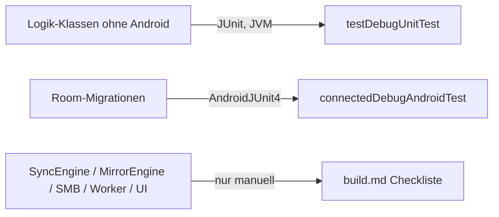
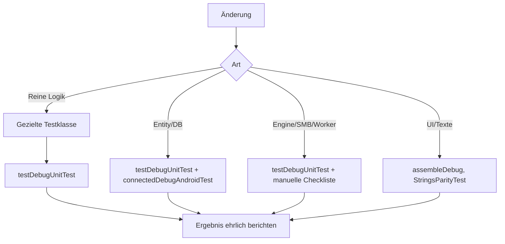

# Tests, Build und Qualitätssicherung – LeoSync (Sync2PC)

Stand: Version 0.11.0 (DB-Version 6). Grundlage: `build.gradle.kts`, `app/build.gradle.kts`, `gradle/wrapper/gradle-wrapper.properties`, `build.md` und alle Dateien unter `app/src/test` und `app/src/androidTest` (inhaltlich gelesen).

Diese Datei beschreibt **nur** Tests, Build und Qualitätssicherung. Fachliche Abläufe stehen in `docs/SYNC-ENGINE.md`, `docs/DATA-MODEL.md`, `docs/ARCHITECTURE.md`, Entscheidungen in `docs/DECISIONS.md`.
Kennzeichnung: **[vorhanden]** = im Repository nachweisbar, **[fehlt]** = nachweislich nicht vorhanden, **[manuell]** = nur per Checkliste prüfbar, **[Empfehlung]** = nicht umgesetzt.

---

## 1. Überblick

| Testart | Status | Framework | Ort | Läuft auf |
|---|---|---|---|---|
| JVM-Unit-Tests (reine Logik) | vorhanden: 25 Klassen, 143 Tests (QA-Lauf 2026-11-09 nach 0.12.1, `testDebugUnitTest --rerun-tasks`, JDK 17, aus JUnit-XML: 0 Fehler, 0 Fehlschläge, 0 übersprungen; 132 + 11 `MsgTest`) | JUnit 4.13.2, `org.json:json:20240303` | `app/src/test/java/com/sync2pc/app/` | PC (JVM), kein Gerät |
| Instrumentierte Tests | vorhanden: 1 Klasse, 3 `@Test` (nur Room-Migration); QA-Lauf 2026-11-09 auf Emulator `LeoSync_API29(AVD)` (Android 10): 3/3 bestanden | AndroidJUnit4, `room-testing` (`MigrationTestHelper`) | `app/src/androidTest/java/com/sync2pc/app/` | Gerät/Emulator |
| Textparität DE/EN | vorhanden (als Unit-Test) | JUnit 4 | `StringsParityTest.kt` | PC |
| Manuelle Release-Checkliste | vorhanden, dokumentiert | – | `build.md` (Abschnitte „Release-Checkliste“, „Test …“) | echtes Handy + PC/NAS |
| UI-/Compose-Tests | **[fehlt]** | – | – | – |
| SMB-/Netzwerk-Tests (echt oder Fake) | **[fehlt]** | – | – | – |
| Engine-Tests (`SyncEngine`, `MirrorEngine`, Worker) | **[fehlt]** | – | – | – |
| CI/CD (z. B. `.github/`) | **[fehlt]**, kein Workflow vorhanden | – | – | – |
| Statische Analyse (detekt, ktlint, eigene Lint-Konfiguration) | **[fehlt]**, nichts konfiguriert | – | – | – |

Mocking-Bibliotheken (Mockito, MockK, Robolectric, Turbine …) sind **nicht** eingebunden. Es gibt keine Fakes für SMB oder Dateisysteme. Die vorhandenen Tests prüfen ausschliesslich Klassen, die ohne Android-Abhängigkeit und ohne Netzwerk auskommen (im Quellcode als „rein“ gebaut, siehe `docs/ARCHITECTURE.md` 4.7).

### Qualitätssicherungsmechanismen im Überblick

| Mechanismus | Wirkung | Quelle |
|---|---|---|
| Unit-Tests beim Standard-Build | `build.bat` ruft `gradlew testDebugUnitTest assembleRelease` auf; ein Testfehler bricht den Build ab (ausser `-SkipTests`) | `build.md` |
| Kompilierung mit R8 im Release | `isMinifyEnabled`/`isShrinkResources` = true; deckt fehlende Keep-Regeln erst zur Laufzeit auf, nicht im Test | `app/build.gradle.kts` |
| Room-Schema-Export | `exportSchema = true`, Schemas `1.json`–`8.json` in `app/schemas/…/`; Grundlage für `MigrationTest` | `AppDatabase.kt`, `app/build.gradle.kts` |
| Strings-Parität | schlägt fehl, wenn DE/EN-Schlüssel, Platzhalter oder Plural-Formen abweichen | `StringsParityTest.kt` |
| Schutzbremse etc. zur Laufzeit | Fachliche Sicherungen der App (Löschschutz, Prüfstufen), keine Testmechanismen; Logik teilweise per Unit-Test abgesichert | `MirrorGuardTest`, `VerifyLevelTest` |
| Manuelle Release-Checkliste | Deckt Engine, SMB, Hintergrund, Migration auf echtem Gerät ab | `build.md` |

---

## 2. Build-System

| Komponente | Wert | Quelle |
|---|---|---|
| Gradle | 9.8.2 (Wrapper) | `gradle/wrapper/gradle-wrapper.properties` |
| Android Gradle Plugin | 9.5.0 (Kotlin eingebaut, kein `kotlin-android`-Plugin) | `build.gradle.kts` |
| Kotlin | 2.4.21 (`kotlin-gradle-plugin`, Compose-Compiler-Plugin gleich) | `build.gradle.kts` |
| KSP | 2.3.13 (Room-Compiler) | `build.gradle.kts` |
| Room | 2.8.5 | `app/build.gradle.kts` |
| Compose BOM | 2024.12.01 | `app/build.gradle.kts` |
| WorkManager | 2.10.0 | `app/build.gradle.kts` |
| SMB | `com.hierynomus:smbj:0.13.0`, `com.rapid7.client:dcerpc:0.12.13` | `app/build.gradle.kts` |
| SDK | compileSdk 36, targetSdk 36, minSdk 29 | `app/build.gradle.kts` |
| Java | Source/Target 17; Build läuft mit JDK 17–25 | `app/build.gradle.kts`, `build.md` |
| Modul | nur `:app` (Einzelmodul) | `settings.gradle.kts` |
| Flavors | **keine** | `app/build.gradle.kts` |
| Gradle-Optionen | `org.gradle.parallel=true`, `org.gradle.caching=true`, 3 GB Heap | `gradle.properties` |

**Build-Typen**

- `debug`: `applicationIdSuffix = ".debug"`, `versionNameSuffix = "-debug"` (parallel zur Release-App installierbar).
- `release`: R8 + Ressourcen-Shrinking, `proguard-rules.pro`; signiert nur, wenn `keystore.properties` existiert (wird vom Builder erzeugt, nicht in Git).
- Version aus `version.properties` (`versionCode = MAJOR*1_000_000 + MINOR*1_000 + PATCH`).

**Besonderheiten für Tests**

- `ksp { arg("room.schemaLocation", "$projectDir/schemas") }`: Schemas werden beim Build nach `app/schemas` geschrieben.
- `kspReleaseKotlin` läuft nach `kspDebugKotlin` (verhindert Schema-Race, siehe Kommentar in `app/build.gradle.kts`).
- `androidTest`-Assets enthalten `app/schemas` (für `MigrationTestHelper`).
- `TestTexts` (Unit-Test-Hilfsklasse) sucht `src/main/res` bzw. `app/src/main/res` relativ zum Arbeitsverzeichnis. Gradle startet Unit-Tests im Modulordner `app/`; ein Aufruf aus einer IDE mit anderem Arbeitsverzeichnis kann daran scheitern.

### Befehle

Alle Befehle aus dem Projektwurzelordner (Windows: `gradlew.bat`). Die Tasks sind Standard-AGP-Tasks; die Projektkonfiguration definiert **keine** eigenen Test- oder Prüf-Tasks. Der Hinweis „nicht ausgeführt“ gilt für diese Dokumentation: Befehle wurden hier aus der Konfiguration abgeleitet, nicht gestartet.

| Befehl | Zweck | Umfang | Wann |
|---|---|---|---|
| `build.bat` | Standard-Build des Projekts: Hash-Prüfung, Versionserhöhung, Unit-Tests, Release-APK nach `releases\` | Debug-Unit-Tests + `assembleRelease` | Vom Projektinhaber für Releases; Claude Code baut laut Projektregel **nicht** selbständig |
| `build.bat -SkipTests` / `-Force` / `-Debug` / `-NoPause` | Tests überspringen / immer bauen / Debug-APK / ohne Tastendruck am Ende | wie oben | nach Absprache |
| `gradlew.bat testDebugUnitTest` | Alle JVM-Unit-Tests (Debug) | 24 Testklassen, kein Gerät; Gradle braucht JDK 17+ (die Shell-Standard-`JAVA_HOME` zeigt auf Java 8; z. B. `C:\Program Files\Android\Android Studio\jbr` verwenden) | Nach jeder Änderung an Logikklassen, Texten (`strings_*.xml`) oder Datenmodell-Klassen |
| `gradlew.bat testDebugUnitTest --tests "com.sync2pc.app.MirrorGuardTest"` | Eine Testklasse | 1 Klasse | gezielte Prüfung nach kleinem Eingriff |
| `gradlew.bat testDebugUnitTest --tests "com.sync2pc.app.MirrorGuardTest.massDeleteAbove20Percent"` | Eine Testmethode | 1 Test | Fehlersuche |
| `gradlew.bat testReleaseUnitTest` | Unit-Tests gegen die Release-Variante | wie oben | selten; nur bei Verdacht auf Varianten-Unterschiede |
| `gradlew.bat assembleDebug` | Debug-APK (kompiliert alles inkl. Compose/KSP) | kein Test | schneller Kompilier-Check nach UI-Änderungen |
| `gradlew.bat assembleRelease` | Release-APK mit R8 | kein Test | nach Änderungen an Abhängigkeiten, Reflection, Room, smbj/dcerpc (R8-Keep-Regeln) |
| `gradlew.bat testDebugUnitTest assembleRelease` | Befehl, den `build.bat` ausführt; auch „Manuell bauen“ in `build.md` | Tests + Release | Vollprüfung vor Release |
| `gradlew.bat connectedDebugAndroidTest` | Instrumentierter `MigrationTest` | 3 Tests, braucht Gerät/Emulator (API ≥ 29) | Bei jeder Änderung an `Entities.kt`, `AppDatabase.kt`, Schemas |
| `gradlew.bat lintDebug` | Android-Lint (AGP-Standardtask) | keine projektspezifische Lint-Konfiguration vorhanden | optional; nicht Bestandteil des Projektablaufs, Ergebnis nicht dokumentiert |

Reports: JUnit-HTML unter `app/build/reports/tests/testDebugUnitTest/`; Build-Log von `build.bat` unter `.build/last-build.log`.

---

## 3. Teststruktur

```
app/
  schemas/com.sync2pc.app.data.AppDatabase/1.json … 6.json   (Room-Schemas, Testgrundlage)
  src/
    test/java/com/sync2pc/app/          JVM-Unit-Tests (19 Klassen + TestTexts)
    androidTest/java/com/sync2pc/app/   MigrationTest.kt
```

Es gibt keine `testFixtures`, keine Testressourcen-Ordner (`src/test/resources`), keine gemeinsamen Testdatendateien. Testdaten werden in den Tests selbst aufgebaut (Hilfsfunktionen wie `st()`, `e()`, `p()`, `item()`). Einzige Hilfsklasse: `TestTexts.kt` (lädt `strings*.xml` aus `src/main/res` und installiert einen deutschen `Texts.Resolver`, damit Texte in JVM-Tests aufgelöst werden; ohne Android-Context).

Testarten und Zuständigkeiten:



---

## 4. Vorhandene Tests im Detail

Pfade relativ zu `app/src/test/java/com/sync2pc/app/` (Ausnahme: `MigrationTest`). Zahl = `@Test`-Methoden.

### 4.1 Synchronisations-nahe Logik (Ordner-Sync, Entscheidungshilfen)

| Datei | Getestet | Geprüfte Szenarien (aus dem Testinhalt) | Tests |
|---|---|---|---|
| `MirrorGuardTest.kt` | `mirror/GuardPolicy`, `mirror/MirrorGuard` (Schutzbremse und Inhaltsvergleich) | Massenlöschung > 20 % (genau 20 % noch erlaubt); kleine Ordner ≤ 5 Dateien nur bei „alles weg“; ab 100 Löschungen immer Rückfrage; Prozentgrenze pro Profil, 100 % = nur feste Regeln; verschwundener Unterordner; Stichprobe begrenzt; oberste Verzeichnisse aus Schlüsseln; Abgleich Soll/Ist (alles da, fehlende Datei/Ordner = Abweichung, einzelne Grössenabweichungen toleriert, Grösse der geprüften Seite); gründlicher Vergleich (kleine Dateien komplett gehasht, grosse per Stichprobe, Änderung in der Mitte erkannt) | 14 |
| `TransferPlanTest.kt` | `mirror/TransferPlan` | kleine Dateien zuerst; Fortsetzen einer abgebrochenen Übertragung, wenn PC-Datei unverändert; Neustart, wenn PC-Datei nach Abbruch geändert, angefangene Datei leer/zu gross oder Zeitstempel unbekannt | 3 |
| `VerifyLevelTest.kt` | `VerifyLevel`/`Profile.verify()`, `PartialHash`, `BackupCodec` (Stufen) | Stufen Wenig/Mittel erzeugen dieselbe Prüfsumme wie früher; „Aus“ liest nichts; „Viel“ komplett bis 256 MB, dann Stichprobe; „Komplett“ deckt jedes Byte lückenlos ab; „Aus“ wird angehoben, wenn Dateien entfernt werden; unbekannter Code → Standard; Sicherung behält Stufe und trimmt Namen; alte Sicherung ohne Stufe nutzt `verifyUpload` | 7 |
| `FileFilterTest.kt` | `mirror/FileFilter` | leerer Filter akzeptiert alles ausser Temp-Dateien; Positivliste; Negativliste gewinnt; Namensmuster gilt in Unterordnern | 4 |
| `TrashIndexTest.kt` | `mirror/TrashIndex` (Papierkorb-Index, Wiederherstellen) | Eintrag aus Papierkorb-Pfad (Datumsordner nötig); Versionsnamen mit Uhrzeit, Rückführung auf Originalnamen, Altformat `_2`, nummerierte Namen nur bei vorhandenem Basisnamen; neueste Version pro Datei; alles eines Tages; ganzer Ordner inkl. Unterordner; nur eine Version pro Datei auswählbar; Datums-Sortierung | 8 |
| `TrashPolicyTest.kt` | `mirror/TrashPolicy` | Ablauf alter Datumsordner (Stichtag selbst bleibt), fremde Ordnernamen laufen nie ab, Stichtagsberechnung | 3 |
| `TrashPurgeTest.kt` | `mirror/TrashPurge` | Regeln (nie fremde Ordner löschen), gleicher Stichtag wie Aufbewahrung, Kodierung/Dekodierung, Betroffenheit nach Seite, reservierte Einträge bleiben erhalten | 5 |
| `TrashPurgeConfirmedTest.kt` | `mirror/TrashPurge.planConfirmed` (bestätigter Stand beim Aufräumen, DEC-144) | ganzer Tag; neuere Version bleibt; geänderte Grösse; vorgemerkte bleiben; verschwundene Einträge/Tage unabhängig; `dateDir`; seit 0.11.10 | 6 |
| `InterventionRegistryTest.kt` | `mirror/InterventionRegistry` (Zustandslogik der Eingriffe beim laufenden Sync) | Warten/Laufen/Fertig; ein Eingriff je Profil; Abbrechen nur wartend; Neustart nach Abbrechen; Zustellung bzw. nicht zustellbares Ergebnis; Fehlertext; Zähler; Stand nach Development -036 | 8 |
| `FreeRulesTest.kt` | `sync/FreeRules` (Speicher freigeben) | Alter, Ordner inkl. Unterordner, Typen/Endungen, Grösse und Ausnahmen, Auswahl behält ungesicherte Favoriten und ganze Gruppen | 5 |
| `FolderNamesTest.kt` | `sync/FolderNames`, `sync/PartialHash` | Monat aus umbenannten Ordnern; Standardnamen; erzeugte Namen sind keine Kandidaten; Konfliktnamen ab „2“; gleicher Basisname; Bereinigung; Teilhash-Bereiche und Abhängigkeit von der Dateigrösse | 8 |
| `FilenameDateParserTest.kt` | `media/FilenameDateParser`, `smb/SmbTarget` | gängige Datumsmuster im Dateinamen, Epoch-Millisekunden, kein Datum, SMB-Pfad-Parser | 4 |
| `LocalTreeLabelTest.kt` | `mirror/LocalTree` (nur Beschriftung) | Download-Picker-Pfade werden gekürzt | 1 |

### 4.2 Daten, Profile, Sicherung, Diagnose

| Datei | Getestet | Geprüfte Szenarien | Tests |
|---|---|---|---|
| `BackupCodecTest.kt` | `backup/BackupCodec`; zusätzlich `StaleCheck`, `SpaceFreer` | Round-Trip ohne Passwort; Passwörter verschlüsselt und wiederhergestellt; falsches/fehlendes Passwort importiert Profile trotzdem; ältere Sicherung bekommt Standardwerte; fremde und zukünftige Dateien werden abgelehnt; Erinnerung „veraltet“ alle drei Tage; Live-Photo-Paare bleiben zusammen; Schalter `syncOffWifi` im Round-Trip (Boolean) und fehlender Schlüssel bleibt fehlend (seit 0.11.7). Seit 0.13.0 drei Tests zur PC-Erkennung: Round-Trip von `pcCheck`/`pcGuid`/`pcGuidHost`; ältere Sicherung ohne diese Felder → `WIFI` und leer; Normalisierung beim Einlesen (Kleinbuchstaben/Host getrimmt; unbekannter Modus oder Null-UUID → `WIFI`/leer) | 12 (laut Quelltext, 3 neu; **nicht ausgeführt**) |
| `ProfileOverlapTest.kt` | `data/ProfileOverlap` | gleiche Quelle trotz anderer Schreibweise; zusätzlicher Ordner = teilweise; Oberordner = teilweise; anderes Ziel/andere Ordner = ok; Bearbeiten desselben Profils ist kein Konflikt; Ordner-Profile vergleichen lokalen Ordner; verschachtelte Ordner-Profile warnen | 7 |
| `ProfileWizardTest.kt` | `data/ProfileWizard` | Schritte je Profiltyp (Schutzbremse nur bei Ordner-Profilen, zuletzt); Pflichtfelder (WLAN optional); Speichern ab erstem optionalem Schritt | 3 |
| `CredentialGroupsTest.kt` | `data/CredentialGroups` | gleicher Benutzer/Server/Passwort = ein Eintrag; Abweichungen getrennt; Profile ohne Benutzer ignoriert | 3 |
| `RunSummaryTest.kt` | `sync/RunSummary`, `data/RunGrouping` | Zusammenfassung zeigt nur Geschehenes; Nullwerte entfallen; aufeinanderfolgende ruhige Läufe gruppiert; einzelner ruhiger Lauf bleibt einzeln; Filter Fehler/Übertragung; „gefunden auf PC/Papierkorb“ ist nicht ruhig; Altformat bis 0.3.3 | 6 |
| `DiagnosticsTest.kt` | `diag/Diagnostics`, `VendorHints`, `CrashReporter` | Log-Verdichtung (neues/altes Format, Einzelzeile); Herstellererkennung; Absturzprotokoll behält neueste drei; Trace gekürzt; seit 0.12.4 Maskierung/Pseudonymisierung über `Redactor` (DEC-203) | 15 (laut Development, grüner Gesamtlauf `testDebugUnitTest` 2026-11-09; vorher 6; nicht von QA gemessen) |
| `RemoteFolderNameTest.kt` | `invalidFolderName` (Ordnername in der PC-Auswahl) | Namensprüfung (leer, Länge, verbotene Zeichen, „.“/„..“, Ende mit Punkt/Leerzeichen, Dublette); seit 0.11.3; im QA-Lauf 2026-11-08 ausgeführt und bestanden | 4 |
| `NetworkRulesTest.kt` | `sync/NetworkRules` (reine Netzentscheidungen, DEC-126) | Tabelle erlaubte Netzart (`onAllowedNetwork`); Schalter + mobile Daten/VPN nötig (`offWifiSyncActive`); Weiterlaufen nach SSID bzw. Netzart (`mayContinue`); Wartezeiten (`retryMinutes`); Erreichbarkeitsversuche (`reachabilityWaits`); seit 0.11.7. Seit 0.13.0 (DEC-204) zusätzlich je Modus `WIFI`/`GUID`/`BOTH`: `needsWifiName`, `eligible`, `mayContinue(mode, …)`, `wifiTriggerMatches` | 11 (laut Quelltext, 6 neu; **nicht ausgeführt**) |
| `PcIdentityTest.kt` | `sync/PcIdentity`, `PcIdentityException` (DEC-204) | Normalisierung der Kennung (Kleinbuchstaben, Null-UUID/leer ungültig); `PcCheckMode.parse` fällt auf `WIFI` zurück; gespeicherte Kennung gilt nur für denselben Host (ohne Gross-/Kleinschreibung); Tabelle `decide` je Modus: `WIFI` blockiert nie, `GUID`/`BOTH` ohne Kennung nie anmelden, ohne gespeicherte Kennung nur bei `USER` lernen, mit gespeicherter Kennung gleich/abweichend; nur `ALLOW`/`ALLOW_AND_LEARN` dürfen anmelden; `PcIdentityException` ist kein Netzwerkfehler (auch verschachtelt) und keine `IOException`, echte Netzwerkfehler werden weiter erkannt; Meldungen lesbar mit Host. Neu seit 0.13.0 | 13 (laut Quelltext; **nicht ausgeführt**) |
| `FolderFreerTest.kt` | `mirror/FolderFreer` (`isProtectedDir`, `emptyDirCandidates`; DEC-147) | Profil-Wurzel immer geschützt; `DCIM/Camera` geschützt (handgeschriebene Labels); andere Ordner nicht geschützt; Kandidaten tiefster Ordner zuerst ohne geschützte; geschützte übersprungen, andere bleiben; seit 0.11.8 | 5 |
| `RestoreRetryPolicyTest.kt` | `mirror/RestoreRetryPolicy` (DEC-146) | ab dem 5. Fehlversuch erschöpft; Zähler je Wiederherstellungs-ID; ID-Präfix wird nicht verwechselt (1/12); seit 0.11.8 | 3 |
| `MsgTest.kt` | `l10n/Msg` (Kennung), `data/RunTexts`, `RunGrouping.isIdle`, `RunSummary.NOT_IDLE_KEYS` (DEC-159/DEC-202) | Code rendert wie der Originaltext; Ressourcen-Namen statt IDs gespeichert; Mehrzahl und Verschachtelung überstehen die Speicherung; wörtlicher Text ohne Code; Rückfalltext bei unbrauchbarem Code; unbekannte Felder ignoriert, Tiefe begrenzt; Anzeige in der aktiven statt der Schreibsprache; `isIdle` über Schlüssel bzw. Merkmal-Wörter ohne Code; Log-Zeilen aus Code oder Rückfalltext; `NOT_IDLE_KEYS` sind echte Ressourcen; seit 0.12.0 | 11 (QA-Lauf 2026-11-09 bestanden) |
| `StringsParityTest.kt` | `res/values*/strings*.xml` über `TestTexts` | gleiche Schlüssel, Plural-Formen `one`/`other`, gleiche Platzhalter, Formate funktionieren, Apostrophe maskiert | 5 |

### 4.3 Instrumentation

`app/src/androidTest/java/com/sync2pc/app/MigrationTest.kt` (`@RunWith(AndroidJUnit4)`, `MigrationTestHelper`, braucht Gerät/Emulator):

- `fromVersion1ToLatest`: Profil der DB-Version 1 durchläuft `MIGRATION_1_2` … `MIGRATION_7_8` und `runMigrationsAndValidate(..., 8, true, …)` (seit 0.13.0; vorher bis 7); prüft Schema und eine übernommene Spalte (Prüfung an → „Wenig“).
- `verifyLevelFromVersion5`: `MIGRATION_5_6` mit Datenzeilen (KEEP/Prüfung aus → „Aus“; TRASH/Prüfung aus → „Wenig“; Prüfung an → „Wenig“).
- `runCodesFromVersion6` (seit 0.12.0): `MIGRATION_6_7`; bestehender Lauf und bestehende Log-Zeile behalten ihren Text, die neuen Spalten `messageCode`, `triggerCode`, `code` sind `NULL`; eine Kennung lässt sich danach schreiben. Ausgeführt durch QA 2026-11-09 (Emulator API 29): bestanden.
- `pcCheckFromVersion7` (seit 0.13.0, DEC-204): `MIGRATION_7_8`; ein bestehendes Profil behält Name, Pfad, verschlüsseltes Passwort und WLAN-Liste, die neuen Spalten stehen auf `pcCheck = 'WIFI'`, `pcGuid = ''`, `pcGuidHost = ''`. **Nicht ausgeführt.** Der Quelltext hat jetzt 4 `@Test`; die Zahl „3“ in Abschnitt 1 gilt nur für den ausgeführten Stand 0.12.1.

`app/src/androidTest/java/com/sync2pc/app/MsgInstrumentedTest.kt` (seit 0.12.2, 6 Tests laut Development -043/-039): Namen-Round-Trip mit echtem `AndroidResolver`, Plural/verschachtelt, Rückfall, DE/EN, `triggerData/triggerOf`; Sprachwechsel nur bis Android 12. **Noch nicht ausgeführt:** Testzahl der instrumentierten Tests erst nach grünem `connectedDebugAndroidTest` (QA/Inhaber) eintragen; die Zahlen in Abschnitt 1 (3 Tests) gelten nur für `MigrationTest`. Zusätzlicher Gerätetest beim Inhaber (nicht ausgeführt): Hinweise für LeoSync aus → Eingriff → Ansicht öffnen (Ergebnis bleibt stehen).

Einzelne Migrationen 1→2, 2→3, 3→4, 4→5 werden **nur als Teil der Kette** gegen das Schema validiert, nicht mit eigenen Datenprüfungen (nachweisbar nur die oben genannten Datenprüfungen).

---

## 5. Datenbank- und Migrationstests

| Aspekt | Stand |
|---|---|
| Migrationskette 1→8 | **[vorhanden]** `MigrationTest.fromVersion1ToLatest` (Gerät/Emulator); bis 1→7 am 2026-11-09 bestanden, die Erweiterung auf 8 ist **nicht ausgeführt** |
| Datenerhalt bei 7→8 (`pcCheck`, `pcGuid`, `pcGuidHost`) | **[vorhanden, nicht ausgeführt]** `MigrationTest.pcCheckFromVersion7` |
| Datenerhalt bei 5→6 (`verifyLevel`) | **[vorhanden]** `MigrationTest.verifyLevelFromVersion5` |
| Datenerhalt bei 6→7 (Kennungsspalten) | **[vorhanden]** `MigrationTest.runCodesFromVersion6` (QA 2026-11-09 bestanden) |
| Datenerhalt bei 1→2, 2→3, 3→4, 4→5 mit eigenen Daten | **[fehlt]** (nur Schema-Validierung innerhalb der Kette) |
| Spalten `mirrorState`, `syncedFile`, `folderMapping`, `pendingRestore` usw. nach Migration | **[fehlt]** (nicht geprüft; nur eine Spalte des Profils) |
| DAO-Tests (`SyncDao`) | **[fehlt]** |
| Repository-/Entity-Tests, Transaktionen, Fremdschlüssel, Eindeutigkeit | **[fehlt]** |
| Persistierung von Sync-Ständen (`MirrorState`, `SyncedFile`) | **[fehlt]** als Datenbanktest; `MirrorState` wird nur als Datenobjekt in `MirrorGuardTest`/`BackupCodecTest` verwendet |
| Duplikaterkennung über Datenbank | **[fehlt]** |
| Backup/Restore der Profil-Daten (JSON, kein Room) | **[vorhanden]** `BackupCodecTest`, `VerifyLevelTest` |
| Schema-Datei zur aktuellen DB-Version vorhanden | `7.json` ist jetzt vorhanden (Befund aus Development -009/QA -040 erledigt); der Test prüft die Schemas nur, wenn `connectedDebugAndroidTest` läuft |

Wichtig: Das Gradle-Setup führt `MigrationTest` **nicht** beim Standard-Build (`build.bat`) aus. Ohne manuellen Lauf mit Gerät/Emulator ist eine Datenbankänderung beim Build ungeprüft. `build.md` verlangt zusätzlich einen Update-Test über die bestehende Installation.

---

## 6. Synchronisationsengine (Details: `docs/SYNC-ENGINE.md`)

`SyncEngine` (Bildordner), `MirrorEngine` (Ordner, 3-Wege-Abgleich, `plan()`), `SyncWorker`, `SyncRunner`, `DeletionManager`, `RestoreManager`, `TrashCleaner`, `FolderFreer` haben **keine direkten Tests**. Getestet sind nur ausgelagerte reine Hilfsklassen.

| Szenario | Vorhandener Test | Testdatei | Bewertung |
|---|---|---|---|
| Neue Dateien erkennen (`plan()`) | – | – | **fehlt** |
| Geänderte Dateien erkennen | – | – | **fehlt** |
| Gelöschte Dateien erkennen | – | – | **fehlt** |
| 3-Wege-Abgleich / Entscheidungsbaum `plan()` | – | – | **fehlt** |
| Gleichzeitige Änderungen / Konflikterkennung | – | – | **fehlt** |
| Konfliktbehandlung (`ConflictMode`, `MirrorConflict`) | – | – | **fehlt** |
| Massenlösch-Schutzbremse (Entscheidungsfunktion) | `massDeleteAbove20Percent` u. a. | `MirrorGuardTest.kt` | getestet (reine Funktion `GuardPolicy`; Einbindung in den Lauf nicht getestet) |
| Soll/Ist-Abgleich nach verschwundenem PC-Ordner | `vanishedSubfolder`, `matchesWhenEverythingIsThere`, `missingFileOrDirIsMismatch` | `MirrorGuardTest.kt` | getestet (Funktion, nicht der Lauf) |
| Gründliche Inhaltsprüfung (Hash/Stichprobe) | `thorough*`, `fullCoversEveryByteWithoutGaps` | `MirrorGuardTest.kt`, `VerifyLevelTest.kt` | getestet |
| Reihenfolge der Übertragung | `smallFilesFirst` | `TransferPlanTest.kt` | getestet |
| Abgebrochene Übertragung fortsetzen / neu starten | `resumeWhenPcFileUnchanged`, `restartWhenPcFileChangedOrUnclear` | `TransferPlanTest.kt` | Entscheidungslogik getestet; die tatsächliche Dateiübertragung (`writeFileResumable`, `SmbSession.upload/download`) **fehlt** |
| Wiederholungsversuche, Fehlerbehandlung (`Errors.kt`) | – | – | **fehlt** |
| Wiederanlauf nach App-Abbruch / Neustart | – | – | **fehlt** (nur manuell, siehe Abschnitt 8) |
| Sichere Dateiersetzung (`replaceWith`, Temp-Datei `.s2ptmp`) | – | – | **fehlt** |
| Löschmodi / Papierkorb-Zuordnung | `entryFromTrashPath`, `versionNamesWithTime` u. a. | `TrashIndexTest.kt` | Namens- und Indexlogik getestet; Verschieben/Löschen selbst **fehlt** |
| Aufbewahrungsfrist Papierkorb | `olderFoldersExpire`, `cutoffIsDaysBack` | `TrashPolicyTest.kt` | getestet |
| Papierkorb leeren (Regeln, Vormerkung) | `rules`, `reservedEntriesAreKept` | `TrashPurgeTest.kt` | Regeln getestet; Ausführung **fehlt** |
| Wiederherstellen (Auswahl der Version) | `onlyOneVersionPerFileSelected`, `latestVersionPerFile` | `TrashIndexTest.kt` | Auswahl getestet; `RestoreManager`/`PendingRestore` **fehlt** |
| Speicher freigeben (Auswahlregeln) | `FreeRulesTest` (5) | `FreeRulesTest.kt` | Regeln getestet; `SpaceFreer`/`FolderFreer`-Ablauf **fehlt** |
| Bildordner: Datumsermittlung aus Dateiname | `commonPatterns`, `epochMillis` | `FilenameDateParserTest.kt` | getestet |
| Bildordner: Zielordnernamen, Konfliktnamen | `FolderNamesTest` | `FolderNamesTest.kt` | getestet |
| Bildordner: EXIF, Länderzuordnung (`MediaAnalyzer`, `CountryLookup`), Live-Photo-Paare | Live-Photo-Logik via `livePhotoPairs...` | `BackupCodecTest.kt` | Live-Photo-Test enthält lokale Hilfsklasse `F`; ob er produktiven Code aufruft, ist im Test nur über `SpaceFreer` erkennbar; EXIF/Land **fehlt** |
| Synchronisationsprofile (Überschneidung, Wizard, Zugangsdaten-Gruppen) | `ProfileOverlapTest`, `ProfileWizardTest`, `CredentialGroupsTest` | siehe 4.2 | getestet |
| Ein Lauf für alle Profile, Mutex, Pausen, WLAN-/PC-Bedingungen (`SyncWorker`) | – | – | **fehlt** |
| Simulation (`dryRun`) | – | – | **fehlt** |

---

## 7. SMB-, Netzwerk- und Android-Tests

### SMB / Netzwerk (`smb/SmbSession.kt`, `sync/WifiHelper.kt`)

Nachweislich **keine** Tests für Verbindungsaufbau, Authentifizierung, Freigabenliste (`listShares`), Verzeichnisoperationen, Upload/Download, `isReachable` (TCP 445), Timeouts, Wiederverbindung oder Netzwerkfehler. Es gibt weder echte SMB-Tests noch Fake-/Mock-Implementierungen. Das Einzige, was aus der SMB-Schicht getestet ist: der Pfad-Parser `SmbTarget` (in `FilenameDateParserTest.smbPaths`) und der Teilhash-Berechnungsteil (`PartialHash`, in `FolderNamesTest`/`MirrorGuardTest`/`VerifyLevelTest`) mit lokalen Byte-Arrays.

### PC-Erkennung (DEC-204, DEC-205; Stand 2026-11-09, Code 0.13.0 ungebaut, nichts ausgeführt)

- **Unit (vorhanden, nicht ausgeführt):** `PcIdentityTest`, `NetworkRulesTest` (je Modus), `BackupCodecTest` (3 neue Tests), Instrumentation `MigrationTest` 7→8 (Abschnitte 4.2, 4.3, 5). Beim Bau durch den Inhaber: `PcIdentityTest`, `NetworkRulesTest`, `BackupCodecTest`, `StringsParityTest` (neue Texte `profile_pc_*`, `home_profile_pc_*`, `skip_pc_not_recognised`, `smb_err_pc_*`) und `MigrationTest` (mit `8.json`).
- **Neu/erweitert in 0.13.1 (vorhanden, nicht ausgeführt, Development SYNC-20261109-055):** `PcLoginTest` (Fake-Verbindung: kein `authenticate` bei UNKNOWN/CHANGED/NO_ID/WRONG_NET, Reihenfolge connect → Kennung → Entscheidung → authenticate, Lernen/Neuvertrauen nur nach Commit, strengerer Modus, Grundsatz V7, Host-Zwischenspeicher, Host-Prüfung); `PcIdentityTest` erweitert (Modus × Zugriffsart × `learnNetOk`, V7, `PcEditorRules`, `WRONG_NET`-Meldung); `NetworkRulesTest` (`learnNetOk`); `DiagnosticsTest` (PC-Kennung/Host pseudonymisiert; die Zeilen in `Diagnostics.build` selbst nicht JVM-testbar); androidTest `PcGuidDaoTest` (SQL `learnPcGuid`/`trustNewPcGuid`/`clearPcGuid` inkl. Moduswächter, In-Memory-Room). Auch zu bauen: `StringsParityTest`, `MigrationTest` (mit `8.json`).
- **Neu in 0.13.14 (Development SYNC-20261109-079):** `PcIdentityTest.hostChangeAsksOnlyForExistingGuidProfilesWithNewUnconfirmedHost` (`PcEditorRules.needsHostConfirm`, DEC-208). Gezielter Lauf `testDebugUnitTest` (`PcIdentityTest`, `MsgTest`) am 2026-11-09 grün (JDK 17) laut Development; nicht von Documentation ausgeführt. Nicht abgedeckt: UI-Verdrahtung (`confirmHost`).
- **Lücken:** keine Tests für `SyncWorker.precheckPc` und die Oberfläche (`ProfileScreen`, `HomeParts`; nur die ausgelagerte reine Regel `PcEditorRules` ist per JVM-Test abgedeckt).
- **Gerätetest (QA, ausstehend; SYNC-20261109-053):** ein fremder PC unter gleicher IP erhält keinen SESSION_SETUP; Verhalten bei Kennungswechsel; Stabilität der Kennung bei Samba/NAS (ungeprüft); Akku bei `GUID` in fremden WLANs.
- **Gerätetest (DEC-205, ausstehend, QA):** Speichern und «Verbindung testen» in fremdem WLAN bei `BOTH` ohne Kennung → kein SESSION_SETUP; manueller Sync ohne Kennung → keine Anmeldung (Hinweis «Profil öffnen → Verbindung testen»). Unsicher bei der Kompilierung (nicht gebaut, laut Development): `ConnectionContext.getServerGuid()`, Compose `collectAsState` in `createdId?.let`.

### Android-spezifisch

| Bereich | Stand |
|---|---|
| Activity/Lifecycle (`MainActivity`) | **[fehlt]** |
| ViewModels | im Projekt nicht als eigene Klassen erfasst; **keine** ViewModel-Tests |
| Compose-UI / Navigation | **[fehlt]** (keine `compose-ui-test`-Abhängigkeit) |
| Berechtigungen (`Permissions.kt`, `PermissionRows.kt`) | **[fehlt]**, nur manuell |
| Speicherzugriff (SAF, `LocalTree`, MediaStore) | **[fehlt]**; nur Label-Funktion getestet. `PendingTrashedErrorTest` (4 Tests, **[vorhanden]**) prüft nur die Fehlererkennung (`isPendingOrTrashed`, `LocalItemNotReadyException`, keine Verwechslung mit Netzwerkfehlern); reale Verifikation des MediaStore-Verhaltens (`IS_TRASHED`-Filter, Überspringen) auf dem Gerät fehlt |
| WorkManager (`SyncWorker`, `TriggerWorker`, `UpdateWorker`, `SyncScheduler`) | **[fehlt]** (kein `work-testing`) |
| Benachrichtigungen (`Notifications.kt`) | **[fehlt]** |
| Receivers (`Receivers.kt`), `PauseService` | **[fehlt]** |
| Selbst-Update (`UpdateChecker`, `UpdateInstaller`) | **[fehlt]** |
| Verschlüsselung (`CredentialCrypto`, Android Keystore) | **[fehlt]**; Passwort-Round-Trip in `BackupCodecTest` betrifft den Sicherungs-Codec, nicht den Keystore |
| Room-Migration | einziger Instrumentation-Test (Abschnitt 5) |

Instrumentation (Gerät/Emulator nötig): ausschliesslich `MigrationTest`. Alle anderen automatisierten Tests laufen auf der JVM.

---

## 8. Manuelle Tests und reale Geräte

Die Quelle ist `build.md`; sie wird hier nicht kopiert. Ergänzend die Einordnung.

**Zwingend (laut `build.md` Release-Checkliste, nur manuell möglich):**

1. Update über bestehende Version installieren; Profile, Verlauf, Sync-Stand vorhanden (Migration auf echtem Datenbestand).
2. Bildordner-Profil: Simulieren und Synchronisieren, richtige Monats-/Länderordner, keine Duplikate.
3. Ordner-Profil beidseitig: Änderung auf Handy und PC wird abgeglichen („Test Ordner-Sync“).
4. WLAN während des Syncs trennen → „Pausiert“; wieder verbinden → Fortsetzen (inkl. „fortgesetzt ab … MB“).
5. Schutzbremse (PC-Ordner umbenannt, > 20 % gelöscht, ganzer Unterordner) – „Test Schutzbremse“.
6. Papierkorb/Wiederherstellen/Aufräumen, auch bei ausgeschaltetem PC (Vormerkung) – „Test Versionsschutz …“, „Test Papierkorb aufräumen“.
7. Speicher freigeben (Fotos und Ordner) – „Test Speicher freigeben …“.
8. Sicherung Export/Import mit und ohne Passwort.
9. Sprache DE/EN auf allen Seiten.
10. Selbst-Update nach Release auf einem Gerät mit Vorversion.

**Ergänzend (empfohlen, in `build.md` nicht oder nur teilweise geregelt) [Empfehlung]:**

- Unterschiedliche NAS-/SMB-Implementierungen und Windows-Versionen (Samba, Synology, Windows-Freigabe).
- App-Abbruch (Prozess beenden) mitten in Upload, Download und Papierkorb-Aktion.
- Neustart des Geräts; Akkuoptimierung/Hintergrundbeschränkung der Hersteller (siehe `VendorHints`).
- Berechtigungen entziehen während Betrieb (Foto-, Speicher-, Benachrichtigungs-, Akku-Berechtigung).
- Sehr viele Dateien, sehr grosse Dateien, zu wenig Speicherplatz auf Handy oder PC.
- Mehrere Android-Versionen (minSdk 29 bis targetSdk 36), v. a. Speicherzugriff und Hintergrundlimits.
- Lokaler Ordner mit Sonderzeichen/langen Pfaden; Zeitzonen- und Uhrenabweichung zwischen Handy und PC.

---

## 9. Regressionsanfälligkeit und Testauswahl

| Änderung an … | Mindestens ausführen | Zusätzlich manuell |
|---|---|---|
| `GuardPolicy`/`MirrorGuard`, Schutzbremse | `testDebugUnitTest --tests "*MirrorGuardTest"` | „Test Schutzbremse“ |
| Prüfstufen, `PartialHash`, Hashing | `*VerifyLevelTest`, `*MirrorGuardTest`, `*FolderNamesTest` | Sync mit Prüfstufe „Viel“/„Komplett“ |
| Übertragung (Reihenfolge, Fortsetzen) | `*TransferPlanTest` | Test Ordner-Sync inkl. WLAN-Trennung; Engine-Verhalten ist nicht automatisiert abgesichert |
| `MirrorEngine.plan()`, 3-Wege-Abgleich, Konflikte | **keine automatisierten Tests vorhanden**; sicherheitshalber komplette Unit-Tests | Test Ordner-Sync und Schutzbremse, Konflikt-Szenario mit gleichzeitiger Änderung |
| Löschen, Papierkorb, Wiederherstellen | `*TrashIndexTest`, `*TrashPolicyTest`, `*TrashPurgeTest` | „Test Versionsschutz“, „Test Papierkorb aufräumen“ |
| Speicher freigeben | `*FreeRulesTest`, `*BackupCodecTest` (`livePhotoPairs…`) | „Test Speicher freigeben“ |
| Datenmodell/Entity/Migration | `testDebugUnitTest` + `connectedDebugAndroidTest` (neues Schema `7.json`, neue Migration in `MigrationTest.all` aufnehmen) | Update über bestehende App |
| Sicherung/Backup-Format | `*BackupCodecTest`, `*VerifyLevelTest` | Export/Import |
| Profile, Wizard, Überschneidung | `*ProfileWizardTest`, `*ProfileOverlapTest`, `*CredentialGroupsTest` | Profil anlegen/bearbeiten |
| Texte/Strings | `*StringsParityTest` (alle `strings_*.xml` synchron) | Sprachumschaltung |
| Verlauf/Zusammenfassung | `*RunSummaryTest` | Verlauf-Ansicht |
| Dateifilter | `*FileFilterTest` | – |
| SMB-Zugriff | **keine Tests** | Test Ordner-Sync und Bildordner mit echtem PC; `assembleRelease` (R8) |
| WorkManager/Hintergrund/Berechtigungen | **keine Tests** | WLAN-Trennung, Neustart, Akku-Einschränkung, Berechtigungen |
| UI (Compose) | `assembleDebug` | Sichtprüfung auf Gerät |
| Abhängigkeiten, Gradle, Proguard | `testDebugUnitTest` + `assembleRelease` | Release-APK starten (R8-Abstürze nur zur Laufzeit sichtbar) |

Empfohlener Prüfablauf:



---

## 10. Abdeckung und Lücken

| Bereich | Automatisierte Tests | Manuelle Tests | Erkannte Lücken |
|---|---|---|---|
| Schutzbremse / Löschschutz | Entscheidungslogik (`MirrorGuardTest`) | ja | Einbindung in den Lauf nicht getestet |
| Dateifilter, Namen, Datum | ja | teilweise | EXIF/Land (`MediaAnalyzer`, `CountryLookup`) ungetestet |
| Papierkorb, Versionen, Wiederherstellen | Index-/Regel-Logik | ja | Ausführung (`TrashCleaner`, `RestoreManager`, `DeletionManager`) ungetestet |
| Speicher freigeben | Auswahlregeln | ja | Ausführung ungetestet |
| Prüfstufen/Hashing | ja | ja | Vergleich mit echter SMB-Datei ungetestet |
| Übertragungsplanung | ja | ja | Echte Übertragung, Abbruch, Wiederholung ungetestet |
| Sync-Engine Ordner (`MirrorEngine`, 3-Wege) | **keine** | ja | **Kritisch:** `plan()`, Konflikte, Zustandsfortschreibung (S) ohne Test |
| Sync-Engine Bilder (`SyncEngine`) | **keine** (nur Hilfsklassen) | ja | **Kritisch:** Zielzuordnung, Duplikate, Live-Photo-Ablauf |
| SMB (`SmbSession`) | **keine** | ja | **Kritisch:** kein Fake, kein Integrationstest |
| Datenbank | nur Migrationstest (Gerät) | ja (Update) | DAO, Constraints, Datenerhalt der Zwischenmigrationen |
| WorkManager/Receiver/Pause | **keine** | ja | Kein `work-testing`; Pausen-, Wartebedingungslogik ungetestet |
| UI/Compose, Navigation | **keine** | ja | Keine UI-Tests |
| Berechtigungen, Benachrichtigungen | **keine** | ja | nur manuell |
| Verschlüsselung (`CredentialCrypto`) | **keine** | indirekt | Keystore-Verhalten ungetestet |
| Selbst-Update | **keine** | ja | nur manuell |
| Sicherung/Import | ja | ja | – |
| Texte DE/EN | ja | ja | – |
| CI / statische Analyse | **keine** | – | Kein automatischer Lauf ausserhalb von `build.bat` |

**Nicht eindeutig feststellbar** (Quellcode der betreffenden Klassen wurde für diese Datei nicht auf versteckte Testbarkeit geprüft): ob `livePhotoPairsStayTogether` produktiven Code oder nur lokale Testlogik prüft; ob weitere Funktionen von `Diagnostics`/`LocalTree` getestet sind, als die in 4.1/4.2 genannten. Es wurde keine Coverage-Messung (JaCoCo) durchgeführt; Zahlen zur Zeilenabdeckung sind unbekannt.

Testlücken mit höchster Priorität (ableitbar, [Empfehlung], nicht umgesetzt): (1) `MirrorEngine.plan()` mit Entscheidungstabellen aus `docs/SYNC-ENGINE.md` als Unit-Test, dafür reine Funktion ohne SMB nötig; (2) Fake für `SmbSession` hinter einer Schnittstelle; (3) Migrations-Datenprüfungen für alle Schritte und alle Tabellen; (4) DAO-Tests mit In-Memory-Room; (5) `work-testing` für `SyncWorker`; (6) CI-Lauf von `testDebugUnitTest` auf GitHub; (7) Nach 0.11.7 sind Netzregeln (`NetworkRulesTest`) und `syncOffWifi`-Round-Trip getestet. Weiter ohne Test (QA 2026-11-08): Orchestrierung in `SyncWorker` (Wartestufen, `handleUnreachable` mit `midRun`/Schalter), `SyncScheduler.onOffWifiChanged`, Aufhebung der Wartezeit in `WifiNetworkReceiver`, „Problem melden“ (`reportProblem`). Manuelle Gerätetests (Netzwechsel, Mail-App, Sicherung) bleiben beim Inhaber und wurden nicht ausgeführt. Die Gesamtzahl: 109 → 110 (0.11.7) nicht erklärt; 118 = 110 + 5 + 3 (0.11.8, laut QA -029).
(8) Ohne Test nach 0.11.8/0.11.9 (QA -029; `deleteDirIfEmpty` mit `rawChildCount` und `RestoreFailures` sind nicht JVM-testbar): `FolderFreer.verifyAndDelete`, `LocalTree.deleteDirIfEmpty` (SAF), `RestoreFailures` (Prefs), `runRestores`-Filter und Rollback, Kartenarithmetik „vorgemerkt − fehlgeschlagen“ auf der Startseite, `RestoreManager.retryFailed`; `isProtectedDir` nur mit handgeschriebenen Labels, nicht mit der echten Ausgabe von `LocalTree.label`; Verhalten von `deleteDocument` auf Ordnern am echten Anbieter nicht automatisierbar. Manuelle Gerätetests beim Inhaber (nicht ausgeführt): Ordner leeren (Unterordner, `DCIM/Camera`, SD-Karte, `.nomedia`, Netzabbruch) und 5 Fehlversuche provozieren (Erneut versuchen, Verwerfen, Papierkorb leeren).
(9) Ohne Test nach 0.11.10 (QA -035/-038): `TrashCleaner.purgeConfirmed`/`deleteEntries` mit I/O; `FolderFreer.verifyAndDelete` mit `onStart`; `MirrorEngine` Leeren nach Stichprobe (Development -034); `Notifications`; Abbrechen genau zwischen Sperrerwerb und `onStart`. Die Zustandslogik der Eingriffe (`InterventionRegistry`, früher `PendingIntervention`) ist seit -036 getestet. Manuelle Gerätetests beim Inhaber (nicht ausgeführt): Aufräumen während laufendem Sync (Wartezustand, Ansicht verlassen, Ergebnis als Hinweis); „Abbrechen“ im Wartezustand, auch kurz vor Sync-Ende wiederholt; PC aus → „Alles“ → Ordnerwechsel → Sync mit Ersetzungen → nächster Sync (ersetzte Versionen bleiben); Speicher freigeben während Sync; Prozess beenden im Wartezustand (nichts gelöscht); System-Hinweise für LeoSync aus → Eingriff → Ansicht schliessen → Ergebnis prüfen.
(10) Ohne Test nach 0.12.1 (QA -040): `SyncScheduler.triggerData`/`triggerOf`, `SyncDao.closeDanglingRuns`, Auflösung der Kennungen per Name mit echten Android-Ressourcen (`MsgTest` nutzt nur `TestTexts`), Sprachwechsel im Verlauf. Manuelle Gerätetests beim Inhaber (nicht ausgeführt): Update von 0.11.x mit bestehendem Verlauf (alte Einträge als Text); Sprachwechsel DE↔EN mit Verlauf (Lauf-Karte, aufgeklappte Zeilen, Export); Release-APK starten und Verlauf prüfen.
**Qualitätsrisiko (möglich, nicht belegt): Ressourcen-Namen im App-Bundle.** Kennungen speichern Ressourcen-**Namen** (`getResourceEntryName`) und lösen per `getIdentifier` auf. Im APK bleiben die Namen erhalten (QA: `aapt2 dump resources` am Release-APK 0.12.1, 799 Strings lesbar, u. a. `run_nothing`, `run_trashed`, `run_conflicts`). Für ein App-Bundle (AAB, Play Store) nicht geprüft; Bundle-Optimierung kann Namen verkürzen, dann würden gespeicherte Kennungen nach einem Update falsch oder nicht aufgelöst (Rückfalltext). Vor dem ersten AAB-Upload prüfen.

---

## 11. Empfehlungen je Aufgabe

| Aufgabe | Vorgehen |
|---|---|
| Kleine UI-Änderung | `assembleDebug`; bei Textänderung `StringsParityTest`; Sichtprüfung auf Gerät, falls möglich. Kein vollständiger Testlauf nötig |
| Entity/Datenbank | Version in `AppDatabase` erhöhen, Migration schreiben, Schema `N.json` committen, `MigrationTest` erweitern (Daten prüfen!), `testDebugUnitTest`, `connectedDebugAndroidTest`, Update-Test auf Gerät. Ohne Gerät: ausdrücklich als nicht ausgeführt melden |
| Sync-Engine | `testDebugUnitTest` komplett; Logik wenn möglich in reine Funktion auslagern und Test ergänzen; manuell „Test Ordner-Sync“ und „Test Schutzbremse“ |
| SMB-Zugriff | `assembleRelease` (R8), manueller Test gegen echten PC; ohne Tests Restrisiko benennen |
| WorkManager/Hintergrund | keine automatisierten Tests; manuell WLAN-Trennung, Neustart, Hintergrundbeschränkung; Risiko benennen |
| Backup-Format | `BackupCodecTest`, `VerifyLevelTest`; Altformat-Test ergänzen |
| Neue reine Logikklasse | Test in `app/src/test/java/com/sync2pc/app/` im Stil der bestehenden Tests (JUnit 4, Hilfsfunktionen, deutsche Kommentare) |

---

## 12. Qualitätsregeln für Claude Code

1. Vor Abschluss die zur Änderung passenden Tests aus Abschnitt 9 ausführen.
2. Testergebnisse nie erfinden; nur berichten, was tatsächlich gelaufen ist.
3. Fehlgeschlagene Tests und Build-Fehler immer nennen, auch wenn sie nicht zur Änderung gehören.
4. Build-Erfolg ist keine Aussage über funktionale Korrektheit (besonders Engine, SMB, Worker).
5. Bei Änderungen an `MirrorEngine`, `SyncEngine`, Löschlogik, Datenmodell und Migrationen gezielte Regressionstests und die passenden manuellen Szenarien aus `build.md` nennen.
6. Nicht ausgeführte Tests ausdrücklich als „nicht ausgeführt“ kennzeichnen (z. B. `connectedDebugAndroidTest` ohne Gerät).
7. Bei fehlenden Tests das verbleibende Risiko benennen.
8. Bei kleinen Änderungen gezielte Tests statt Vollläufen.
9. Projektregel: Claude Code startet keinen Release-Build (`build.bat`) von sich aus; er wird vom Projektinhaber ausgelöst.
10. Neue oder geänderte Texte immer in beiden `strings_*.xml` pflegen (sonst scheitert `StringsParityTest`).
11. Bei DB-Änderungen Schema-Datei und Migration committen; `MigrationTest.all` ergänzen.

---

## 13. Pflege dieser Datei

Bei neuen Testklassen: Abschnitt 4 und die Tabellen in 6, 9, 10 aktualisieren. Anzahl und Pfade der Tests sind in `docs/ARCHITECTURE.md` 4.7 ebenfalls erwähnt; bei Änderungen dort mitführen. Die Testanzahl (Stand QA-Lauf 2026-11-09: 25 Klassen, 143 Tests; `MigrationTest` 3) ist bei jeder Änderung neu zu prüfen.
